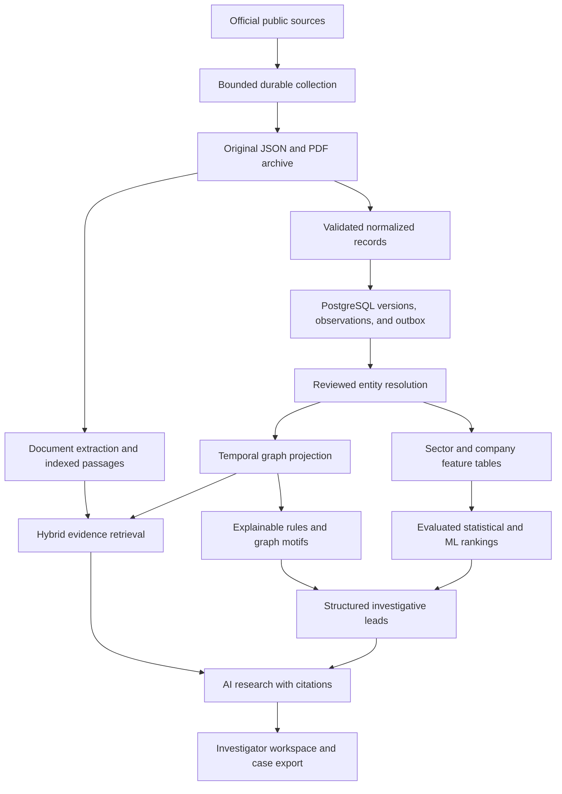

# Nima investigation architecture

## Current direction

On 2026-11-16 the owner selected company/market intelligence, with a trusted data
foundation, shared semantic definitions and analytics before persona workflows and
AI activation. [ADR-0005](decisions/0005-market-intelligence-foundation.md) records
the accepted direction; the revised [capability map](../CAPABILITIES.md) is proposed
for review. New egress feature work is paused with existing code/checks retained.
The first candidate is one cited captured-contract readout, not a general rewrite.

The original investigation mission and delivered-state notes below remain
historical context. Journalist workflows become one use of the shared foundation.
No new semantic layer, analytic service or market coverage is claimed implemented.

## Original investigation mission (historical context)

Help investigators reconstruct how Greek companies relate to public spending,
how those relationships change, and which patterns merit closer examination.
The outcome is a reviewable case with supporting records, counterevidence,
coverage limitations, and a reproducible method.

The differentiation hypothesis is that a dependable identity/time/evidence layer
will save investigators work currently spent joining records manually. Validate
that hypothesis against existing tools and real investigation tasks. A graph
visualization or a model alone does not establish differentiated value.

Primary users are journalists, independent investigators, and researchers.
Investigation support, public procurement, and corporate relationships are the
scope. Electoral comparisons and campaign products are a separate concept.

## Architecture

PostgreSQL is authoritative for record history and work state; original evidence
is archived separately. The implemented bounded graph is a rebuildable private
JSON view of selected reviewed records. The [database assessment](graph/database-candidates.md)
compares Memgraph/FalkorDB as prototype candidates, Neo4j as a tooling baseline and
AGE/HydraDB alternatives across technical, operating/support and licensing factors.
No store or adapter has been adopted or benchmarked.
Self-hosted Prefect is the selected Apache 2.0 workflow engine for the local
KIMDIS pipeline. Graph-store adoption and production hosting remain later decisions.

The local outbox consumer now materializes versioned contract facts and reported
buyer/supplier occurrences in PostgreSQL. Its evidence-linked relationship view
is an input to identity review, not a resolved company graph. Per-version receipts
allow deterministic replay. Money stays on contracts; the relationship view does
not allocate values to joint suppliers. Entity resolution needs an explicit
country/identifier/conflict policy before any occurrences become company nodes.

## Source order and boundaries

1. **KIMDIS:** contracts first, then awards, notices, and payment orders as distinct
   stages. Do not add their values together as if they were independent spend.
2. **Diavgeia:** decisions, documents, source revisions, and typed references.
3. **GEMI:** identifier-based company enrichment and published filings under the
   available access/license conditions. Production API access needs a key.
4. **TED:** additional procurement notices and competition information.
5. **Sector sources and official case publications:** contextual data and
   documented procedural outcomes, with explicit coverage and licensing.

KIMDIS documents daily open-data updates. Near-real-time processing means reacting
to records when a source makes them available; it does not expose real-time bank
flows or every private transaction. Public procurement data cannot establish
all-company tax evasion. Private invoices, tax filings, unrestricted beneficial
ownership, and bank flows are not assumed available.

Primary source contracts:

- https://cerpp.eprocurement.gov.gr/khmdhs-opendata/help
- https://diavgeia.gov.gr/api/help
- https://opendata.businessportal.gr/techdocs/
- https://developer.ted.europa.eu/

## Graph model

Keep source observations, resolved identity, and analytical inference distinct.

The implemented [bounded pilot contract](graph/investigation-pilot.md) uses exact
contract versions, selected party occurrences, unclassified reviewed handles,
registry anchor observations and raw-evidence references. Active-only reviewed
links retain their acceptance event/candidate/current revision; unresolved/history
members and duplicate selected handles remain visible. The private artifact/focus
and its measured limits are in the [operator runbook](verification/investigation-graph.md).
The wider domain model below remains a target beyond that bounded representation;
the pilot does not classify legal entities or infer ownership/validity intervals.

| Node | Meaning |
|---|---|
| Company / public body / person | Resolved entity with identifiers, source observations, aliases, and reviewed identity links |
| Procurement process / contract / payment order | Distinct process and publication stages |
| Document / record version | Immutable evidence reference with original bytes and extraction version |
| Assertion | A reported relationship with its source, applicable dates, observation time, method, and review state |
| Case / finding | An investigator's reviewed work, with supporting and contradicting evidence |

Relationship families include reported supplier participation, public-buyer
roles, directorship, shareholding where disclosed, amendments, document support,
and published subcontracting. Beneficial ownership is recorded only when a lawful
source actually establishes it. Payment orders are not automatically verified
bank transfers.

Attribution includes a document version/hash and JSON pointer or page/text span.
Preserve event time and observation time. A past director must not appear as a
current director merely because an old filing was collected today.

Initial useful queries:

- Buyer → procurement → supplier, filtered by classification and period.
- Company → supported officer/ownership relationships → other companies during
  an overlapping time interval, with every edge inspectable.
- Contract → amendment/cancellation → subsequent record and document history.
- Investigator-selected supplier groups → buyer concentration and changes over time.

Shared addresses, names, or graph communities generate candidate connections.
They do not establish common ownership, influence, or collusion. Company matching
uses verified identifiers first, then evaluated candidate matching and review.

## Model selection strategy

These are candidates with defined evaluation tasks, not trained or selected
production models. No hosted model call or model charge is required by current code.

| Task | Baseline / candidate | Why and evaluation gate |
|---|---|---|
| Native API extraction | Deterministic schemas and Decimal | Existing structured fields require exactness; replay and failure-path tests must pass |
| Document extraction | Native text/tables, then Greek/English OCR | Benchmark field accuracy and source locations before adding an LLM |
| Entity matching | Exact identifiers, then Splink/Fellegi–Sunter | Explain matching evidence; measure false merges on reviewed Greek aliases and related entities |
| Semantic retrieval | BGE-M3 vs multilingual-e5-large | Evaluate Greek/English legal and procurement queries; compare retrieval recall and citation evidence |
| Relationship extraction | Schema-constrained multilingual LLM; benchmark a hosted small model against Qwen3-14B | Preserve role/date/negation and verify supporting spans; model self-confidence is not evidence |
| Company/sector outliers | Robust peer statistics, then Isolation Forest | Compare useful reviewed leads against simple rules; report scores as rankings, not fraud probabilities |
| Network patterns | Temporal motifs, concentration measures, community analysis | Control for supplier size, sector, geography, procurement method, and activity; communities are descriptive |
| Supervised prioritization | Logistic regression, then gradient-boosted trees | Requires credible labels; compare precision at analyst review capacity with temporal/group-aware evaluation |
| Graph ML research | GraphSAGE; consider R-GCN for useful typed relations | Only after a stable graph and adequate evidence; must improve over tabular models with graph-derived features |

Candidate references:

- Splink: https://moj-analytical-services.github.io/splink/
- BGE-M3: https://huggingface.co/BAAI/bge-m3
- Multilingual E5: https://huggingface.co/intfloat/multilingual-e5-large
- Qwen3-14B: https://huggingface.co/Qwen/Qwen3-14B
- GraphSAGE: https://arxiv.org/abs/1706.02216
- R-GCN: https://arxiv.org/abs/1703.06103

Select LLMs on measured extraction/citation quality, operating cost, privacy,
license, and latency for Greek documents. The current prototype uses no model
provider and no inference credentials.

## Insights and detector prerequisites

| Lead family | Minimum inputs | Important controls |
|---|---|---|
| Buyer/supplier concentration | Reconciled awards/contracts, comparable cohorts, valid amount basis and currency | Joint awards, frameworks, source coverage, and market-definition limits |
| Potential purchase splitting | Comparable subject, buyer, dates, values, and applicable legal threshold/context | Legitimate lots, recurring needs, exceptions, and rule changes |
| Amendment growth | Linked original contract, later changes, dates, and amounts | Correct lifecycle linking and changes in scope |
| Comparable-item price outliers | Units, quantity, specification, currency, taxes, delivery conditions, and time | Whole-contract totals are not unit prices |
| Repeated co-bidding or winner rotation | Identified bidders and outcomes across enough comparable tenders | Awarded suppliers alone do not reveal losing bidders |
| Related supplier participation | Reviewed corporate relationship evidence valid at the relevant time | Shared service addresses and names are weak evidence |

Every detector declares its eligibility checks. Missing bidder identities disable
co-bidding analysis; a bidder count alone is insufficient. Insufficient data is
a visible outcome, not a zero-risk score. Adapt procurement indicators from the
Open Contracting Partnership to source coverage and applicable Greek rules:
https://www.open-contracting.org/resources/red-flags-in-public-procurement-a-guide-to-using-data-to-detect-and-mitigate-risks/

Sector views start with CPV procurement cohorts and separately maintained company
activity classifications. CPV and KAD describe different things; do not treat
them as interchangeable. Prioritize sectors based on measured source coverage,
not assumptions about which sectors are dishonest.

## AI research and the case workspace

Combine exact identifier lookup, Greek lexical retrieval, multilingual embeddings,
and bounded graph traversal. Run numeric calculations in validated SQL/Python.
An LLM explains the returned records and calculations with citations; it does not
invent totals, connections, missing bidders, or a finding of guilt.

An investigative lead contains:

- Type, scope, period, cohort, and detector/model version.
- The observed pattern and comparison, with units and denominators.
- Supporting graph paths and evidence references.
- Coverage gaps, uncertainty, and plausible alternative explanations.
- Review state, reviewer notes, and counterevidence.

The workspace lets a researcher inspect a company and its timeline, explore a
bounded network, compare peers, review an insight, and export the evidence for a
case. Separate extraction confidence, identity confidence, analytical ranking,
and human review. Allegations and official case outcomes retain procedural status
and dates. A source quotation's existence does not prove it entails an AI claim.

## Evaluation and release gates

1. **Collection:** exact money, no logical duplicates, durable evidence and
   checkpoints, bounded retries, reconciliation, and real process-restart tests.
2. **Identity:** reviewed match pairs and false-merge analysis; maintain source
   identity alongside resolved identity and keep disputed matches reversible.
3. **Graph:** sampled edge correctness, temporal correctness, provenance coverage,
   and reproducible rebuilds from the authoritative store.
4. **Detectors/models:** review precision at a fixed analyst budget, false-positive
   explanations, cohort coverage, and comparison with simple baselines. Use time
   cutoffs and verified corporate-group separation where appropriate. Do not
   leak later filings, case outcomes, or future graph edges into earlier scoring.
5. **AI:** retrieval evidence recall, claim/citation correctness, arithmetic
   correctness, abstention on missing evidence, and cost/latency budgets.
6. **Product:** observed investigator task completion, verification time, and
   reproducibility. A larger graph or more generated leads is not itself success.

Keep model/detector artifact hashes, source snapshot IDs, feature definitions,
training/evaluation periods, parameters, metrics, and review decisions versioned.
Reviewed leads are a selected sample and do not establish population fraud rates.
GNN experiments need to demonstrate additional value before adoption.

## Current state and next milestone

As of 2026-11-15, main `4a33a3e` implements bounded KIMDIS contract
collection, raw evidence archives, typed normalization, PostgreSQL versions and
observations, safe resume, reported-participation projection and offline identity
assessment. GEMI has a bounded archive collector and offline SQL import; accepted
live profiles still require the personal-key pilot. Manual Publicity evidence
intake and the controlled-worker boundary are also implemented; no live Publicity
scraper or deployed investigator IP protection is established.

Self-hosted Prefect supports KIMDIS collection/resume, run-scoped projection and
bounded daily refresh schedules. No live refresh policy has been activated.
PostgreSQL stores immutable
request identity, bounded retry budgets and dispatch history as well as evidence.
The separate local Prefect control store contains workflow state, not source bodies.
There is no graph store, evaluated model or investigator UI.

The controlled-worker increment is delivered through E12: the full 28-case matrix,
actual packet-rule mutation/restoration, real failure controls, complete CI recipe
and measured runbook are merged. `just source-worker-check` runs all 12 Docker
tests and validates one fresh full receipt before CI upload. See the
[delivery record](verification/source-worker-egress.md) for exact commits/results
and undeployed public-IP/recovery limits.

The [offline registry-comparison report](identity/registry-comparison.md) is
implemented through #72. One read-only snapshot supplies a bounded selected
KIMDIS/GEMI cohort to a pure reported-AFM policy, then a canonical private report.
The shared registry catalog retains repeated/404 observations and conflicts;
procurement occurrences reference it without accepting identities or graph edges.
The [operator/delivery record](verification/registry-comparison.md) documents the
CLI, bounds, redaction and actual interrupted-publication/replay evidence.

The [reviewed-decision workflow](identity/reviewed-decisions.md) is implemented
through #84 after scope #74, plan #75 and owner-reviewed checkpoints A–D. A trusted
local operator records explicit accept/reject/revoke decisions against immutable
SQL source facts; one atomic transaction preserves event, entity anchor and head.
Exact request/principal replay returns an old receipt without reapplying a decision.
Separate disposable DB logins, independent writer races and actual pre/post-COMMIT
SIGKILL/retry tests exercise the trust/concurrency boundary.

The private resolution export reads one bounded read-only snapshot and closes SQL
before publication. It retains unresolved members, original source/report context,
all selected history/anchors and explicit selected-handle ambiguity. Accepted
occurrences are counted separately from zero automatic links; old artifacts retain
their original revisions. The [measured runbook](verification/reviewed-decisions.md)
documents commands, limits, database-principal-only attribution and actual export
interruption/replay evidence. No public authentication, production deployment,
identity consolidation or empirical false-merge accuracy is claimed.

The bounded graph CLI is implemented through #95 after owner-reviewed checkpoints
A–C of plan #90. One repeatable-read/read-only/UTC SQL snapshot revalidates selected
review state and complete contract facts in a combined byte budget. Pure construction
retains exact version/occurrence/evidence keys, source dates and decimal-text money;
focus adds selected-history references without collecting more data. SQL closes
before canonical 0700/0600 publication, and old artifacts retain their original
revisions. Actual concurrent revokes, 26-table read-only snapshots and pre/post-link
SIGKILL/Ctrl+C retry are measured in the [graph runbook](verification/investigation-graph.md).

The next product gate is an authorized real-company cohort: recover original
sources for every displayed active link and audit identity, edge, date and amount
correctness, then observe investigator tasks against the manual workflow. A thin
read-only company dossier/explorer is a product-validation candidate for that
separate specification; the full case workspace remains later scope. Evaluate
investigator task completion and verification time before expanding the graph,
detectors or model stack. No graph store, trained model or detector is implemented
by the graph CLI; live GEMI compatibility and production/IP-protection gates remain.
See the [workflow contract](sources/kimdis-orchestration.md),
[pipeline/reference mapping](pipeline-reference.md) and the
[capability progress estimate](progress.md).
