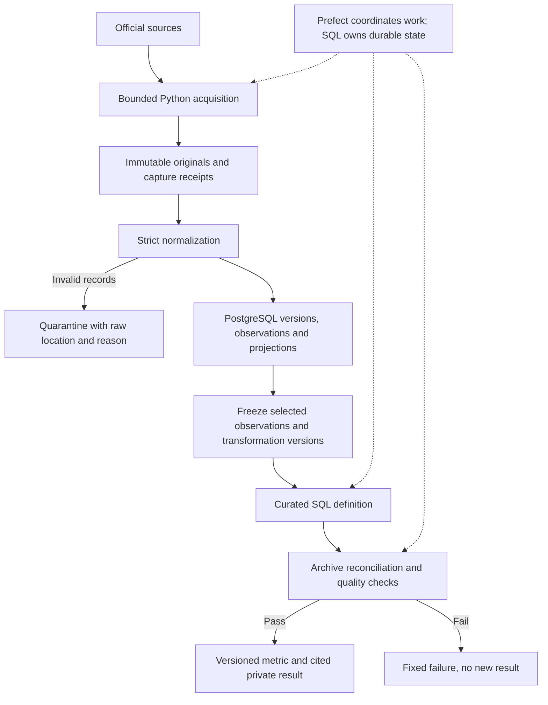

# Data pipeline and quality validation

Status: conceptual direction accepted for planning on 2026-11-16. The owner
requested continuation after reviewing acquisition-to-semantics quality,
deduplication and the proposed SQL/dbt comparison. The owner approved the plan,
merged the offline readout through #118 and requested continuation on 2026-11-17.
The isolated comparison is now executed: see the
[measured report](verification/pipeline-dbt.md) for versions, quality failures,
license/security evidence, timings and the recommendation to defer adoption.
This document retains the architecture/acceptance contract; current delivery is
tracked in the [plan](../tasks/plan.md) and [tasks](../tasks/todo.md). No source is activated.

## Architecture and ownership

The existing application remains one modular monolith with PostgreSQL and private
originals. Python owns source transport/parsing and evidence verification. Prefect
owns workflow coordination; a task retry does not create a fresh domain request
or replenish its saved budget. SQL owns durable evidence and workflow identities.
dbt is a candidate SQL build/test adapter, not the acquisition engine or scheduler.

The first readout needs no new permanent tables. It freezes the exact selected
observation/fact tuples and SQL calculation in one read-only repeatable-read
snapshot, closes SQL, verifies originals and publishes a deterministic artifact.
The artifact itself records the input manifest and check results. This is not a
general persisted release registry or a deployed freshness/alerting service.

Later, if curated models are materialized, build them against a sealed input
manifest in a separate generation. Publish that generation only after all checks
pass. Multiple dbt connections cannot be assumed to share one SQL snapshot: select
the same immutable observation IDs/version hashes for every model. The comparison
below uses a private verified synthetic export copied into a disposable database.
It cannot mutate application evidence or human review history.

## Quality and deduplication contracts

| Boundary | Rule | Existing or next proof |
|---|---|---|
| Original bytes | SHA-256 addressed, archive before parse, verify on read | Readout verifies all selected pages |
| Request/page replay | Same committed page is repeat-safe; gaps/drift fail | Existing real-SQL/crash tests |
| Version history | Source ID + normalizer + source-content hash; A→B→A reuses A | Existing; preserve every later observation |
| Invalid record | Preserve raw pointer/reason; never silently drop it | Existing quarantine; first readout refuses quarantined cohorts |
| Derived facts | Projection version/receipt, full field and ordinal reconciliation | Full original-byte readout reconciliation delivered |
| Record count | Latest observed version before supplier filter, once per source ID | Provider, hand-labelled SQL and readout checks delivered |
| Company grouping | Eligible reported country/tax key; no name-based legal merge | Provider scope; conflicts/unknowns remain visible |
| Coverage/freshness | Query windows and observed times, not a claim of the whole market | First artifact exposes windows/clocks; broader monitoring is later |

Cross-source references and different procurement stages are linked assertions,
not duplicates to delete or values to add. Unknown optional fields remain unknown;
an unusable grouping key excludes the occurrence from that metric, not from the
evidence archive. Matching ordinals do not multiply a contract-publication count.

Hard failures include missing originals, digest/content disagreement, incomplete
projections, duplicate grains, unsupported versions and exceeded bounds. Missing
buyer keys, ambiguous revisions and unassessed supplier identifiers remain visible
outcomes under the [provider](../SPEC-semantic-layer.md) and
[consumer](../SPEC-market-analytics.md) contracts. They cannot become legal identity
or verified absence. All captured rows must reconcile as accepted plus quarantined;
eligible buyer counts plus unassigned records must reconcile to the metric total.

Freshness has separate collection, last successful processing, reliable source
update time (when available), window coverage and publication clocks. A recent
re-crawl of old data is not proof of current source coverage. Seven-day overlap
does not establish discovery of older corrections. Historical reconciliation,
refresh-child recovery, full archive replay, backup/restore, application roles and
effective branch protection retain their separately scoped reliability backlog.

## Bounded comparison

Use the provider's synthetic eight-ID, eleven-observation, ten-version fixture.
Expected output is B1=3, B2=1, unassigned=1, total=5; cancellation false=3,
true=1, unknown=1; one same-tax unassessed ID and one ambiguous revision ID.
The human-calculated answer is the oracle; agreement between two wrong engines
does not pass. Include earlier cutoffs, A→B→A and duplicate ordinals as variants.

The reference path must work before the dbt comparison. Both paths consume the
same frozen rows, observation cutoff, metric version and supported transformations.
Compare contributing source IDs and evidence mappings as well as totals. SQL
computes the arithmetic; a pure provider policy and hand-labelled expectations
check eligibility and revision selection independently.

| Case | Required result |
|---|---|
| Same request replay / same record newly observed | No extra contribution; observation history retained |
| Later revision removes supplier | Old matching version contributes zero |
| Different versions tie at latest capture time | Unresolved; no arbitrary winner |
| Missing page or projection receipt | No published result; bounded fixed failure |
| Corrupt blob or mismatched derived fact | Detected before publication; previous result unchanged |
| Missing country / missing buyer / cancellation unknown | Explicit diagnostics/bucket, no inferred values |
| Empty capture / no pre-cutoff observations / unresolved selection | Distinct consumer outcomes |
| Source dates and late corrections | Ordering remains observed time; no claim that overlap discovers unfetched changes |

Re-running the supported normalizer on archived bytes checks reproducibility;
it does not implement a new normalizer's persisted replay path or fix saved
request-version compatibility. Those require their own tested storage scope.

## dbt experiment boundary and decision

Candidate pins, checked against PyPI metadata on 2026-11-16:
`dbt-core==1.11.17` and `dbt-postgres==1.11.0`, Python 3.12, disposable
PostgreSQL 17. Core declares Apache-2.0; the adapter declares the Apache classifier.
The candidate now passes resolution, resolved-package license/advisory review,
isolated install, actual PG17 execution and synthetic comparison; the report
records limitations. Metadata compatibility alone was not treated as proof.

The isolated experiment has its own lock/environment under
`experiments/pipeline_dbt/`; never edit the application lock, runtime image, CI or
default gate to install it. Pin transitive dependencies before execution, review
telemetry/network behavior, disable optional telemetry and do not use cloud
accounts or real company data. Setup may download packages; the actual data test
uses only the disposable local database and synthetic inputs. Preserve environment
proxy/CA controls. A failed license, security or compatibility review stops this
candidate, without choosing an unreviewed version silently.

Compare a small observation model, selected-revision model and count model with
uniqueness, accepted-value, relationship and domain reconciliation tests. Run
introduced-defect cases too. Declare identifiers as text in seed/model schemas
so type inference cannot remove leading zeroes. Re-observed source IDs are valid;
uniqueness tests apply to observation IDs and the declared output grain, not every
source ID in history. Store compiled SQL, model manifest and run/test
artifacts privately; dbt's model dependency graph supplements Nima's record-level
evidence pointers. The analytics command keeps its SELECT-only role; a separate
builder may write only experiment-derived relations in the disposable database.

Adopt only if the known answers/evidence match, introduced defects fail, reruns
are repeat-safe and docs/dependency/test diagnostics save maintenance work. Record
setup effort, build/query time, model overhead and limitations; tiny-fixture timing
is not a production benchmark or a reason to promise lower SQL latency. If the
benefit is weak, keep the tested SQL definition with the existing orchestrator.
Adoption needs its own dependency/operating review and one authoritative definition,
not two independently maintained production metrics.

The final gate is a protected real-data cohort and an observed analyst task. If
private originals are unavailable, record that pilot as blocked. Synthetic success
does not establish provider completeness, semantic ground truth or product value.

## References

- [Current pipeline/reference implementation](pipeline-reference.md)
- [dbt Core 1.11.17 metadata](https://pypi.org/pypi/dbt-core/1.11.17/json)
- [dbt Postgres 1.11.0 metadata](https://pypi.org/pypi/dbt-postgres/1.11.0/json)
- [Core v1 license](https://github.com/dbt-labs/dbt/blob/1.latest/core/LICENSE)
- [Postgres setup](https://docs.getdbt.com/docs/local/connect-data-platform/postgres-setup)
- [SQL data tests](https://docs.getdbt.com/docs/build/data-tests)
