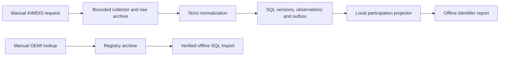

# Pipeline principles and orchestration

Reviewed against neural-maze/substack-brain-course at commit
[`b6d3474`](https://github.com/neural-maze/substack-brain-course/tree/b6d347435ff9ee9e9abb783594d3b267f73af2bf).
This is an architectural reference, not a dependency or a claim that its stack
has already been installed in Nima.

## What the reference actually does

- [Ingest function](https://github.com/neural-maze/substack-brain-course/blob/b6d347435ff9ee9e9abb783594d3b267f73af2bf/kb/functions/ingest.py):
  named Inngest steps for allowlist, fetch, parse, change detection, chunk, embed,
  persistence and event emission; publication-keyed concurrency, global run-start
  throttling and manual/backfill priority.
- [Freshness poller](https://github.com/neural-maze/substack-brain-course/blob/b6d347435ff9ee9e9abb783594d3b267f73af2bf/kb/functions/freshness.py):
  scheduled conditional RSS polling and new-entry events.
- [Enrichment](https://github.com/neural-maze/substack-brain-course/blob/b6d347435ff9ee9e9abb783594d3b267f73af2bf/kb/functions/enrich.py):
  structured extraction, quote-span checks, PostgreSQL claims and a separate
  Memgraph synchronization step, retaining supersession information.
- [Event contracts](https://github.com/neural-maze/substack-brain-course/blob/b6d347435ff9ee9e9abb783594d3b267f73af2bf/kb/schemas/events.py):
  named, validated producer/consumer messages. Failure datasets and bounded
  research/evaluation loops appear in later course increments.

## What Nima has today

| Principle | Current implementation or gap |
|---|---|
| Small, testable stages | Collection, raw archive, normalization, SQL persistence, projection and identity assessment are separate boundaries |
| Repeat-safe writes | Version/observation keys, immutable evidence, atomic checkpoints and projection receipts; worker SIGKILL/replay tests |
| Bounded work and backpressure | Explicit windows, per-run limits and Retry-After handling; saved workflow attempt/execution/deadline budgets and a SQL source lease |
| History and provenance | Raw SHA-256 references, JSON pointers, observation times and separate source dates; A→B→A history preserved |
| Durable workflow execution | Self-hosted Prefect tasks/deployment, SQL request/dispatch journals and repeat-safe replay; no Inngest runtime |
| Freshness and scheduling | Bounded daily refresh coordinator, immutable cycle/request identity, serialized enable/pause and local Prefect schedules; no live policy activated |
| Graph and AI evaluation | Planned gated work; no graph store, embeddings, extraction LLM or model evaluation service installed |

Existing data paths:

GEMI SQL imports do not enter the KIMDIS procurement outbox. The two evidence
paths are not automatically joined, and neither produces a resolved company graph.

## Orchestration direction

The user selected self-hosted Prefect because its server and Python package use
Apache 2.0. Prefect supplies named tasks, selective retries, local process execution,
concurrency limits and run timelines. PostgreSQL remains authoritative for evidence,
request identity, budgets, checkpoints and projection receipts. An external write
can succeed before the engine acknowledges a task. Stable SQL identities survive
that gap; this implementation disables Prefect task caching/result persistence
rather than assuming the course's Inngest memoization semantics.

The implemented slice is one explicitly requested local KIMDIS workflow:
prepare/locate request → collect or safely resume → project selected run → reconcile.
Event/step payloads carry IDs, hashes and counters, not source bodies, personal
names, tax numbers or secrets. HTTP retries stay bounded across workflow restarts;
wrapping a fresh collector in a retrying function is insufficient.

Transient task errors retry automatically within saved budgets. After a killed
process or unknown dispatch, the operator redispatches the same request UUID;
that creates another Prefect run while retaining the domain run and evidence.
This does not promise automatic continuation of a crashed Prefect process.
See the [approved workflow contract](sources/kimdis-orchestration.md).

dbt remains a candidate for later SQL analytical models, tests and lineage.
It complements orchestration and is not installed in this increment.

The bounded daily refresh increment extends that workflow with durable policy,
cycle and request state plus local Prefect schedules; no live policy is activated.
KIMDIS documents daily refresh, so
five-minute RSS polling is not an appropriate default. Verify each provider's
date/update semantics, late revisions and backfill needs; do not assume its API
supports the reference's ETag/Last-Modified behavior. No source-wide freshness
claim follows from repeatedly collecting yesterday's records.

Later stages add registry comparison/review, a rebuildable temporal graph,
detectors and evidence-cited AI. Structured procurement and registry fields use
deterministic parsers; chunking/embeddings/LLMs are introduced for document tasks
only after source coverage and evaluation gates justify them. Verbatim spans
help verify quotations; their existence alone does not prove a claim is entailed.

First orchestration development uses a local engine. No paid account, cloud
deployment, external event export or live provider call is authorized merely by
starting the development services. Production hosting is a later reviewed choice.
