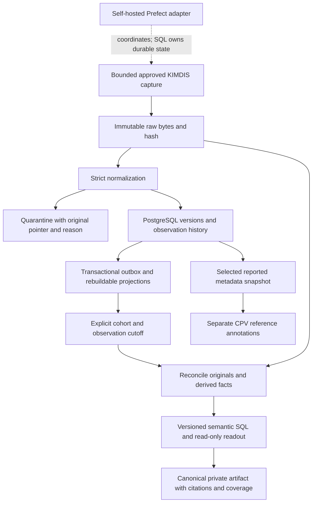

# Analytics foundation readiness

> Re-scored on 2026-11-21 at about **70/100** with these same weights; see the
> [release scorecard](release-scorecard.md#foundation-rubric-re-scored). The text below is the
> assessment as it stood at #147.

## Current assessment — 2026-11-19: approximately 65/100

Verified main `6f706f1` after owner-merged #147 includes reviewed `f230ea0`
with identical files. Use the same seven weights and target denominator as the
2026-11-18 baseline below. This is a planning judgement about the single-operator
analytics foundation; it is not v1.0 completion or live coverage. O2 policy health
(#148) and the O3 access audit (#149) are since delivered but are **not yet scored**;
re-scoring is pending and must keep these weights.

| Capability | Weight | Earned | Change from 61-point baseline |
|---|---:|---:|---|
| Source integration/coverage | 20 | 6 | Unchanged: KIMDIS pilot; no additional live company feed |
| Ingestion and versioned storage | 15 | 14 | +1: saved-intent compatibility and explicit current-profile recovery/succession preserve old identities/budgets |
| Data quality and deduplication | 15 | 13 | +1: historical ODCS compatibility gate and first durable validation-history/health boundary |
| Lineage and reproducibility | 10 | 9 | Unchanged: broader cross-source/document lineage remains |
| Semantic definitions and references | 15 | 9 | Unchanged: one draft metric, no newly certified definitions |
| Analytics delivery and user proof | 10 | 4 | Unchanged: cited supplier–buyer CLI; human task/source review remains pending |
| DataOps and operations | 15 | 10 | +2: selected-run health, audited recovery decisions and opt-in correlated stage events; daily/off-host/runtime proof still open |
| **Total** | **100** | **65** | **+4, with unchanged scope and weights** |

Current chapter: **v0.1 dependable foundation**, work package **V1-03 operating
controls**. Contract evolution/first journal boundary and current-profile recovery
are delivered; O1 diagnostics, O2 selected-policy health and the O3 access audit are
owner-merged.
Scoped-runtime/operator configuration, approved off-host recovery and effective
branch controls remain open. V0.1 is not released. The next chapter is v0.2 shared
semantics, followed by v0.3 two-source data, v0.4 insights, v0.5 serving/workspace,
v0.9 operational/user proof and v1.0 owner-approved release.

Latest merged verification: 2628 tests/93.34%, clean dependency/security gates,
33 installed-wheel cases and all three hosted jobs in run 44540966944. These
prove tested code behavior, not publisher truth, continuous operation or analyst
usefulness. The historical 61-point and old investigator-product estimates keep
their original scope below; do not add or compare their different denominators.

## Historical assessment — 2026-11-18

This is a capability assessment, not a percentage of Greek companies covered or
of the whole eventual product. It replaces no historical scope or estimate. The
owner-selected goal is company/market intelligence; graph, AI and persona UIs
remain later consumers of the data foundation.

## Assessment baseline and delivery state

Main is `ad62fb3` after #134. Reachability verification confirms that the reviewed
CPV commands from #133 now reside on main. #133 initially targeted its feature
branch; #134 promoted those exact files without content changes. All three jobs
passed on promotion head `122e7e8` in runs 44313904157 and 44313323422.

The application tree from tested head `4f758f8` passed 2,285 tests, 93.27% local
coverage, 93.24% hosted coverage and clean security/audit checks in run 44310710304.
The provider head `2f5fe6c` separately passed 2,252 hosted tests/93.18% and all three
jobs in run 44309170654. A feature-branch merge alone is not main delivery.

Capability credit below includes reviewed working code and retained private pilot
proof, with the main-delivery verification above. The new KAD assessment adds no
runtime capability credit. Test counts and coverage establish tested-code scope,
not publisher accuracy, country-wide coverage or demonstrated analyst usefulness.

## Connected sources versus prepared integrations

| Source | Actual state | Remaining boundary |
|---|---|---|
| KIMDIS contracts | End-to-end connector, strict normalizer, versioned SQL/projections, bounded real capture and cited supplier–buyer readout exercised | One selected pilot cohort; no national coverage or active refresh schedule. Its three-attempt allowance is exhausted |
| GEMI OpenData API | Bounded collector, archive verifier, offline profile import and identity-comparison code implemented | Personal-key/live compatibility validation remains pending; no dependable live profile feed claimed |
| GEMI Publicity | Manual PDF/image evidence intake and protected-worker fixture checks implemented | Automated live capture, deployed gateway and deployed privacy validation remain pending/paused; no running VPN/proxy service claimed |
| OP-TED CPV reference | Selected SDK 1.15.1 catalogue read offline in Greek/English; 9,454 base codes per language. Separate match commands promoted to main through #134 | Base-code membership only; check digit unchecked. A classification list is not a company dataset or TED notice connector |
| AADE KAD reference | Official catalogue/mapping captured privately and sampled; release/column/reuse assessment recorded | No installed KAD dictionary or crosswalk; complete extraction and dataset reuse acceptance remain gates |
| Diavgeia decisions | Planned source, no integrated live connector | Source contract, ingestion/projection/reconciliation and real-data validation |
| TED notices / data.gov.gr datasets | Discovery/backlog, no integrated acquisition feeds | Select concrete datasets and verify access, reuse, connector and quality contracts |

The working company-data path is a KIMDIS pilot. Prepared GEMI code, public
reference documents and a portal appearing in the roadmap do not count as three
live company-data feeds. Registry API and Publicity remain distinct adapters;
source selection cannot bypass an access rejection or an unverified egress boundary.

## Working data path

KIMDIS documents daily publication updates. The implementation can process newly
available records; there is no continuously running real-time market feed today.
The current readout counts covered contract-publication records for an eligible
reported supplier key. It does not calculate paid spend, market share, verified
legal-company relationships or a fraud score.

## Quality, deduplication and trust already exercised

- Raw bodies are content-addressed and archived before parsing. Every reported
  record keeps source ID, raw hash/location, transformation version and observation
  time. Processing time remains separate from the source observation.
- A record's content version is distinct from its observation: A→B→A can reuse
  version A while retaining the later observation. Retries do not invent new facts
  or replenish a request's saved budget.
- Page commit, observations, outbox and checkpoint are transactional. Projection
  receipts and replay/promotions are repeat-safe; actual process-kill/concurrency
  tests cover recovery boundaries.
- Strict parsing, exact Decimal money, quarantine and accepted/quarantined counts
  expose malformed data. Missing/corrupt originals, incomplete projections and
  unsupported selections fail before publication.
- The first metric selects latest-observed revisions before supplier filtering
  and counts once per eligible source record. Supplier ordinals do not multiply
  the count. Tied revisions and missing keys stay explicit; full contract value is
  not allocated to every joint supplier.
- Reported country/tax keys support bounded grouping; reviewed identity decisions
  have an audit trail. Broad automatic company matching and a false-merge quality
  evaluation remain open. Similar names or shared codes are not legal identity.
- Selected SQL metadata snapshots are immutable and queryable. CPV matching leaves
  reported labels/versions untouched. In the retained pilot, 148 CPV occurrences
  matched selected base codes; this proves neither check digits nor source truth.

The first metric remains a draft definition. Human source review and observed
analyst-task counts remain zero. Automated reconciliation is useful evidence,
but it does not certify a publisher's assertion or establish product usefulness.

## DataOps already exercised and still missing

Implemented: self-hosted Prefect coordination, SQL-owned requests/checkpoints and
leases, bounded retries, saved-intent compatibility checks, explicit archive
verification/replay, derived SQL promotion, limited daily reader/promoter roles,
immutable evidence controls and native local backup/restore drills with relocated
originals. Schema 9 was installed in the private pilot after a verified restore.
CI checks types, lint, tests/coverage, builds, code security, secrets and locked
dependency advisories. dbt was compared in isolation; it is not a runtime dependency.

Remaining: approved sustainable acquisition budgets, enabled and observed refresh,
late-correction coverage measurement/reconciliation, health/freshness monitoring,
structured operational logs and alerts, off-host scheduled backups/restore cadence,
and measured volume/latency targets. Refresh recovery and version evolution retain
their stated bounded contracts; this is not a universal replay/failover service.
Effective main/dev branch protection was last observed absent; workflow files do
not enforce it. No new administration check or setting change is claimed here.

## Proposed planning rubric v1: about 60% ready

Target denominator: a dependable **single-operator, multi-source analytics core**
with repeatable approved acquisition, evidence-backed transformations, reusable
semantic definitions, a small set of reviewed descriptive metrics and observable,
recoverable daily operations. Hosted multi-user UI, general-purpose graph querying,
RAG/LLMs and national company coverage are outside this denominator.

Points are an engineering planning judgement, not an automated maturity score.
Keep these weights stable in later assessments; change scores only with concrete
capability evidence and identify any scope/denominator change explicitly.

| Capability | Weight | Earned | Evidence and gap to full credit |
|---|---:|---:|---|
| Source integration/coverage | 20 | 6 | One real KIMDIS path; GEMI prepared. Additional live source and reference acceptance missing |
| Ingestion and versioned storage | 15 | 13 | Durable bounded ingestion/projections; broader connector reuse and evolution remain |
| Data quality and deduplication | 15 | 12 | Reconciliation, strictness, replay/grain checks; cross-source identity and volume evaluation remain |
| Lineage and reproducibility | 10 | 9 | Hashes, locations, observation clocks and repeatable artifacts; broader source/document lineage remains |
| Semantic definitions and references | 15 | 9 | First metric/glossary, reported metadata and CPV; KAD, more reviewed definitions and lifecycle semantics remain |
| Analytics delivery and user proof | 10 | 4 | One working cited CLI readout; broader metrics/query surface and observed usefulness remain |
| DataOps and operations | 15 | 8 | Roles, recovery tests and local restore; unattended freshness/monitoring/off-host operations remain |
| **Total** | **100** | **61** | **Report as approximately 60% of this foundation target** |

This is a new company/market foundation rubric. It cannot be treated as a numeric
increase from the old 33% investigator/graph product baseline: the denominators
differ. It also is not 93% complete because test coverage is around 93%.

## Next measurable increments

1. Maintain the verified main-delivery boundary; #134 completed CPV command promotion.
2. Finish [KAD source acceptance](../sources/kad-reference.md): clear reuse scope,
   freeze extraction semantics and release evidence before a runtime dictionary.
3. In parallel with that acceptance work, prioritize a bounded DataOps health/
   freshness readout and structured failure logs. Keep source schedules disabled
   until their acquisition and operational gates are met.
4. Add a genuinely independent source through a verified connector boundary, then
   validate cross-source grouping. GEMI live validation needs approved access;
   Diavgeia is the next open-source connector candidate.
5. Review/certify a small set of descriptive metrics and observe one analyst task.
   Source/market coverage and measured usefulness determine subsequent graphs,
   models and interfaces; PR volume alone earns no readiness credit.
