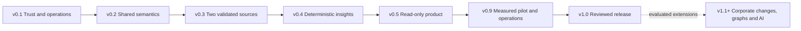

# Product roadmap through v1.0

Planning baseline: **2026-11-18**, main `9d29845` after #138. Requested by the
owner; proposed future scope, not released functionality. The package still
declares `0.0.1`. Milestone names below do not create tags or change that version.
Use [progress](../progress.md) for delivered state and the
[v1.0 release contract](../../SPEC-release-v1.0.md) for acceptance.

## Mission and current position

Nima makes covered Greek company and procurement activity explainable through
trusted data, common definitions and inspectable evidence. The differentiator to
test is less manual joining/checking and more reproducible company/market research.
Graph and AI are consumers of that foundation, not proof of product value.

Implemented: bounded KIMDIS collection, immutable originals, typed normalized
records/version history, SQL projections, offline replay/promotion, restricted
readout, reported metadata/CPV annotations, archive verification/local restore,
selected-run health, three draft ODCS contracts and one draft semantic metric.
The initial cited supplier–buyer CLI is working in a bounded pilot.

Prepared or incomplete: GEMI collector/import (live key/compatibility pending),
Publicity manual intake/fixture protection (no deployed capture gateway), offline
graph export (no graph server), KAD reference assessment (no accepted runtime
dictionary), analyst task validation and broader semantic/insight/serving surfaces.
Diavgeia and TED notice feeds are not connected. No live daily refresh is claimed.
#139 proposes automatic historical contract checks; verify its main reachability
before counting it as delivered. No source-derived pilot details belong here.

Current checkpoint update (2026-11-19): main `6f706f1` includes #139 historical
contract checks and later durable validation history/health, current-profile
recovery and #147 diagnostics; main `fa4d772` adds #148 policy health and the #149
access audit. V0.1/V1-03 operating controls is the active chapter; worker role
profiles and TRUNCATE guards are next. The same-weight analytics foundation rubric
was 65/100 at #147 and is pending re-scoring; the 61-point baseline below is retained
historically. Neither score
means v1.0 is released. See [current progress](../progress.md#current-project-and-chapter-position).

The earlier [61/100 foundation assessment](analytics-readiness.md) uses a fixed
single-operator analytics-core denominator and an older main baseline. It is not
v1.0 completion, company coverage or a score to extrapolate from PR counts.

## Version milestones and exit criteria

| Milestone | Product outcome | Main work / backlog IDs | Exit evidence |
|---|---|---|---|
| v0.1 — dependable foundation | An operator can diagnose, reproduce and recover a selected dataset | Contract evolution/history, refresh/version recovery, logs/health, backup/access gaps: V1-01–03 | Durable failures and successful checks; recovery/version tests; operator rehearsal |
| v0.2 — reusable analytics semantics | Multiple questions share the same keys, time, joins, metrics and trust meanings | Minimal connector boundaries, semantic registry/party tier, CPV/time eligibility: V1-04–05 | Independent known answers, certified definitions, shared-query parity; preserved U1 |
| v0.3 — two-source data ready | Covered procurement records and decisions can be joined without fabricated identity or double counts | Diavgeia contract/adapter, explicit cross-references, dataset checks: V1-06–08 | Authorized real cohorts from both feeds, reconciliation, quality/lineage history |
| v0.4 — explainable insights | An analyst gets comparable activity, repeat-participation, concentration and observed-change readouts | Deterministic insight contracts and quality/volume checks: V1-09 | Four reviewed metric families; evidence, denominators, unknowns and insufficient-data outcomes |
| v0.5 — usable intelligence | A person can query, inspect and export company/buyer/CPV views without reading internal tables | Parameterized read-only API/CLI, minimal local view: V1-10–11 | API/CLI/view parity, input/access/time limits, evidence navigation and export |
| v0.9 — release candidate | A fresh install operates within a measured workload and survives failure | Human cohort/task validation, observed schedules, performance/security/restore rehearsal: V1-12–13 | R1–R9 proofs; seven observed daily cycles/feed; task findings; reviewed release blockers |
| v1.0 — analytics and insights release | A reproducible, supported-scope single-operator product | Release manifest, instructions, known limitations and owner go/no-go: V1-14 | All R1–R10 passed; final-head CI; clean-host installation and explicit release approval |

Milestones are dependency gates, not calendar promises. Each contains small PRs;
do not implement a milestone as one PR. Finish the current bounded contract
increment, then V1-01. Design later metrics and source acceptance in parallel with
independent operations work only when their interfaces are explicit.

## Sources and architectural decisions

| Source / component | Release role | Dependency or limitation |
|---|---|---|
| KIMDIS contracts | Primary v1.0 procurement feed | Sustainable acquisition budget and activated/observed policy still needed; late corrections unverified |
| Diavgeia decisions | Proposed second independent v1.0 feed | Inspect current official access/reuse, freeze source contract, test real samples and explicit ADA/contract links |
| GEMI API | Conditional registry enrichment; broader corporate intelligence in v1.1 | Await approved key/live evidence; no fabricated ownership/beneficial-owner coverage |
| GEMI Publicity | Conditional fallback for an approved capture need | No key-rejection bypass or direct operator-IP request; deploy/verify protected worker first |
| CPV | V1.0 procurement-category reference | Pin language/release; disclose version ambiguity; procurement category is not company sector |
| KAD | Optional company-activity reference extension | Resolve extraction/reuse/version acceptance first; does not block CPV-only v1.0 |
| TED notices / data.gov.gr | v1.1+ dataset-specific expansion | Pick concrete datasets and source contracts; neither is one uniform company feed |
| PostgreSQL + private blobs | Authoritative state, projections and evidence | Verify backup/relocation boundary; add storage engines only after measured need |
| Self-hosted Prefect | Coordination, retries and observed schedules | SQL remains authoritative; implementation approval does not activate a source |
| dbt | Deferred optional transformation adapter | Existing parity experiment did not justify runtime adoption; revisit with model count/lineage pain |
| Graph / vector / model servers | Post-v1.0 evaluated consumers | No automatic Memgraph/FalkorDB/Qdrant/LLM adoption from this roadmap |

## After v1.0

V1.1 can broaden approved registry/corporate-change and TED coverage, add saved
analyses/opt-in deterministic alerts, and evaluate graph queries on real questions.
V1.2 can evaluate Greek document extraction (rules/text first, GLiNER candidate
when useful), evidence retrieval and cited AI explanations. Each model needs a
versioned labelled evaluation set, false-merge/extraction/citation thresholds,
cost/latency measurements and abstention. Neither release is a commitment to a
specific library. Multi-user hosting and investigator case workflows require
their own access, privacy and product specifications.

## How to use this plan

Start with the [agent handoff](agent-handoff.md), select one unblocked
[backlog card](agent-backlog.md), and prove its acceptance before the next card.
The release checklist is [R1–R10](../../SPEC-release-v1.0.md#required-capabilities-and-acceptance).
Existing detailed [tasks](../../tasks/todo.md), source contracts and metric specs
remain authoritative within their scopes. Do not mark them complete from this
roadmap alone. Update status once with a main commit and evidence link; preserve
historical scope/estimates. A roadmap is not deployment authorization.
