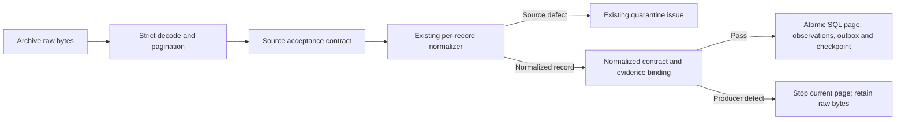

# KIMDIS acceptance and normalized-record contracts

Two draft ODCS 3.2.0 / version 1.0.0 contracts describe Nima-owned boundaries:

- [Source acceptance](../../src/nima/contracts/kimdis-source-v1.odcs.json): minimum
  decoded-page structure. Existing strict JSON and pagination checks still run.
- [Normalized record](../../src/nima/contracts/kimdis-normalized-v1.odcs.json): the
  JSON validation view of one normalized contract, including its original hash
  and record pointer. SQL continues storing evidence separately from versions.



The contracts describe what Nima accepts and produces. They do not promise
government accuracy, legal company identity, availability, national coverage or
freshness. Source dates remain unqualified source text, not observation clocks.
The metric/output contract remains separate and draft.

## Shape, exactness and failure

`normalize_page` retains its strict duplicate/non-finite rejection and pagination
arithmetic. Its source contract deliberately leaves `content` items untyped so a
scalar item or malformed record can retain its existing issue and original index.
Unknown raw fields remain in the original bytes and source-content hash. No field
is silently dropped from that evidence or guessed to meet a schema.

Every successful record is validated before joining a Page. `normalize_contract`
also validates its result, while retaining its existing record-only envelope API.
Nullable fields must be present; missing suppliers remain distinct from an empty
list. Money must still be a finite Decimal in the model. Only its validation view
uses exact decimal text, retaining exponent/precision; the dataclass is unchanged.
Integer model fields reject booleans and integral floats. Contract-level amounts
are never allocated to each supplier. References retain their procurement stages.

The raw digest and `/content/index` must match the independently supplied record
location. Bad producer output raises fixed `normalized_contract`; acceptance
metadata/shape failure raises `source_contract`. These are `InvalidRecord` failures
at the public source boundary. The collector preserves its existing `invalid_page`
summary; it does not convert a producer defect into a source quarantine issue.
PageStore archives first and cannot advance that page's SQL checkpoint on failure.
Previously committed pages remain valid. Retrying identical valid bytes is safe.

## Explicit profile and ownership

The neutral engine is `nima.contracts.schema`; importing it loads no serving,
semantic or storage modules. C8 public contract APIs remain available. Two ODCS
custom properties extend the small profile explicitly:

| Property | Meaning |
|---|---|
| `nima.opaqueItems: true` | An array has unconstrained items; it cannot also declare `items` |
| `nima.present: true` | A named property must exist, independently of its nullable `required: false` type |

Unknown, repeated or non-true flags fail. Other unsupported element constraints
still fail; no metadata URL, code reference or SQL is executed. Compiled validators
cache only immutable packaged rules per process. Source values/results are always
validated anew. Deploying changed package rules requires a fresh process; runtime
file editing is not a policy-update mechanism.

`nima.sources.kimdis_contracts` owns the source policy and unchanged
`kimdis-normalized-v1` constant. Storage retains its public alias. No stored
version, request identity, schema, original byte, replay or successful report is
rewritten. Contract-version comparison remains the existing conservative policy;
automatic historical PR-base comparison and durable check history remain later.

```sh
uv run --frozen pytest tests/test_contract_schema.py tests/test_ingestion_contracts.py
uv run --frozen pytest tests/test_ingestion_contract_boundary.py
```

The second command requires the existing disposable local PostgreSQL 17
`NIMA_TEST_DSN` configuration. Full `just check`/`just audit` and final-head hosted
results are recorded with delivery. No live acquisition, grants or schedules are
activated by installing these contracts.
