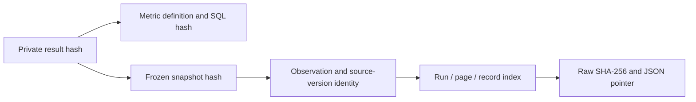

# Captured contract participation

`captured_contract_record_count.v1` counts distinct captured KIMDIS contract
publication IDs reporting a selected supplier identifier, grouped by reported
buyer key. It is descriptive evidence about a bounded capture. The definition is
`draft`, not a certified identity, market-share, award or paid-spending metric.

The pure provider is `nima.semantics.participation`; its packaged
`participation.sql` is the reference SQL calculation. The private readout uses
both, checks their complete results agree and verifies originals before
publication. See the [scope](../specs/SPEC-semantic-layer.md) and
[operator runbook](../analytics/supplier-buyers.md).

## Vocabulary and grains

| Term | Meaning here |
|---|---|
| ΚΗΜΔΗΣ / KIMDIS | Public procurement source; this metric uses its contract stage only |
| ΑΦΜ | Reported tax identifier; eligible text is a grouping key, not a legal identity finding |
| ΓΕΜΗ / GEMI number | Different registry identifier; neither required nor inferred by this metric |
| ΑΔΑ | Diavgeia decision identifier; a reference is not another contract contribution |
| Source record | Namespaced KIMDIS publication ID, the counted grain |
| Version | Source ID + normalizer version + canonical source-record content hash |
| Observation | One recorded encounter in a selected run/page/index; re-observation preserves history |
| Raw hash and pointer | Original response SHA-256 plus `/content/<index>` locating the source record |
| Buyer key | `kimdis.buyer-key:` plus the eligible reported source organization key |
| Cutoff | Inclusive UTC observation time, distinct from source submission/update text |

Commitments, notices, awards, contracts and payments remain different stages.
CPV procurement classification and KAD business activity are different concepts;
neither is a grouping dimension in this first metric. Source references and
repeated observations are retained rather than deleted as generic duplicates.

## Eligibility and revision rules

1. Restrict observations to the explicitly selected complete runs and inclusive
   UTC cutoff. Verify complete run coverage even when the cutoff excludes records.
2. Select the latest observed revision for each source ID before supplier matching.
   Repeated observations of the same version do not multiply a contribution.
3. If different versions tie at the latest observed time, retain the ambiguity and
   its evidence. Do not choose an arbitrary winner or count that source ID.
4. Match eligible reported supplier country/tax text. Trim ASCII whitespace only;
   tax IDs must contain nine ASCII digits and cannot be all zero. No checksum is
   performed. Source country `GR` or `EL` qualifies; request country is `GR`.
5. Count a matching source ID once, even when multiple supplier ordinals match.
   Retain all matching ordinals and every selected observation in the artifact.
6. Group by the reported buyer source key. Missing/empty buyer keys remain in the
   unassigned bucket, without a guessed name-based or legal-company merge.

A later revision removing the supplier makes its earlier matching revision
contribute zero. A→B→A retains all observations and reuses immutable version A;
its latest observation determines eligibility. This is observed-time ordering,
not a claim to know the source's current revision. Source dates remain source text.

Cancellation `true`, `false` and unknown are all included, with separate counts.
Unknown supplier lists, empty lists, invalid identifiers, same-tax unassessed
country keys and ambiguities remain distinct diagnostics. No missing value is
silently invented. Eligible buyer counts plus unassigned source IDs equal the
distinct matching total. Joint-supplier records are never allocated full monetary
value to each party; this metric performs no financial aggregation.

## Reproducibility and attribution

The metric definition hash binds the exact rules and packaged SQL hash. The
snapshot hash binds the selected run IDs, cutoff, supplier key, exact frozen SQL
document and definition. The canonical request hash excludes physical archive
locations. The final SHA-256 binds the entire canonical report.

Each evidence row includes its observation time, source/content/normalizer and
projection versions, original location, normalized record and selection status.
Earlier, after-cutoff, ambiguous and unassessed records stay inspectable. Greek
text and exact money strings are preserved in the private artifact. This is
record-to-original attribution, not universal field-level lineage.

Archive bytes are checked at read time, all records are re-normalized, and full
projected fields/ordinals reconcile before publication. These checks establish
consistency with captured originals; they do not establish publisher truth,
legal identity or national completeness. Original-byte recovery never performs a
source request or archive repair.

## Known-answer and operational proof

The committed fixture is synthetic: eight source IDs, eleven observations and ten
versions. Its hand-labelled answer is total five: B1 receives A/C/H (three), B2
receives D (one), and E is unassigned (one). One counted record is cancelled, one
has unknown cancellation; F is unassessed and G has tied conflicting versions.
The latest B revision removes the selected supplier and is not counted.

Pure-policy and real PostgreSQL reference tests compare exact contributing IDs,
not just totals. The readout reconciles the actual managed synthetic originals,
projects them, uses a SELECT-only principal and privately publishes the result.
Fault tests reject missing receipts, inconsistent facts/ordinals and corrupt or
missing originals, including empty/nonmatching inputs. Database uniqueness also
rejects a duplicate observation at its declared grain; a legitimate repeated
supplier ordinal in a source record remains evidence rather than an extra count.

Actual process-interruption tests check closed SQL, old-report preservation and
identical replay. Required local/hosted evidence is recorded with the delivery
PRs and [tasks](../../tasks/todo.md). No tiny-fixture timing or synthetic success
is a production scale, real-company accuracy or analyst usefulness measurement.
The isolated dbt comparison and protected real-data/task pilot retain their
later review gates.
