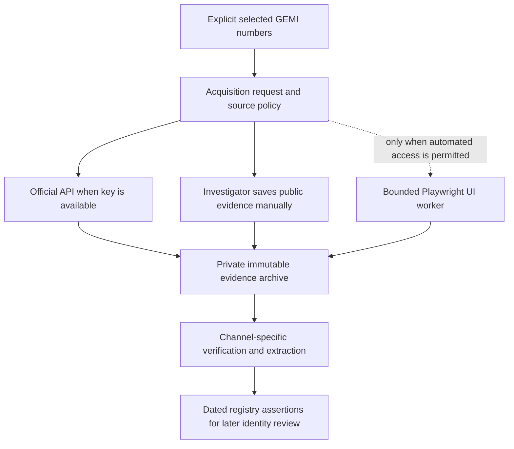

# Proposal: GEMI Publicity evidence fallback

Status: **draft for review**, 2026-11-12. Research and design only; no collector,
new command, dependency, database migration or live schedule is introduced.
Provider module: existing `source-ingestion`; identity review remains separate.
This proposal supplements, rather than replaces, the approved GEMI API contract.

## Objective and assumptions

Let an investigator preserve a small, explicitly selected set of public company
records while the personal GEMI API key is pending or the API channel is unavailable.
Success means reproducible evidence with honest coverage, not an entire-registry
crawl or a claim that a company committed tax evasion.

Assumptions: private research use; at most ten explicitly selected GEMI numbers in
the first pilot; API preferred after approval; one stable network connection;
no proxy purchase, provider contact, identity decision or production activation.
Search by AFM/name, public-document downloading and SQL import are later extensions
with their own source contracts. Ordinary manual discovery can identify the pilot
numbers, but a name search never automatically selects a matching company.

## Which sources belong in Nima

| Source | What it contributes | Recommended use and limits |
|---|---|---|
| KIMDIS / ΚΗΜΔΗΣ | Public-procurement requests, notices, awards, contracts and payment orders, with ADAM identifiers | Primary procurement spine. Nima currently collects contracts; other stages require distinct adapters. A contract or payment order is not evidence of bank settlement or tax paid. |
| GEMI / ΓΕΜΗ OpenData | Public company-registry assertions and filings; registry number, reported AFM, names, legal form/status and activities | Primary registry enrichment. Personal API key requires approval. Field coverage and dates must be checked; registry capital is not revenue or tax liability. |
| GEMI Publicity | Browser access to public GEMI information | An alternative acquisition channel of GEMI, not independent corroboration. Conditional automation described below. |
| Diavgeia / Διαύγεια | Administrative decisions and supporting documents, identified by ADA | Add decision context and references. ADA and ADAM are different namespaces; overlapping publication does not create additional spend. |
| TED | EU procurement notices and associated structured information | Add published EU-level procedures and comparisons; coverage is not every Greek contract. Reconcile overlapping procedures with KIMDIS. |
| data.gov.gr | National catalogue of datasets/resources from multiple public bodies | Discover targeted datasets, then verify each publisher, licence, access method and freshness. It is not a replacement company register. |
| ELSTAT | Official sector, geographic and economic statistics | Aggregate benchmarks and context, not individual-company tax returns. Match classification versions and reference periods. |
| AADE business-registry basic-details service | Basic tax/professional status for eligible registered users | A separately credentialed service, not anonymous access to tax returns, invoices or tax payments. Outside the open-data MVP. |

Recommended sequence: deepen KIMDIS coverage, enrich selected companies with GEMI,
then link Diavgeia documents. Add TED and selected statistical datasets when a
specific investigation needs them. Acquisition of more sources does not replace
identity review, stage reconciliation or historical coverage checks.

An eventual graph can represent buyer → procurement stage → reported supplier
occurrence → reviewed company → dated registry assertions. Repeated awards,
concentration, corporate changes and documented relationships can become leads.
Shared names, addresses or directors alone do not establish control, collusion or
tax evasion. CPV describes the procurement subject; KAD describes registered
business activities. They need an explicit, versioned crosswalk before comparison.

## Verified observations and unresolved access

Checked on 2026-11-12:

- The [Publicity search](https://publicity.businessportal.gr/) advertises lookup
  by AFM, GEMI number, name and distinctive title. Its form also offers company
  status, legal form, activity, location and date filters. These are discoverable
  controls, not a verified search-result or profile extraction contract.
- The [OpenData description](https://opendata.businessportal.gr/) explicitly
  relates the API to public GEMI information available through Publicity. Both
  channels therefore belong to source family `gemi`.
- A direct HTTPS inspection of
  [Publicity robots.txt](https://publicity.businessportal.gr/robots.txt) returned
  HTTP 200 with `User-agent: *` and `Disallow: /*`. This is a clear machine-access
  restriction signal; it is not presented here as a legal determination. Keep
  unattended collection disabled pending provider clarification permitting the
  proposed access, or a relevant change to the published access policy.
- Initial direct homepage/robots requests returned HTTP 429 without retained
  response diagnostics, so the origin of those responses is unclassified. Later
  diagnostic requests returned 200. This does not establish a reliable rate limit.
- The retrieved homepage HTML includes Google's reCAPTCHA integration. This does
  not prove a challenge is required for every search or that headless access works.
- The local Playwright inspection failed before a usable page with
  `net::ERR_CERT_AUTHORITY_INVALID`. This is an environment/browser trust failure,
  not evidence that GEMI rejected a search. TLS verification was not disabled.
  No company search, profile retrieval or successful UI workflow was verified.
- The [OpenData licence](https://opendata.businessportal.gr/license/) states
  ODC-BY-1.0 for the API and GEMI open data. It does not, by itself, settle UI
  automation rules or reuse conditions for every attachment and personal field.

Raw diagnostic HTML/logs are outside the repository. No company records, cookies
or credentials are committed. A homepage fetch is not a successful collection pilot.

## Operating modes and routing



**Manual capture is the immediate fallback.** An investigator uses the ordinary
public UI to save a selected public page or offered document. The intake records
the original file, source URL, claimed capture time, supplied GEMI number and
content hash. Nima independently records import time. A user-supplied file is
labelled `publicity-manual`; its URL and supplied timestamp are capture metadata,
not cryptographic proof of origin. Missing verifiable identity remains unresolved.
Screenshot-only evidence is review material, not sufficient for automatic field
extraction. A PDF requires a separately tested document-type parser or manual review.

**Automated UI capture is conditional.** It is disabled by default. Before a live
pilot, record applicable access/reuse conditions, resolve browser CA trust normally,
and validate one ordinary public search/profile interaction. If automation remains
disallowed or blocked, manual intake and other ingestion work continue independently.

The official API remains preferred. Missing credentials are a waiting/configuration
state, not an exception that silently launches a browser. Authentication failures
require configuration review. A GEMI throttle causes a shared pause, not a switch
from API to UI. API-specific failure may justify an explicitly requested UI job
only if that channel is permitted and healthy. Both may fail in an upstream GEMI
outage. Preserve API/UI disagreements and their observation dates; never silently
overwrite one channel with the other.

## Conditional browser collection contract

Use Playwright with Chromium for ordinary page navigation and labelled UI controls.
It fits the Python codebase and can observe page-generated network responses;
see its [official network documentation](https://playwright.dev/python/docs/network)
and [locators documentation](https://playwright.dev/python/docs/locators).
Use deterministic extraction for structured fields. No LLM is required to identify
a registry number or parse a labelled field. The browser dependency/version and
browser image must be pinned and reviewed during implementation, not selected here.

1. Validate bounded explicit GEMI-number inputs and freeze the request/version/budgets.
2. Acquire one source-family lease and persist an attempt before navigation.
3. Use normal public controls to search an exact registry number and open its profile.
4. Archive relevant completed page/network evidence before normalization.
5. Verify the displayed profile registry number matches the requested number.
6. Produce a private channel-specific evidence bundle and truthful outcome.

Never invent a profile URL or private endpoint from an untested assumption. An XHR
or fetch body may be archived if the ordinary permitted UI interaction actually
returns it for the public profile. That does not grant permission to replay hidden
endpoints, export session tokens or bypass the browser's access controls.

Initial extracted fields are limited to registry number, reported AFM, company
names, legal form/status and activities where visibly available and tested.
Unknown activity-classification versions stay unknown. No normalized person,
ownership, beneficial-owner, address-link or contact graph is part of this release.

## Client budgets, failures and network choice

The following are proposed Nima ceilings, **not verified provider allowances**.
Tighter provider terms win. A pilot must measure actual browser traffic first.

| Control | Proposed first-pilot policy |
|---|---|
| Selection | At most 10 explicitly selected company profiles per run |
| Concurrency | One worker, one active page; no parallel sessions |
| Pace | At least 30 seconds between search/navigation actions |
| Daily bound | At most 10 profile jobs across the source family; no unattended schedule |
| Time | Navigation timeout 30 seconds; profile action budget 2 minutes; run deadline 30 minutes |
| Evidence bytes | At most 8 MiB per evidence body and 50 MiB of retained evidence per run; exceeding a bound stops capture visibly |
| Transport retry | At most one retry for a transient network failure within original persisted budgets |
| Downloads | Disabled initially; public PDFs are a separate bounded document increment |

A page can load many assets and XHRs. Logical-action pacing is not an HTTP-request
quota. Meter requests, response statuses and resource sizes separately; keep normal
browser caching. Enforce byte limits during acquisition, not after loading an
unbounded response into memory. The implementation design must demonstrate how
stream/body limits are enforced; a completed Playwright `response.body()` alone
does not prove a streaming bound. Retained-evidence ceilings are not a measured
network-bandwidth cap.

- **429:** persist the response and source-family cooldown; honour Retry-After.
  End the current batch, with no automatic retry. Without Retry-After, require
  operator review and at least a 30-minute pause. A longer explicit value wins.
- **403 or CAPTCHA challenge:** record blocked access and stop the source job.
  No CAPTCHA solver, stealth modification or IP rotation to resume a blocked job.
- **TLS trust failure:** configuration failure; fix CA trust, never disable TLS.
- **5xx/timeouts:** bounded deferred/unknown outcome; no claim of no company found.
- **No search result:** preserve the dated search outcome; not proof of nonexistence.
- **Wrong company or changed UI:** quarantine the evidence and stop extraction;
  never substitute the first result or convert parser failures into empty fields.
- **Interrupted attempt:** retain unknown outcome and original attempt budget;
  explicit recovery must not create a fresh retry allowance under another job ID.

Use a normal stable connection first. Webshare offers HTTP/SOCKS proxy infrastructure
([vendor documentation](https://www.webshare.io/proxy-server)); a proxy changes
egress, not access permission, source freshness or evidence quality. A VPN plus a
proxy adds complexity without an established requirement. No purchase is proposed.

If a documented deployment/network requirement later warrants a proxy, use one
approved stable/sticky egress, inherited TLS trust and secret-managed credentials.
Do not multiply quotas across IPs. Keep the source lease/cooldown shared across
API/UI workers and deployment egresses. Review the provider's visibility of queries
and any hosted browser's access to page contents before sending investigation data.

## Evidence, persistence and orchestration boundaries

Every bundle needs source family, acquisition channel, run/attempt identity,
requested identifier, actual URL, capture method, observation/import times,
extractor version, content hashes, outcome and truncation/completeness indicators.
Preserve original Greek text, leading zeros in reported AFM, and unknown versus
not-displayed versus parse-failed states. Source publication dates differ from
observation times. Each extracted field points to its exact archived object and
evidence location: JSON pointer for JSON; tested label/DOM location for rendered
HTML; page/text location for an explicitly supported document.

Archive response bodies actually observed, rendered HTML where needed and a
screenshot for review. Distinguish server response HTML from browser-rendered DOM;
neither should be mislabelled as the other. Do not retain cookies, credentials,
reCAPTCHA tokens or unfiltered HAR/trace data in evidence or logs. Required browser
session state stays transient and private. Company records and captures remain
outside Git with restrictive access.

Do not feed UI/manual bundles into the existing GEMI API archive verifier or fake
an API JSON response. First delivery ends at channel-specific verified staging.
Canonical SQL assertions/import and identity-comparison support require an explicit
extension later. The two GEMI channels do not count as two independent sources.
Unchanged content can reuse blobs but still has distinct dated observations.

When scheduled orchestration is eventually approved, self-hosted Prefect dispatches
work and PostgreSQL remains authoritative for request identity, leases, attempt
budgets and cooldown. These GEMI browser controls do not exist today. The current
standalone API command does not share such a ledger; before concurrent or scheduled
API/UI use, route both through the same source-family guard. The initial operator
pilot is serialized with API jobs disabled. No automatic failover or active schedule
is included in this proposal.

## Implementation conventions and verification

Current stack: Python 3.12, HTTPX 0.28.1, Psycopg 3.3.8 and self-hosted Prefect 3.9.2.
Proposed first-party modules belong under `src/nima/`; fixture-backed tests under
`tests/`; source contracts under `docs/sources/`; pilot evidence summaries under
`docs/verification/`. Raw evidence belongs in a private Git-ignored archive.
Use existing strict typing, Ruff formatting, immutable evidence and redacted outcomes.
For example, a proposed outcome could preserve absence without guessing:

```python
from dataclasses import dataclass


@dataclass(frozen=True)
class PublicityObservation:
    source_family: str
    acquisition_channel: str
    requested_registry_number: str
    displayed_registry_number: str | None
    evidence_sha256: str
```

Existing executable verification commands, from the repository root:

```bash
export PATH="$PWD/.tools/bin:$PATH"
export UV_CACHE_DIR=/workspace/work/uv-cache
just skills-check
just lint
just check
just audit
```

These are repository checks, not browser pilot commands. No UI collector/intake
CLI is implemented; its exact interface belongs in an approved implementation plan.
No live government searches run in CI. Use synthetic public-page fixtures and
local browser endpoints for parsers, network behaviour and failure states.

Required acceptance cases for a later first delivery:

- Manual evidence retains original bytes and labels supplied provenance honestly.
- Automated mode fails configuration while provider access policy is unresolved.
- Exact selected GEMI number is required; mismatches cannot produce an accepted profile.
- Changed labels, partial profiles, unknown classifications and challenge pages
  produce distinct tested outcomes, not silently accepted blanks.
- Complete bodies precede derived fields; oversized/incomplete evidence is rejected.
- Replay, interruption and duplicate delivery cannot reset budgets or mutate evidence.
- Throttling pauses the source family and cannot trigger channel/IP failover.
- Errors/logs/archives exclude session secrets and records are excluded from Git.
- Fixture tests preserve the repository's 90% combined coverage floor; a later
  opt-in live pilot reports verified IDs, field coverage, request counts and failures.
- No automatic entity link, UBO assertion, fraud label or production schedule appears.

Always retain evidence, source/channel distinctions, explicit unknowns and failure
states. Review dependency/schema/CI changes in the implementation plan. Never
bypass access controls, manufacture API provenance, commit source records/secrets,
merge or activate production automatically.

## Decision and open questions

Recommendation: support manual evidence intake first and develop the conditional
browser adapter offline only after design approval. Keep API access as the target.
The public UI is a useful potential channel fallback, not a reliable bypass for
source-wide restrictions or outages. Registry comparison and other ingestion work
can continue while access remains pending.

Before any automated live pilot, resolve permitted automation/reuse conditions and
select 1–3 explicit company registry numbers. Search/profile selectors, actual
field coverage, browser trust setup and per-profile traffic remain unverified.
There is no measured throughput, hosting cost or success-rate claim yet.

Other official references checked for the source comparison:

- [KIMDIS documentation](https://cerpp.eprocurement.gov.gr/khmdhs-opendata/help)
  describes distinct procurement stages and the public read API, licensed CC BY 4.0.
- [GEMI technical documentation](https://opendata.businessportal.gr/techdocs/)
  describes API access and its limited Swagger trial, which is not a personal-key replacement.
- [Diavgeia](https://diavgeia.gov.gr/) currently displays a maintenance notice
  limiting site search to ADA and suspending statistics; API health was not tested.
- [TED](https://ted.europa.eu/en/) links its structured-notice developer services.
- [Official data.gov.gr launch announcement, 2026-05-14](https://ai.gov.gr/press-releases/data-gov-gr-se-leitoyrgia-i-nea-ethniki-pyli-dedomenon/)
  describes the CKAN/DCAT-AP catalogue and APIs/downloads. Direct catalogue access
  was unavailable through the research tool; no dataset endpoint was validated.
- [ELSTAT](https://www.statistics.gr/en/home) publishes official economic/sector statistics.
- [AADE service description](https://www.aade.gr/en/research-business-registry-basic-details)
  requires TAXISnet registration and special credentials for basic-details research.
