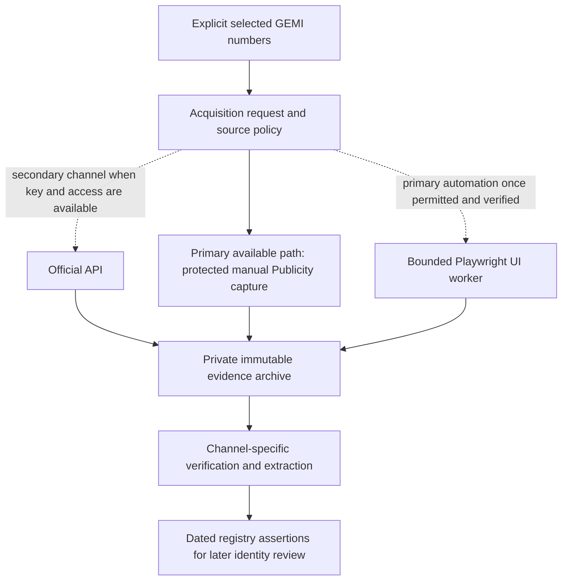
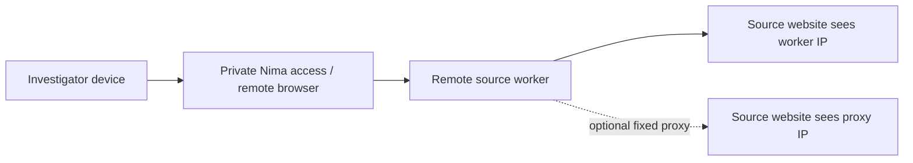
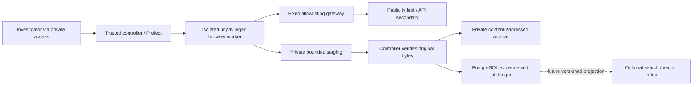

# GEMI Publicity-first acquisition and secondary API

Status: **design approved**, 2026-11-12, by the user's “I agree continue”, including
the personal-IP requirement added in `53f9285`. The offline manual intake and
verification slice is implemented. No browser collector, new dependency, database
migration, remote infrastructure or live schedule has been introduced.
Provider module: existing `source-ingestion`; identity review remains separate.
The owner reprioritized delivery on 2026-11-15: Publicity is the primary acquisition
path to develop; the official API is secondary when its key becomes available.
This changes channel priority, not the implemented API schema or current graph
input contract. No source-facing worker or live gateway has been provisioned.
The owner accepted [ADR-0004](../decisions/0004-bounded-http-and-browser-acquisition.md)
on 2026-11-16: HTTPX for structured HTTP, Playwright for JavaScript UI, lxml as
the preferred future HTML parser and Prefect above bounded acquisition jobs.
No additional parsing/crawling dependency is adopted by that decision. Crawlee
is a future option when URL-frontier/browser-pool needs justify it. The owner
merged the [remote egress scope](remote-worker-egress-pilot.md) in #104; its
implementation plan is proposed, and actual host inputs remain missing.
This document supplements the approved GEMI API contract.
The first delivery plan and review gates are recorded in `tasks/plan.md` and
`tasks/todo.md`. Design approval is not a claim of provider permission to automate.

## Objective and assumptions

Let an investigator preserve a small, explicitly selected set of public company
records while the personal GEMI API key is pending or the API channel is unavailable.
Success means reproducible evidence with honest coverage, not an entire-registry
crawl or a claim that a company committed tax evasion.

Assumptions: private research use; at most ten explicitly selected GEMI numbers in
the first pilot; Publicity first and API secondary; one stable network connection;
no proxy purchase, provider contact, identity decision or production activation.
User clarification: source websites must not receive the investigator's home or
office IP. This applies to manual capture, automated collection and API requests.
Search by AFM/name, public-document downloading and SQL import are later extensions
with their own source contracts. Ordinary manual discovery can identify the pilot
numbers, but a name search never automatically selects a matching company.

## Which sources belong in Nima

| Source | What it contributes | Recommended use and limits |
|---|---|---|
| KIMDIS / ΚΗΜΔΗΣ | Public-procurement requests, notices, awards, contracts and payment orders, with ADAM identifiers | Primary procurement spine. Nima currently collects contracts; other stages require distinct adapters. A contract or payment order is not evidence of bank settlement or tax paid. |
| GEMI / ΓΕΜΗ OpenData | Public company-registry assertions and filings; registry number, reported AFM, names, legal form/status and activities | Primary registry enrichment. Personal API key requires approval. Field coverage and dates must be checked; registry capital is not revenue or tax liability. |
| GEMI Publicity | Browser access to public GEMI information | An alternative acquisition channel of GEMI, not independent corroboration. Conditional automation described below. |
| Diavgeia / Διαύγεια | Administrative decisions and supporting documents, identified by ADA | Add decision context and references. ADA and ADAM are different namespaces; overlapping publication does not create additional spend. |
| TED | EU procurement notices and associated structured information | Add published EU-level procedures and comparisons; coverage is not every Greek contract. Reconcile overlapping procedures with KIMDIS. |
| data.gov.gr | National catalogue of datasets/resources from multiple public bodies | Discover targeted datasets, then verify each publisher, licence, access method and freshness. It is not a replacement company register. |
| ELSTAT | Official sector, geographic and economic statistics | Aggregate benchmarks and context, not individual-company tax returns. Match classification versions and reference periods. |
| AADE business-registry basic-details service | Basic tax/professional status for eligible registered users | A separately credentialed service, not anonymous access to tax returns, invoices or tax payments. Outside the open-data MVP. |

Recommended sequence: deepen KIMDIS coverage, enrich selected companies with GEMI,
then link Diavgeia documents. Add TED and selected statistical datasets when a
specific investigation needs them. Acquisition of more sources does not replace
identity review, stage reconciliation or historical coverage checks.

An eventual graph can represent buyer → procurement stage → reported supplier
occurrence → reviewed company → dated registry assertions. Repeated awards,
concentration, corporate changes and documented relationships can become leads.
Shared names, addresses or directors alone do not establish control, collusion or
tax evasion. CPV describes the procurement subject; KAD describes registered
business activities. They need an explicit, versioned crosswalk before comparison.

## Verified observations and unresolved access

Checked on 2026-11-12:

- The [Publicity search](https://publicity.businessportal.gr/) advertises lookup
  by AFM, GEMI number, name and distinctive title. Its form also offers company
  status, legal form, activity, location and date filters. These are discoverable
  controls, not a verified search-result or profile extraction contract.
- The [OpenData description](https://opendata.businessportal.gr/) explicitly
  relates the API to public GEMI information available through Publicity. Both
  channels therefore belong to source family `gemi`.
- A direct HTTPS inspection of
  [Publicity robots.txt](https://publicity.businessportal.gr/robots.txt) returned
  HTTP 200 with `User-agent: *` and `Disallow: /*`. This is a clear machine-access
  restriction signal; it is not presented here as a legal determination. Keep
  unattended collection disabled pending provider clarification permitting the
  proposed access, or a relevant change to the published access policy.
- Initial direct homepage/robots requests returned HTTP 429 without retained
  response diagnostics, so the origin of those responses is unclassified. Later
  diagnostic requests returned 200. This does not establish a reliable rate limit.
- The retrieved homepage HTML includes Google's reCAPTCHA integration. This does
  not prove a challenge is required for every search or that headless access works.
- The local Playwright inspection failed before a usable page with
  `net::ERR_CERT_AUTHORITY_INVALID`. This is an environment/browser trust failure,
  not evidence that GEMI rejected a search. TLS verification was not disabled.
  No company search, profile retrieval or successful UI workflow was verified.
- The [OpenData licence](https://opendata.businessportal.gr/license/) states
  ODC-BY-1.0 for the API and GEMI open data. It does not, by itself, settle UI
  automation rules or reuse conditions for every attachment and personal field.

Raw diagnostic HTML/logs are outside the repository. No company records, cookies
or credentials are committed. A homepage fetch is not a successful collection pilot.

## Operating modes and routing



**Protected manual Publicity capture is the immediate primary channel.** An investigator uses the ordinary
public UI to save a selected public page or offered document. The intake records
the original file, source URL, claimed capture time, supplied GEMI number and
content hash. Nima independently records import time. A user-supplied file is
labelled `publicity-manual`; its URL and supplied timestamp are capture metadata,
not cryptographic proof of origin. Missing verifiable identity remains unresolved.
Screenshot-only evidence is review material, not sufficient for automatic field
extraction. A PDF requires a separately tested document-type parser or manual review.

**Automated UI capture is conditional.** It is disabled by default. Before a live
pilot, record applicable access/reuse conditions, resolve browser CA trust normally,
and validate one ordinary public search/profile interaction. If automation remains
disallowed or blocked, manual intake and other ingestion work continue independently.

The official API is secondary while its key is pending, and remains an optional
secondary channel after access arrives unless the owner changes priority. Missing
API credentials must not block Publicity development or eligible Publicity jobs.
This is the requested delivery policy, not an implemented automatic router. Select
a channel explicitly from those with verified prerequisites; source-family throttles
and blocks pause collection across channels. Authentication failures need review;
no gateway/direct-IP fallback, quota multiplication or automatic channel hopping
after a block is permitted. Both channels may fail in an upstream GEMI outage.
Preserve API/UI disagreements and their observation dates; never silently overwrite
one channel with the other.

## Conditional browser collection contract

Use Playwright with Chromium for ordinary page navigation and labelled UI controls.
It fits the Python codebase and can observe page-generated network responses;
see its [official network documentation](https://playwright.dev/python/docs/network)
and [locators documentation](https://playwright.dev/python/docs/locators).
Use deterministic extraction for structured fields. No LLM is required to identify
a registry number or parse a labelled field. The browser dependency/version and
browser image must be pinned and reviewed during implementation, not selected here.

1. Validate bounded explicit GEMI-number inputs and freeze the request/version/budgets.
2. Acquire one source-family lease and persist an attempt before navigation.
3. Use normal public controls to search an exact registry number and open its profile.
4. Archive relevant completed page/network evidence before normalization.
5. Verify the displayed profile registry number matches the requested number.
6. Produce a private channel-specific evidence bundle and truthful outcome.

Never invent a profile URL or private endpoint from an untested assumption. An XHR
or fetch body may be archived if the ordinary permitted UI interaction actually
returns it for the public profile. That does not grant permission to replay hidden
endpoints, export session tokens or bypass the browser's access controls.

Initial extracted fields are limited to registry number, reported AFM, company
names, legal form/status and activities where visibly available and tested.
Unknown activity-classification versions stay unknown. No normalized person,
ownership, beneficial-owner, address-link or contact graph is part of this release.

## Client budgets, failures and network choice

The following are proposed Nima ceilings, **not verified provider allowances**.
Tighter provider terms win. A pilot must measure actual browser traffic first.

| Control | Proposed first-pilot policy |
|---|---|
| Selection | At most 10 explicitly selected company profiles per run |
| Concurrency | One worker, one active page; no parallel sessions |
| Pace | At least 30 seconds between search/navigation actions |
| Daily bound | At most 10 profile jobs across the source family; no unattended schedule |
| Time | Navigation timeout 30 seconds; profile action budget 2 minutes; run deadline 30 minutes |
| Evidence bytes | At most 8 MiB per evidence body and 50 MiB of retained evidence per run; exceeding a bound stops capture visibly |
| Transport retry | At most one retry for a transient network failure within original persisted budgets |
| Downloads | Disabled initially; public PDFs are a separate bounded document increment |

A page can load many assets and XHRs. Logical-action pacing is not an HTTP-request
quota. Meter requests, response statuses and resource sizes separately; keep normal
browser caching. Enforce byte limits during acquisition, not after loading an
unbounded response into memory. The implementation design must demonstrate how
stream/body limits are enforced; a completed Playwright `response.body()` alone
does not prove a streaming bound. Retained-evidence ceilings are not a measured
network-bandwidth cap.

- **429:** persist the response and source-family cooldown; honour Retry-After.
  End the current batch, with no automatic retry. Without Retry-After, require
  operator review and at least a 30-minute pause. A longer explicit value wins.
- **403 or CAPTCHA challenge:** record blocked access and stop the source job.
  No CAPTCHA solver, stealth modification or IP rotation to resume a blocked job.
- **TLS trust failure:** configuration failure; fix CA trust, never disable TLS.
- **5xx/timeouts:** bounded deferred/unknown outcome; no claim of no company found.
- **No search result:** preserve the dated search outcome; not proof of nonexistence.
- **Wrong company or changed UI:** quarantine the evidence and stop extraction;
  never substitute the first result or convert parser failures into empty fields.
- **Interrupted attempt:** retain unknown outcome and original attempt budget;
  explicit recovery must not create a fresh retry allowance under another job ID.

### Personal-IP protection requirement

Run source-facing browsers and API clients on a dedicated remote worker. The
investigator connects to Nima or a private remote-browser session; source websites
receive the worker's egress IP, not the investigator's home/office IP. The earlier
research requests ran in the hosted execution environment, not the user's local
browser. A production Nima worker has not been provisioned or privacy-tested.



The worker IP alone satisfies protection from exposing the home IP to source
websites. If hiding the worker IP is also required, add one approved fixed/sticky
proxy or a full-tunnel VPN on the worker. Webshare offers HTTP/SOCKS infrastructure
([vendor documentation](https://www.webshare.io/proxy-server)); Playwright supports
[browser/context proxy configuration](https://playwright.dev/python/docs/network#http-proxy).
No purchase or VPN-plus-proxy chain is proposed by default.

Manual capture must use the remote browser too. An alternative is a separately
verified local full-tunnel VPN with lockdown protection that remains effective
when disconnected, not just a browser extension or a kill switch active only
during an established VPN session. See the distinction in the
[Mullvad app documentation](https://mullvad.net/en/help/using-mullvad-vpn-app).
Ordinary local browsing directly to the source does not meet this requirement.

Required controls for the later implementation:

- Source HTTP/browser work happens on the remote worker. The investigator-facing
  app serves private archived evidence and does not load source-hosted images,
  scripts or embeds into the investigator's browser. Render untrusted captures
  safely. Opening a live source link requires the protected browsing path.
- Never forward the investigator's IP in request headers such as X-Forwarded-For
  or put it in source query parameters, logs or evidence metadata.
- In proxy-required mode, missing credentials, tunnel failure or proxy outage
  stops collection. No retry falls back to direct egress. Enforce this in the
  worker's network policy, not just in Playwright settings. Route or block DNS,
  IPv6 and WebRTC/UDP paths that could bypass the chosen egress.
- Keep TLS verification enabled and credentials secret-managed. Test observed
  egress and connection failures against controlled endpoints before any source
  pilot; do not perform these tests against government services.
- Verify automated and manual browser traffic, subresources and API requests.
  Browser proxy settings alone are not evidence that all traffic is covered.

This protects the home IP from source websites, not anonymity from every party.
The hosting/access provider can see the investigator's connection IP. With a
remote worker, a proxy sees the worker's connecting IP and destination metadata;
visibility into content depends on TLS termination and service architecture.
Accounts, API keys, cookies and other identifiers can still identify the operator.
Review provider logging/retention and avoid claims of guaranteed anonymity.

Network privacy does not change the access-policy prerequisite above. Keep stable
egress, source-family limits and cooldowns; do not rotate IPs to continue after a
block or multiply quotas across deployment egresses.

The next proposed increment is the [operator-run remote egress pilot](remote-worker-egress-pilot.md).
It prepares and verifies a controlled-endpoint boundary before any Publicity
navigation; the operator has approved the architectural direction, while the new
scope and later implementation plan still require their own review. PE1 offline
recovery is owner-merged and verified in #103.

## Recommended self-hosted topology and storage

Design recommendation, 2026-11-15; no host, service or store is deployed by this
record. Start with one remote Linux/amd64 VPS, Docker Compose, self-hosted Prefect,
PostgreSQL and private evidence volumes. A 4-vCPU/8-GiB machine is an initial sizing
candidate, not measured capacity; retain adequate disk for images, archives and
backups and test the actual load. Private SSH tunnels can provide management access.
A second host or external fixed proxy is optional when separation or hiding the
worker IP is required, rather than a prerequisite to hiding the home IP.



The browser has no database/admin credentials or general internet route. Only the
gateway has source-facing egress; policy must cover DNS/IPv6/UDP, subresources and
failure paths. The app/data network and collection network are separate even on
one host. A VM's stable public IP can be the gateway egress; a source-side VPN is
not required to hide the investigator's home IP. A management VPN is a separate
concern and does not prove browser egress isolation. The host/provider can still
observe administrator connections. Controlled fixtures are the starting evidence;
actual host policy, public egress and outage behavior must be verified before live
capture. Do not expose raw VNC/CDP, PostgreSQL, Prefect admin or search ports publicly.
The investigator-facing app must not load live source assets into the local browser.

| Information | Authoritative location / role |
|---|---|
| Original HTML, returned JSON, offered PDF and capture files | Private content-addressed archive; retain exact bytes/hash/channel and capture context; current collector and manual-bundle layouts stay separate |
| Reported company assertions, source versions/observations, review and work state | PostgreSQL; retain raw-object hashes and evidence locations, exact money, original identifiers and explicit unknowns; Publicity extraction/import is still a future source-specific contract |
| Extracted text and chunk metadata | Versioned derived records pointing to original hash plus page/field/span and parser version; extraction precedes embeddings |
| Search / vectors | Rebuildable projection of approved records/chunks; preserve document version, model/chunker revision and filter metadata; never the only original evidence or review ledger |
| Worker configuration | Non-secret templates in Git; environment-specific paths and host configuration privately on the server |
| API/proxy/VPN credentials, browser sessions | Owner-only secret files or environment injection outside Git and evidence/search databases; browser sessions are disposable, not exported as case evidence |
| Egress and verification receipts | Private infrastructure artifacts with hashes/references; keep infrastructure evidence distinct from company observations |

Start with the existing filesystem archive and PostgreSQL. Make off-host private
backups and test restoration before trusting the single-host deployment; snapshots
on the same machine alone do not protect against its loss. A later object-store
adapter can replace the filesystem when scale/operations justify it. Do not add
multiple storage services just to preserve a few company captures.

### Search and vector candidates

These are researched candidates, not installed dependencies or measured winners.
PostgreSQL stays authoritative, consistent with [ADR-0001](../decisions/0001-evidence-first-storage.md).
Start with exact SQL lookups and evaluate PostgreSQL full-text search as a lexical
baseline ([GIN documentation](https://www.postgresql.org/docs/17/textsearch-indexes.html)).
Choose one additional retrieval service only after a versioned Greek-data benchmark.

| Candidate | Best reason to evaluate for Nima | Technical / operating tradeoff |
|---|---|---|
| pgvector | First semantic baseline alongside existing PostgreSQL data, joins and backups | No second server, but vector workloads share database resources; test selective-filter recall, index tuning and query latency |
| Qdrant | Preferred dedicated-vector shortlist for a small self-hosted deployment; filtering and dense/sparse hybrid retrieval | Single-node deployment is straightforward; separate persistence, backup, indexing and monitoring are still needed; Greek retrieval quality depends on the embedding/sparse model and tested tokenization |
| OpenSearch | Document-search-led workspace combining keyword relevance, Greek analysis, faceting/aggregations and vector retrieval | Can cover several search needs in one service; JVM/index/shard tuning and resource overhead require measurement |
| Milvus | A scale-oriented candidate if vector ingestion/query load justifies its deployment model | Lite/standalone/distributed options exist; the standard standalone Compose stack has additional services, so it is not automatically the simplest option for a personal project |
| MongoDB | Worth consideration if the primary application were already MongoDB-based | Current Community supports self-managed search/vector search through mongot; Nima already uses PostgreSQL, so this would add a second operational database plus a search process; server/search SSPL terms differ from Apache-licensed options |

OpenSearch, Qdrant and Milvus core use Apache 2.0; pgvector uses the PostgreSQL
License. Review bundled components separately. MongoDB's current self-managed
support must not be described as Atlas-only. These are operating-fit judgments,
not claims that one engine has lower latency on Nima's unmeasured workload.

Official references checked 2026-11-15:

- [OpenSearch licensing](https://opensearch.org/faq/), [Docker installation](https://docs.opensearch.org/latest/install-and-configure/install-opensearch/docker/) and [Greek analyzer](https://docs.opensearch.org/latest/analyzers/language-analyzers/greek/).
- [Qdrant licence](https://github.com/qdrant/qdrant/blob/master/LICENSE), [self-hosted installation](https://qdrant.tech/documentation/operations/installation/) and [hybrid queries](https://qdrant.tech/documentation/search/hybrid-queries/).
- [pgvector indexes, filtering and licence](https://github.com/pgvector/pgvector).
- [Milvus overview/licence](https://milvus.io/docs/overview.md) and [standalone Compose dependencies](https://milvus.io/docs/install_standalone-docker-compose.md).
- [MongoDB self-managed search/vector deployment](https://www.mongodb.com/docs/search/self-managed/current/) and [SSPL](https://www.mongodb.com/legal/licensing/server-side-public-license).

Benchmark source-backed Greek/English queries and exact GEMI/AFM/ADAM retrieval,
company/source/date filters, lexical versus semantic versus hybrid recall and
ranking, p50/p95 latency under declared concurrency, index/update/delete lag, RAM,
disk, rebuild and backup/restore. Use the same corpus, embeddings, hardware and
recall target; report quality/latency tradeoffs rather than vendor leaderboard
numbers. No vector index establishes a company link or replaces the separate
graph-store evaluation. Published findings must resolve back to pinned source and
current review state even when a search projection lags.

The next source-specific work is protected remote-worker configuration, an observed
ordinary Publicity capture contract, then deterministic extraction with evidence
locations and a reviewed import bridge. Keep manual/UI/API channels distinguishable;
current manual files are opaque and cannot satisfy the existing API-profile graph
input contract. That bridge needs its own source contract before implementation.
API-key approval is not a prerequisite to developing the offline recovery helpers,
private capture workflow or labeled fixtures. Source access and real data remain
explicit execution prerequisites; this recommendation provisions nothing.

## Evidence, persistence and orchestration boundaries

Every bundle needs source family, acquisition channel, run/attempt identity,
requested identifier, actual URL, capture method, observation/import times,
extractor version, content hashes, outcome and truncation/completeness indicators.
Preserve original Greek text, leading zeros in reported AFM, and unknown versus
not-displayed versus parse-failed states. Source publication dates differ from
observation times. Each extracted field points to its exact archived object and
evidence location: JSON pointer for JSON; tested label/DOM location for rendered
HTML; page/text location for an explicitly supported document.

Archive response bodies actually observed, rendered HTML where needed and a
screenshot for review. Distinguish server response HTML from browser-rendered DOM;
neither should be mislabelled as the other. Do not retain cookies, credentials,
reCAPTCHA tokens or unfiltered HAR/trace data in evidence or logs. Required browser
session state stays transient and private. Company records and captures remain
outside Git with restrictive access.

Do not feed UI/manual bundles into the existing GEMI API archive verifier or fake
an API JSON response. First delivery ends at channel-specific verified staging.
Canonical SQL assertions/import and identity-comparison support require an explicit
extension later. The two GEMI channels do not count as two independent sources.
Unchanged content can reuse blobs but still has distinct dated observations.

When scheduled orchestration is eventually approved, self-hosted Prefect dispatches
work and PostgreSQL remains authoritative for request identity, leases, attempt
budgets and cooldown. These GEMI browser controls do not exist today. The current
standalone API command does not share such a ledger; before concurrent or scheduled
API/UI use, route both through the same source-family guard. The initial operator
pilot is serialized with API jobs disabled. No automatic failover or active schedule
is included in this proposal.

## Manual intake runbook

Use this only for public evidence already saved through a remote browser or a
separately verified VPN-protected connection. That acquisition infrastructure is
not supplied by these commands. Never save account pages, credentials, browser
sessions, cookies, HAR files or CAPTCHA tokens. The importer does not inspect or
redact the contents of opaque documents; choose appropriate public captures.

From the repository root, create a private input directory:

```bash
umask 077
mkdir -p -m 700 data/manual-input
```

Place one original PDF, PNG or JPEG per selected company there; do not edit the
original capture to satisfy validation. Write `data/manual-input/input.json`:

```json
{
  "version": "publicity-manual-input-v1",
  "records": [
    {
      "gemi_number": "123",
      "file": "capture.pdf",
      "media_type": "application/pdf",
      "source_url": "https://publicity.businessportal.gr/",
      "claimed_captured_at": "2026-11-12T12:00:00Z",
      "capture_method": "print-to-pdf",
      "capture_context": "remote-browser"
    }
  ]
}
```

These are synthetic placeholders, not a company profile. Replace the registry
number, exact public profile/page URL, capture time and file information with
your capture's metadata. The supplied number is not verified against document
content. A URL needing a query or another host requires an explicit contract
extension; do not strip required URL parts to make a record pass.

Allowed media types are `application/pdf`, `image/png` and `image/jpeg`. Allowed
methods are `download`, `print-to-pdf` (PDF only) and `screenshot` (images only).
Contexts are `remote-browser` or `vpn-protected`; both are operator declarations,
not independently verified network observations. File signatures are checked, but
validity/authenticity of PDF/image content is not established. Nothing is rendered,
OCRed or opened in a browser. HTML and session exports are unsupported.

Choose a fresh request UUID for a new bundle. For example:

```bash
uv run --frozen python -c 'from uuid import uuid4; print(uuid4())'
```

Substitute it consistently below (the shown UUID is synthetic):

```bash
uv run --frozen python -m nima evidence intake publicity \
  --request-id 00000000-0000-4000-8000-000000000001 \
  --manifest data/manual-input/input.json \
  --input-dir data/manual-input \
  --archive-dir data/publicity-manual

uv run --frozen python -m nima evidence verify \
  00000000-0000-4000-8000-000000000001 \
  --archive-dir data/publicity-manual
```

The source manifest is at most 64 KiB, with 1–10 unique registry numbers and files;
each file is at most 8 MiB, with at most 50 MiB total. Input and archive roots must
be private owner-controlled directories. Symlinks, traversal and special files
are rejected. Existing unrelated or incorrectly permissioned archives fail without
being adopted or chmodded. Keep input captures and archives outside version control.

The archive uses `.nima-publicity`, `.gitignore`, content-addressed `objects/` and
immutable `bundles/REQUEST_UUID_HEX.json` files. Only a completed manifest accepts
a bundle. A killed worker may leave ignored temporary files or unreferenced blobs;
these are not accepted bundles. Verification is read-only and works without the
input files. Reusing a UUID with identical claims/content preserves the first
manifest/time; changed content needs a new request. Corrupt completed evidence
fails without automatic repair. Preserve damaged evidence for investigation.

Exit 0 means staged evidence or verified integrity, never source authentication,
identity acceptance, successful extraction or verified IP protection. JSON summaries
explicitly retain false verification/extraction flags. Exit 2 is invalid input;
1 is archive/integrity failure; 130 is interruption. Help is available with
`uv run --frozen python -m nima evidence --help`. Errors do not echo supplied paths,
URLs, identifiers or document content. No API key, database or network is required.

## Implementation conventions and verification

Current stack: Python 3.12, HTTPX 0.28.1, Psycopg 3.3.8 and self-hosted Prefect 3.9.2.
Manual-evidence modules live under `src/nima/evidence/`; synthetic fixture-backed
tests under `tests/test_publicity_evidence*.py`; source contracts under
`docs/sources/`; verification summaries under `docs/verification/`.
Raw evidence belongs in a private Git-ignored archive.
Use existing strict typing, Ruff formatting, immutable evidence and redacted outcomes.
For example, a proposed outcome could preserve absence without guessing:

```python
from dataclasses import dataclass


@dataclass(frozen=True)
class PublicityObservation:
    source_family: str
    acquisition_channel: str
    requested_registry_number: str
    displayed_registry_number: str | None
    evidence_sha256: str
```

Existing executable verification commands, from the repository root:

```bash
export PATH="$PWD/.tools/bin:$PATH"
export UV_CACHE_DIR=/workspace/work/uv-cache
just skills-check
just lint
just check
just audit
```

These are repository checks, not browser pilot commands. Only the manual intake
and verification CLI above is implemented; UI collection remains conditional.
No live government searches run in CI. Use synthetic public-page fixtures and
local browser endpoints for parsers, network behaviour and failure states.

Required acceptance cases for a later first delivery:

- Manual evidence retains original bytes and labels supplied provenance honestly.
- Automated mode fails configuration while provider access policy is unresolved.
- Exact selected GEMI number is required; mismatches cannot produce an accepted profile.
- Changed labels, partial profiles, unknown classifications and challenge pages
  produce distinct tested outcomes, not silently accepted blanks.
- Complete bodies precede derived fields; oversized/incomplete evidence is rejected.
- Replay, interruption and duplicate delivery cannot reset budgets or mutate evidence.
- Throttling pauses the source family and cannot trigger channel/IP failover.
- Source websites and their subresources never receive requests from the
  investigator's home/office connection through Nima. Controlled egress tests
  cover remote manual capture, API calls and automated browsing; proxy-required
  mode fails closed on outage, missing configuration and alternate network paths.
- Errors/logs/archives exclude session secrets and records are excluded from Git.
- Fixture tests preserve the repository's 90% combined coverage floor; a later
  opt-in live pilot reports verified IDs, field coverage, request counts and failures.
- No automatic entity link, UBO assertion, fraud label or production schedule appears.

Always retain evidence, source/channel distinctions, explicit unknowns and failure
states. Review dependency/schema/CI changes in the implementation plan. Never
bypass access controls, manufacture API provenance, commit source records/secrets,
merge or activate production automatically.

## Decision and open questions

Recommendation: support manual evidence intake first and develop the conditional
browser adapter offline only after design approval. Keep API access as the target.
The public UI is a useful potential channel fallback, not a reliable bypass for
source-wide restrictions or outages. Registry comparison and other ingestion work
can continue while access remains pending.

Before any automated live pilot, resolve permitted automation/reuse conditions and
select 1–3 explicit company registry numbers. Search/profile selectors, actual
field coverage, browser trust setup and per-profile traffic remain unverified.
There is no measured throughput, hosting cost or success-rate claim yet.

Other official references checked for the source comparison:

- [KIMDIS documentation](https://cerpp.eprocurement.gov.gr/khmdhs-opendata/help)
  describes distinct procurement stages and the public read API, licensed CC BY 4.0.
- [GEMI technical documentation](https://opendata.businessportal.gr/techdocs/)
  describes API access and its limited Swagger trial, which is not a personal-key replacement.
- [Diavgeia](https://diavgeia.gov.gr/) currently displays a maintenance notice
  limiting site search to ADA and suspending statistics; API health was not tested.
- [TED](https://ted.europa.eu/en/) links its structured-notice developer services.
- [Official data.gov.gr launch announcement, 2026-05-14](https://ai.gov.gr/press-releases/data-gov-gr-se-leitoyrgia-i-nea-ethniki-pyli-dedomenon/)
  describes the CKAN/DCAT-AP catalogue and APIs/downloads. Direct catalogue access
  was unavailable through the research tool; no dataset endpoint was validated.
- [ELSTAT](https://www.statistics.gr/en/home) publishes official economic/sector statistics.
- [AADE service description](https://www.aade.gr/en/research-business-registry-basic-details)
  requires TAXISnet registration and special credentials for basic-details research.
