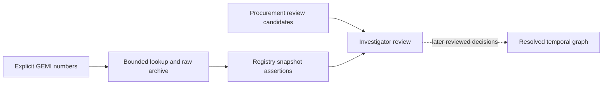

# GEMI registry evidence contract

Status: **approved**, 2026-11-10, by user merge of PR #17 (`1f45c70`).
Provider module: `source-ingestion`, supplementing SPEC-source-ingestion.md.
Consumer: `entity-resolution`, under its separately gated registry-corroboration stage.
Base: merged PR #16 (`0e6e8f5`). No new capability-map module is introduced.

## Objective and first-release scope

Give an investigator a reproducible registry snapshot to compare with procurement
party assertions: registry number, reported AFM, names, legal form, status and
versioned sector activities. These remain dated source claims until identity review.

Assume a fresh, bounded lookup of at most 10 explicitly selected GEMI numbers.
Archive each complete response before normalization. Produce private normalized
snapshots and an honest run summary. No automatic company/person merge, ownership
inference, broad crawl, document download or name/AFM discovery is included yet.
Offline implementation and synthetic transport tests need no production key;
authenticated live validation remains a separate, explicit pilot.



## Verified documentation, not live business payloads

Checked 2026-11-10:

- [Official technical documentation](https://opendata.businessportal.gr/techdocs/)
  describes profile lookup, search and reference data. Its limited test key does
  not replace the required personal production key. This project will not use it
  as a fallback or register/contact the provider automatically.
- [Official Swagger UI](https://opendata-api.businessportal.gr/opendata/docs/)
  returns `Swagger-API-Docs-URL: /api-docs` and loads that public schema.
- [Public Swagger JSON](https://opendata-api.businessportal.gr/api-docs): HTTP 200,
  39,966 bytes, Swagger 2.0, API version 1.0.0. Retrieved SHA-256:
  `c91a65517b89f3a8ac1555f49b4f3178cc185c96addcc08dd2f772c353055e54`.
- [License](https://opendata.businessportal.gr/license/): ODC-BY-1.0, attributed to
  the Central GEMI Service / Central Union of Chambers. Preserve per-source
  attribution; KIMDIS's license is not substituted for GEMI's.

Only public documentation was requested, without authentication. No business
profile, search or metadata service was called. The managed environment reports
no configured secret bindings. The schema confirms declarations, not observed
production field population, compatibility or source freshness.

| Contract | Documented declaration |
|---|---|
| HTTPS host | `opendata-api.businessportal.gr` |
| Base path | `/api/opendata/v1` |
| Authentication | `api_key` request header on profile/search operations |
| First-release operation | `GET /companies/{arGemi}`; path parameter is an integer; response is `Company` |
| Profile responses | 200 Company; 400 errors; 404 not found; 500 errors; 503 unavailable |
| Company identity | `arGemi` integer; `afm` string; no Company properties are declared required |
| Later discovery | `GET /companies` requires at least one criterion; multiple criteria use AND |
| Later AFM criterion | `afm` string, exactly nine characters including original leading zeros |
| Later pagination | `resultsOffset` starts at 0; `resultsSize` query integer 1–200; default sort `+arGemi` |
| Search response | `searchMetadata` plus `searchResults`; metadata `resultsSize` is declared string, although the query uses integer |

Search reconciliation needs a tested adapter for that metadata declaration before
discovery is enabled. Never invent missing leading zeros in a procurement tax ID,
choose the first search result as the matching company, or interpret no result as
proof of nonexistence. The provider's access message to the owner (2026-11-20)
states a personal-key limit of 8 requests/minute, answered with 429 when exceeded
(401 for a wrong key, 5xx for temporary failures). The client default and ceiling
follow that figure; other limits below remain operational choices.

## Profile normalization and evidence

Require a positive integer `arGemi` to identify a profile; reject booleans and
wrong JSON types. Match it against the requested canonical registry number.
Store the namespaced source ID as `gemi:<decimal arGemi>`; keep the supplied input
text and exact response bytes separately. Do not impose an undocumented fixed
registry-number length or manufacture leading zeros. AFM always remains text.

| Source fields | First-release treatment |
|---|---|
| `afm`, `coNameEl`, `coNamesEn`, `coTitlesEl`, `coTitlesEn` | Preserve literal text, aliases and order; missing is unknown; known-empty arrays remain empty |
| `legalType.id/descr`, `status.id/descr` | Retain codes/labels as reported; no guessed legal-form or active-status mapping |
| `isBranch` | Nullable reported flag; false is not evidence of corporate ownership/control |
| `autoRegistered` | Nullable reported flag; false explicitly indicates potentially incomplete profile data; true does not certify complete/current coverage |
| `incorporationDate`, `lastStatusChange` | Reported ISO dates or unknown; neither is a general record-update timestamp |
| `activities[].activity.id/descr/kadVersion` | Retain exact KAD code, label and version; do not equate 2008 and 2026 codes or infer a missing version |
| `activities[].type/dtFrom/dtTo` | Retain reported type and applicable dates; do not replace unknown dates with retrieval time |
| `persons`, `capital`, `stocks`, `branch`, addresses/contact details | Preserve in the original response; no first-release normalized relationship/contact/financial projection |

CompanyStatus metadata has `isActive`, while the inline Company status schema
contains only ID/description. Do not derive active/inactive from a label or
assumed numeric status. Metadata retrieval/mapping is a later versioned source.
KAD codes are not CPV codes; crosswalks and sector cohorts need separate methods.

Person entries have names, role/date fields and percentage text but no stable
person identifier in this schema. Same-name entries cannot become shared person
nodes; percentages or role labels alone do not establish beneficial ownership.

Missing optional fields become explicit unknowns, not defaults. Wrong types or
invalid supplied dates fail profile normalization visibly; raw evidence survives.
Unknown extra fields remain in the archive and do not silently become graph facts.
Each projected alias/activity array is capped at 1,000 entries; exceeding it
quarantines the profile without truncation. This is a client resource limit.
Decode numeric JSON exactly, including unprojected capital values; never use binary
floating point to create monetary assertions. Registry capital is not procurement
spending, revenue or tax liability.

Every normalized assertion retains source ID, extraction version, original body
SHA-256 and JSON pointer (for example `/afm` or `/activities/0/activity/kadVersion`).
Record aware UTC observation time and source-supplied dates separately. There is
no verified registry refresh SLA or generic profile `lastUpdated` field here.
An unchanged normalized subset does not imply an unchanged raw profile.

## Command and operational behavior

Implemented for archive-only staging; production payload compatibility is unverified:

```bash
uv run --frozen python -m nima ingest gemi \
  --gemi-id REGISTRY_NUMBER --archive-dir data/gemi
```

Repeat `--gemi-id` for up to 10 IDs. Accept only bounded ASCII decimal input
(at most 64 characters), require a positive value, preserve original input and
deduplicate canonical registry numbers without losing their input provenance.
This is a client input budget, not a claim about registry validity.

Use `NIMA_GEMI_API_KEY` from environment settings, never a CLI flag, URL/query,
manifest, hash/fingerprint, console output or committed file. Missing/blank key
fails configuration before HTTP or archive creation. Do not request secret values
in chat. Key presence alone does not start a live pilot; the operator must invoke
the explicit command with selected IDs. No registration or live pilot is part of
this implementation's synthetic validation.

Use the fixed HTTPS host/base and GET profile route; verify TLS, preserve inherited
proxy/CA settings and disable redirects. Never follow profile website/document
URLs. Set `Accept-Encoding: identity`; reject unsupported compression and enforce
the body bound while streaming. Archive complete error bodies as evidence too;
incomplete bodies must not be presented as completed source objects.

Client defaults: 8 requests/minute (7.5 seconds between requests), at most 3 attempts per ID, 60-second HTTP
inactivity timeout, 8 MiB per body, 300-second cooperative run budget and maximum
60-second retry wait. Retry only transient transport failures, 429 and selected
5xx statuses. Honor Retry-After; if it exceeds remaining/wait budgets, stop with
an explicit deferred/failure reason rather than retrying early. 400/401/403 are
terminal; authentication failure stops the run. No hard deadline guarantee is made
for an in-flight blocking read; original request/attempt budgets remain visible.

Each invocation starts a fresh run with explicit IDs, endpoint, extraction version,
client limits, source/license, attempt states and redacted metadata. Preserve
response objects immutably, plus run-local normalized/quarantine artifacts and
an atomically published manifest in the existing private Git-ignored archive.
Archive failure prevents transformation/success. Preserve Greek text and unknowns.

A 404 is a recorded `not_found_at_observation` outcome, never an accepted entity
deletion or proof that a business is fictitious. Exit 0 requires all selected IDs
to have accounted-for 200/404 outcomes and every 200 profile to normalize. Exit 3
means a completed response was quarantined; exit 1 covers transport/auth/budget/
archive/incomplete work; exit 2 is configuration and 130 is interruption.
Summaries expose run ID and counters/reasons only, not names, AFM, key or driver
messages. A killed worker's pending outcome remains unknown. No automatic HTTP
resume, exactly-once request guarantee or server/storage crash claim is included.

### Search by AFM (L3, no live call yet)

Implemented against synthetic responses only; first use is the L6 pilot. Design and decisions:
[SPEC-gemi-afm-lookup](../specs/SPEC-gemi-afm-lookup.md).

```bash
uv run --frozen python -m nima ingest gemi-afm --afm 012345678 --archive-dir data/gemi-afm
```

Repeat `--afm` for up to 25 AFMs; each must be nine ASCII digits and not `000000000`, and is sent once
as `GET /companies?afm=<AFM>&resultsSize=20` over the same transport, limits and key rules as above.
Run record: connector `gemi-afm-search-v1`, normalizer `gemi-company-v1`, an `afms` list and one outcome
per AFM (`hit_single`, `hit_multiple`, `truncated`, `afm_mismatch`, `not_found_at_observation`,
`quarantined`). Every returned company is kept as its own normalized row with `afm_matches` and
`truncated`; none is chosen. The summary prints counts only (`found` is AFMs with a hit, `companies`
the hits). A search run is not importable as a profile run until slice L4.

## Integration, stack and style

Keep Python 3.12, HTTPX 0.28.1 and existing archive primitives; no new dependency,
database schema, CI control, graph store or identity write is needed for this slice.
Source handling belongs in `src/nima/sources/gemi.py`, bounded orchestration in
`src/nima/ingestion/gemi.py`, CLI routing in `src/nima/__main__.py`, and focused
tests in `tests/test_gemi_*.py`. Match Ruff formatting and strict mypy; use immutable
typed values, exact identifiers and nullable unknowns. Illustrative model excerpt:

```python
from dataclasses import dataclass


@dataclass(frozen=True)
class RegistryCompany:
    source_id: str
    reported_afm: str | None
    auto_registered: bool | None
```

Current PageStore invokes the KIMDIS normalizer, and the local outbox consumer
rejects other normalizer versions. Do not insert GEMI profiles through that path
or model them as contracts. First-release files are staged registry evidence.
A later reviewed multi-source persistence/dispatch increment must precede SQL-backed
registry joins and accepted entity links. Keep current procurement ingestion intact.

## Verification and acceptance

Existing checks: `just check` and `just audit`. The focused command after
implementation will be `uv run --frozen pytest tests/test_gemi_contracts.py
tests/test_gemi_collection.py`. Use synthetic profiles and HTTPX transport fixtures;
do not commit actual registry payloads or credentials. Existing coverage floor
remains 90% combined line/branch coverage, with no skipped/removed tests.

Verify raw-before-transform, exact/mismatched IDs, leading-zero AFM, optional/empty
fields, partial-registration flag, malformed dates/types, versioned KAD activities,
exact numbers and evidence pointers. Verify key redaction, no redirects/URL following,
limits/retries/Retry-After/auth stops, 404 distinction, quarantine, archive failures
and real worker interruption at request/publication boundaries. Mutation-test a
meaningful guard and restore it. Run the five-axis review and local/hosted checks
before a private main-targeted implementation PR as StamKavid; no automatic merge.

Live acceptance requires a separately configured personal key and explicitly
selected small pilot: retain original payloads privately, reconcile every ID,
compare actual types/coverage with this schema, record deviations and replays,
and report live versus synthetic evidence honestly. A mock-only test suite is not
proof of production compatibility. No key or live payload is required to build/test
the approved offline/transport boundaries first.

## Review decision and later gates

The first-release contract was approved through PR #17. It authorizes bounded
connector development; it does not create credentials or start collection
automatically. Exact-AFM discovery/pagination, metadata mapping,
document/person extraction, multi-source SQL/outbox routing and reviewed identity
decisions remain subsequent gates. No automatic tax-number merge, ownership or
fraud inference, public data publication or paid infrastructure is authorized here.
