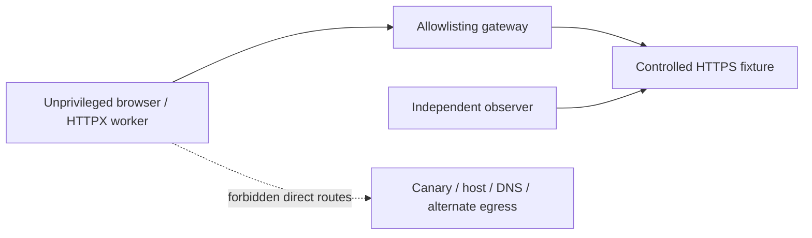

# Spec: source-worker egress verification

Status: **approved**, 2026-11-12, by the user's “I approve”.
Existing capability: `source-ingestion`. Implementation plan and task acceptance
criteria are in `tasks/plan.md` and `tasks/todo.md`, awaiting their own review.
Supplements the approved GEMI Publicity fallback and its personal-IP requirement.
Base: main `ed52c38`, after merged manual-evidence PRs #32–#34.

## Objective and first-release scope

Give Nima a tested network boundary for a future remote collection worker. An
investigator must be able to use a remotely operated browser/API worker without
source websites receiving their home/office IP. First prove the worker's configured
egress restrictions against controlled fixtures; then evaluate deployment separately.

The first release is a local disposable Linux/Docker test environment: a worker,
an allowlisting proxy gateway, controlled HTTPS fixtures and an independent observer.
It exercises HTTPX and a real Chromium process against synthetic pages only.
It collects no business records and makes no requests to government websites or
third-party IP-check services. It does not provision a VPS, buy Webshare/VPN access,
publish a remote desktop, change existing collectors or enable a Prefect schedule.

Assumptions: one worker and one stable gateway; existing self-hosted Prefect remains
the later dispatcher; local kernel/container prerequisites can be checked; missing
isolation support is a visible failure. The first policy has no live-source host
allowlist. The existing standalone collectors remain outside this boundary until
they are explicitly wired into a later, validated worker deployment.

## Trust boundaries and proposed topology



The worker joins an isolated network; only the gateway can bridge to the fixture
side. Packet policy in the worker's network namespace restricts connections to
the selected gateway and required local process communication. A filtering gateway
also validates destination host, port and protocol. Do not rely on proxy environment
variables or Docker network labels alone. Verify the actual resulting routes,
permissions and traffic. The observer provides independent positive controls.

The application cannot alter the network policy. If policy installation requires
NET_ADMIN, scope a trusted setup helper to the disposable worker namespace and
remove that capability from browser/application processes before they start.
The implementation plan must specify and test the exact privilege transition.
No privileged container, host networking, host firewall modification, Docker socket
mount, host PID namespace or broadly accessible debug port is allowed.

Keep Chromium's sandbox enabled. Run workload processes as an unprivileged user,
drop unnecessary capabilities, prevent privilege escalation and bound filesystem
access. Use read-only code/configuration and disposable writable browser state.
An inability to run with these controls is a prerequisite failure, not permission
to disable them. Container/kernel compromise and a malicious host administrator
are outside the claim this fixture suite can establish.

## Configuration and routing contract

- Require an explicit fixture policy, stable gateway address/port and required
  credentials. No default direct mode, proxy bypass list or arbitrary target URL.
  Missing/invalid configuration fails before browser or client work starts.
- The gateway permits only the named fixture destinations and ports, backed by
  fixed fixture resolution. Block alternate hosts, raw-IP CONNECT targets, metadata
  endpoints and host services. There is no general-purpose open proxy.
- An explicit test-only mapping permits fixture-private addresses. It must not
  become a production SSRF exception or silently expand the live allowlist.
- Worker DNS, IPv6, UDP/QUIC and WebRTC paths must not provide alternate egress.
  First support an IPv4 worker with IPv6 explicitly disabled and verified in its
  namespace. Do not report absent IPv6 infrastructure as a successful IPv6 routing
  test. Required UDP/DNS canaries need working observer controls.
- Test attempts to unset proxy variables, use HTTPX `trust_env=False`, add NO_PROXY
  or start a browser with altered proxy settings. Application misconfiguration
  must not restore a direct route.
- Keep TLS verification enabled. Generate fixture CA material privately at test
  time, mount trust explicitly and reject invalid server certificates. Do not
  commit private keys, use `verify=False` or ignore Chromium certificate errors.
- Proxy authentication stays on the proxy hop; it must not reach fixture request
  headers or logs. Never forward an investigator IP in X-Forwarded-For or metadata.
- A stopped/restarted gateway, rejected target or missing credentials produces
  bounded failure. There is no fallback to another IP, gateway or direct connection.

Fixture services and gateway remain on disposable test networks with no Internet
egress. Dependency/image acquisition is a separate build phase using the managed
environment's supplied proxy and CA trust. A later live gateway must preserve any
mandatory platform upstream proxy; this design is not a route around that policy.

## Observable acceptance matrix

| Case | Required observation |
|---|---|
| Allowed HTTPS via gateway | Expected fixture body and gateway-path evidence; valid TLS succeeds |
| HTML, scripts, images, XHR/fetch | Real browser subresources follow the same permitted route |
| Direct IPv4 or proxy variables removed | The reachable canary receives zero worker requests; observer control succeeds |
| Host bridge, host services, metadata IP | No worker access; host-local access is tested explicitly |
| DNS/UDP/QUIC/STUN attempt | Working observer control and zero forbidden worker deliveries; a successful UDP send syscall alone is not delivery |
| IPv6 | Explicit disabled-mode configuration and blocked attempts; no claim to have tested an active IPv6 proxy route |
| Gateway outage/restart or invalid auth | Bounded error with zero direct fallback deliveries |
| Redirect to denied host/IP/port | No request reaches the denied target through either path |
| Invalid TLS certificate | Client/browser rejects it; verification is never disabled |
| Credentials in configuration | Sentinel credentials are absent from target headers, receipts and diagnostic logs |
| Missing policy/kernel capability | Nonzero failure; no skipped test or green unsupported result |

Negative probes are meaningful only alongside positive controls showing that the
target/observer actually works. Distinguish policy rejection from a dead fixture,
unroutable environment or timeout. Use observer counters and policy/namespace
observations, not only application exceptions or an IP-echo response.

Proposed bounds: one browser, at most 30 named cases, 15 seconds per network
attempt, one attempt per case, 10-minute suite deadline, 1 MiB per synthetic
response and 64 KiB per report. Exceeding a bound fails without truncating a case
into success. These are local test budgets, not provider rate allowances.

## Receipt and evidence semantics

Write a versioned private receipt with case names/results, observed policy/image
versions, bounded counters and aware UTC observation times. Separate assertions
from configuration declarations. Keep payloads, URLs with credentials, browser
state, authentication material and unfiltered HAR/trace files out of receipts/logs.
Private test artifacts remain outside Git with restrictive access.

Example required result semantics (illustrative, not an implemented schema):

```json
{
  "version": "source-worker-egress-v1",
  "scope": "controlled-fixtures",
  "isolation_checks_passed": true,
  "internet_egress_verified": false,
  "investigator_ip_protection_verified": false,
  "production_ready": false
}
```

A passing fixture receipt establishes only the tested configuration. It is not
an attestation that the runtime is on a remote host, that a public source observed
an intended public IP or that an investigator is anonymous. Later deployment
verification must bind the actual host, immutable images, effective policy and
approved egress observation. Hosting/proxy accounts, API keys and cookies can still
identify the operator. An application cannot attest an untrusted host by itself.

These receipts are infrastructure evidence, not GEMI observations. They must never
be labelled `publicity-manual` or imported as company records. No registry assertion,
accepted identity, graph edge, SQL migration or detector is part of this release.

## Stack, structure and commands

Current application baseline: Python 3.12, HTTPX 0.28.1, Psycopg 3.3.8 and
self-hosted Prefect 3.9.2. Proposed worker image, proxy implementation, Playwright
package/browser pair and supporting OS packages must be selected, licence-reviewed
and pinned by version/digest in the implementation plan. Do not use `latest`.
Use the official Playwright test image only for controlled-fixture testing, not
as an assumed production image for untrusted source websites.

Proposed first-party policy/probes: `src/nima/egress/`; synthetic tests:
`tests/test_source_worker_*.py`; isolated Compose topology under `infra/`;
verification evidence under `docs/verification/`. Keep existing Prefect/SQL Compose
services and normal collector behaviour unchanged.

Existing verification commands:

```bash
export PATH="$PWD/.tools/bin:$PATH"
just check
just audit
```

Proposed integration entry point, **not implemented**:

```bash
just source-worker-check
```

The recipe must build pinned test images, run only fixture cases, validate the
receipt and clean up only its own explicitly named resources. It may not contact
GEMI. Add a dedicated CI integration gate alongside the existing quality and
orchestration gates; never replace them. The exact files, dependency pins and
commands belong in the reviewed implementation plan.

Code style: strict types, small immutable policy/result values, Ruff formatting,
fixed redacted failure codes, no shell interpolation of user configuration.
For example, `return {"case": case_name, "result": "blocked_by_policy"}` must be
backed by an observed enforcement/control test, not merely a configured proxy URL.

## Testing, delivery boundaries and open decisions

Use TDD for policy validation and receipt semantics, then real Linux/container
integration with HTTPX and Chromium. Add unit tests for invalid targets, missing
configuration, bounds and redaction. Gate on the matrix above, normal `just check`,
clean `just audit` and the unchanged 90% combined coverage floor. Mutate an actual
egress guard and show a negative-case regression fails before restoring it.

Always: preserve mandatory environment proxy/CA policy; fail closed on missing
prerequisites; keep fixture results distinct from deployed privacy claims.
Review in the implementation plan: exact gateway/browser dependencies, namespace
setup capabilities, resource bounds and additive CI changes.
Never: buy services, publish a browser/control port, deploy infrastructure, disable
TLS/browser sandboxing, activate source automation or treat IP rotation as recovery.

The implementation plan selects pinned Envoy, Playwright/Chromium and nftables,
and records limited capability probes and the untested browser/TLS prerequisites.
Review that concrete plan before implementing the worker or changing dependencies.
Live access still needs provider permission and a separate deployment decision;
neither is a blocker for this fixture-only increment. No external credentials are
needed now. Existing registry-comparison and pending GEMI-key work remain tracked.

## Official references checked 2026-11-12

- [Compose networks](https://docs.docker.com/reference/compose-file/networks/#internal)
  documents external isolation through `internal`; topology declaration alone does
  not replace observed denial tests for this threat model.
- [Docker bridge networking](https://docs.docker.com/engine/network/drivers/bridge/)
  describes host/container connectivity and NAT; explicitly test the host boundary.
- [Compose service controls](https://docs.docker.com/reference/compose-file/services/)
  documents capabilities, read-only filesystems, users and security options.
- [Playwright proxy support](https://playwright.dev/python/docs/network#http-proxy)
  covers browser/context configuration, not a system-wide egress guarantee.
- [Playwright Docker guidance](https://playwright.dev/python/docs/docker) describes
  its test/development image and warns against assuming suitability for untrusted
  websites. Resolve the package/browser/image pairing in the implementation plan.
- [HTTPX environment variables](https://www.python-httpx.org/environment_variables/)
  documents proxy selection, NO_PROXY and explicit `trust_env=False`; test network
  enforcement independently of these application settings.
