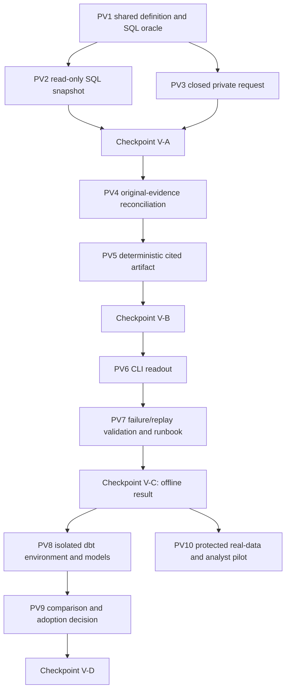

# Delivery plan

## Active V1-08: verified U1 acceptance consumer

Owner approved [C1–C3](../docs/specs/SPEC-participation-acceptance-readout.md) on
2026-11-26 (Europe/Athens), including implementation. The owner merged #226 at `fcfa11d` and the #227 contract at `e3839c0`; both
reviewed heads are reachable from main, and their combined tree matches the
previously composed prerequisite tree. Deliver the consumer in a new PR to main.
No agent merge or history rewrite was performed. Preserve all earlier incomplete work below.

Dependency direction: DataOps command → U1 adapter → existing public preparation
and unchanged pure policy. First extract only descriptor-safe subject reading,
lexical paths and fixed errors into a small shared file helper; maintain citation
exception exports/valid behavior and its 8 MiB bound. U1 keeps its 1 MiB bound.
No second verifier, normalizer, SQL snapshot, publisher or adapter registry.

U1-A: failing file-boundary cases first, extract the shared guard and fixed error
base, then run all existing citation cases unchanged. Files: shared helper,
citation adapter and one helper test module. Acceptance: exact byte bounds,
private/stable single-link reads, fixed errors and preserved citation behavior.

U1-B: begin with one actual native SQL known answer and pure counter/privacy
cases; implement the minimum U1 prepare/export path. Extend strict producer and
policy binding checks before full gates. Files: U1 adapter, mapping/sample tests
and failure tests. Acceptance: all eleven counts measured, ambiguity excluded
from the unambiguous denominator, country/list unknowns unioned once per record,
request hash binds the supplier without copying tax ID or source detail.

U1-C: route through the existing acceptance CLI; add native refusal/retry/
relocation and process-publication proofs. Files: two existing CLI modules and
focused CLI/native/crash test modules. Acceptance: one preparation/connection,
no HTTP or source writes, exact closed results, every retry re-verifies, SQL
closed before publication and original/citation artifacts unchanged.

U1-D: cheap lint/type/security before expensive gates; 100% new-code line/branch,
meaningful counter/verification/file-limit mutations, full check/audit, final
built-wheel proof and all exact-head hosted jobs. Keep code stable while tests
or mutations run. Publish the candidate draft to overlap independent local and
hosted verification; record results in its PR and mark review-ready only when
both pass. No extra local full run solely for documentation-status changes.

Risks: false blocked ambiguity (C-only denominator); hidden country uncertainty
(union flags, preserve provider status); copied AFM (hash-only binding); wrong
shared bound (explicit per-call 1/8 MiB); trusting saved success (fresh public
preparation + full byte equality); source-stack growth (no new source engine).
End checkpoint: reviewed U1 acceptance consumer PR, not V1-08 completion.

## Delivered V1-08: verified citation-acceptance readout

Owner merged #223 at `a4eb99d`; tested head `d2d94db` is reachable from main
with an identical tree. All three main CI jobs passed in run 45639919348.
The local gate passed 4,463 tests at 95.03% overall coverage; new policy coverage
is 100%, 22 mutations rejected, audit and installed-wheel proof clean.

Owner approved [B1–B3](../docs/specs/SPEC-citation-acceptance-readout.md) as recommended
on 2026-11-26 (Europe/Athens), including the bounded citation consumer. Execute
sequentially, keeping existing incomplete work below. Durable history, U1–U4
consumers and actual source reconciliation remain open.

Dependency direction: DataOps command → citation adapter → existing public
preparation API and pure acceptance policy. The policy remains stdlib-only;
normalizers, existing artifacts, reader transactions and legacy validation are
not rewritten. The #224 contract is now merged at `39519c2`; deliver this consumer in a new PR
against main after verifying the implementation.

R1 front-loads verified-result mapping. Write failing known answers for all
fourteen counters, strict producer shapes/bindings and current policy metadata.
Build from a fresh public preparation result, never a fixture template or cached
success flag. Exercise source/target ambiguity, shared revoked targets, A→B→A,
unknown/empty lists, cancellation and after-cutoff evidence before full gates.

R2 adds private subject/hash reading, one actual reconstruction, exact byte
comparison, pure evaluation and bounded sidecar publication. Route the new
command through the existing DataOps dispatcher. Native PostgreSQL 17 tests
prove restricted-role/single-snapshot behavior, every required counter, closed
failures, real retry/relocation and no input/SQL writes. Broken proof produces
no assessment; reconstructed subjects can publish any policy decision.

R3 runs cheap lint/type/security first, then 100% new-code line/branch coverage,
targeted mapping/verification/publication mutations, unchanged legacy pins,
process-interruption recovery, full `just check`/`just audit`, installed-wheel
proof and all exact-head hosted jobs. Keep source stable during test/mutation
runs. Deliver a reviewable PR, not a merge or a live data operation.

Risks: double-counting shared targets (edge grain, not distinct target); treating
ambiguity as a chosen version (typed selection, separate counts); omitted counters
becoming zeros (explicit measured values); trusting saved JSON flags (always run
the existing verifier and compare complete bytes); duplicate verification engines
(reuse the public preparation API); late scanner failures (cheap preflight first).

## Delivered V1-08: pure acceptance policy

The following records the approved execution scope; it is no longer active work.

Owner merged #222 at `9273451`; reviewed head `724bb14` is reachable from
`origin/main` with an identical tree. All three exact-head hosted jobs passed in
run 45624593892; 4,314 tests, 100% new-module line/branch coverage and 22 targeted
mutations rejected. The verified V1-07 readout checkpoint is delivered; actual
four-positive reconciliation remains open.

Owner approved [A1–A3](../docs/specs/SPEC-dataset-acceptance.md) as recommended on
2026-11-25, including implementing the pure evaluator first. Execute that bounded
slice under this plan; no second feature or source activation is authorized.
Existing journal constraints require a separate additive contract before durable
general acceptance can be claimed. Preserve the earlier plans and open work below.

Dependency order: existing verified reader/provider facts → typed policy input →
per-use acceptance decision. The policy imports only stdlib; no dependency points
from the policy into analytics, SQL, files or source adapters. Existing readers
remain the owners of physical verification. First scope has no product adapter.

P1 is one working policy path: immutable bindings/checks/aggregate counters,
closed vocabulary and supported-definition/source profiles, then deterministic
per-use required-check decisions. Begin with failing known answers, implement the
minimum and expand with negative cases. Required failure outranks unavailable
proof; a missing required check cannot pass. Partial citation inspection retains
its limitation while partial U1–U4 captures block. Counts have named grains;
only valid partitions reconcile, never overlapping CPV/supplier cell sums.

P2 exercises existing public readers against owned native PostgreSQL 17 fixtures
and original bytes, then passes verified outcomes into the pure policy in tests.
The fixture bridge is not a supported product adapter or a durable attestation.
Prove complete/partial decisions, failed SQL/raw reconciliation, missing proof,
and unchanged SQL/archive state. No private pilot or source request is involved.

P3 first runs the cheap lint/type/security preflight, then verifies 100% new policy line/branch coverage, targeted decision/accounting
mutations, unchanged semantic pins/catalogue and dependency baseline, full
`just check`/`just audit`, installed-wheel contents and all exact-head hosted
jobs. Review and deliver this combined slice by updating #223; do not merge it.
End checkpoint: reviewed pure-policy PR; verified acceptance publication,
additive durable history and real-cohort reconciliation remain separate work.

P1/P2 are implemented in the #223 candidate: 134 pure cases and 15 native SQL
cases pass, new policy has 100% line/branch coverage and 22 mutations are rejected.
Applicable counters must be explicit; missing diagnostics never become zeros.
The ten-run bound follows all existing readout interfaces. [Focused proof](../docs/verification/dataset-acceptance-policy.md).
P3 is delivered in #223, verified on main `a4eb99d`: full quality/package/audit
proof and all three main jobs pass. This completes the first policy checkpoint,
not the V1-08 work package's consumers, durable history or real-data acceptance.

Risks and controls: caller-supplied flags masquerading as evidence (typed internal
input only; SQL integration invokes actual reconcilers); missing checks passing
vacuously (explicit required sets); partial data mistaken for zero activity
(retain provider status and exclusion counts); unreviewed definition changes
(closed pinned profiles and catalogue parity); scope growing into another quality
framework (one module, focused unit/integration tests; no new CLI/schema/library).

## Delivered V1-07: verified two-source readout

Owner approved [J1–J4](../docs/specs/SPEC-cross-source-citations.md) as recommended
on 2026-11-25, including the model/SQL → verified readout → real reconciliation
delivery order. This extends the existing roadmap; preserve all open work below.
Owner merged #221 at `998f798`; its provider head `e5db0d2` is reachable from
`origin/main` and its tree is identical. All three jobs passed in run 45602309764;
4,230 tests locally and hosted, new provider 100% line/branch, unchanged U1–U4.

Implementation order (sequential): C1 pure typed observations, validation and exact
citation classification using the existing latest-observation selector; C2 independent
reference SQL on the same validated input and PostgreSQL 17 parity; C3 mutation,
compatibility, full quality/audit, package and hosted checks. Tests precede each
behavior change. Each task's file boundary and acceptance live in `tasks/todo.md`.

The model keeps source/target ambiguity and unknown/empty lists separate, preserves
type/status and selected-content observation lineage, and never reads SQL, blobs or
network itself. SQL is packaged reference arithmetic, not a new database object.
Use existing normalizer IDs as an explicit closed supported-version contract in
the pure module, as other semantic providers do; a later installed adapter must
not silently change this model's input contract. Leave the lifecycle/U1–U4 bytes alone.

Risks: later revisions accidentally filtered into earlier valid targets (select
first, then classify); same-hash contradictory facts (validate before selection);
Python/SQL collation and lineage disagreement (Unicode and repeated-observation
parity tests); scope growth (end at model/SQL, no CLI or generic graph framework).
The owner requested continuation after merge. Next, sequentially: R1 strict private
two-source request plus the narrow Diavgeia tag in existing archive recovery; R2
bounded ingestion-ledger snapshot and source-adapter reconciliation, including
quarantine accounting and explicit partial capture; R3 model/SQL parity on that
same read-only session, minimal evidence artifact, publication and CLI; R4 full
regressions/mutations, gates/audit, wheel and exact-head hosted CI. Each task stays
within roughly five implementation/test files; deliver the combined vertical readout
as one PR. No projection, source-data, schema, dependency or CI change.

Reuse `analytics.snapshot.connected` for role/schema/time/statement controls and
`graph.pilot_archive.recover` for descriptor-safe bounded bytes. The new reader
does not require a Diavgeia SQL projection. Recompute all admitted pages through
their supported installed adapter and compare record hashes, normalized forms,
indices, identifiers and quarantine reasons. Verify all selected pages, even when
there are no matches. Source tables never receive a repair or fallback fetch.
Runs with no pages retain partial-coverage disclosure; their bindings provide no
bytes and are not used for recovery. Complete-empty runs still need their empty page.

Keep counts/size preflights before materializing SQL JSON and cap canonical output
at 8 MiB. Only run/query lineage, identifiers, types/statuses/cancellation and
evidence locators enter the private artifact; omit names, amounts and subjects.
Four-positive real validation still needs the owner's actual private inputs;
no fresh source request is implied. Stop after the verified readout PR.

## GEMI AFM lookup: delivered (2026-11-25), kept for the decisions and the risks it answered

**Status:** L1 to L6 and the comparison (L5a to L5c-1) are merged; the record is in `tasks/todo.md` and
`docs/verification/gemi-afm-l6.md`, `gemi-afm-l5c.md`. Open: importing the L6 runs into the owner's database. The text
below is the plan as it stood before the work, not the current state.

[SPEC-gemi-afm-lookup.md](../docs/specs/SPEC-gemi-afm-lookup.md) (2026-11-20) proposes `GET /companies?afm=` so a KIMDIS
reported tax number can be looked up in GEMI without finding the registry number by hand. Evidence and candidates only: every
response archived before parsing, a fixed outcome vocabulary per AFM, no hit chosen for the investigator, no identity link.
Slices L1 spec, L2 pure parser, L3 collector, L4 archive verification, L5 import plus the comparison outcome
`queried_not_found_at_observation` (migration, owner approval first), L6 live pilot on the owner's machine with an
equivalence check against `GET /companies/{arGemi}` and a latency measurement. Nothing is implemented until the owner approves
the spec and decisions D1-D6. Main risks: a search hit not equal to a profile (checked in L6), profile latency of 30 s or more
against the 300 s run limit (measured, then amended in the spec), personal data of sole traders (private archives, redacted
publication). No dependency, CI or source-schedule change. Preserve all earlier tasks.

## Active V1-05 S2: time model, measured before it is written

Owner approved the [semantic model spec](../docs/specs/SPEC-semantic-model.md) on 2026-11-20 with decisions D1-D5 as
recommended. S2 defines how `source_submitted_at` and `source_updated_at` become a calendar period. Their
text format has never been measured on real data, so nothing is parsed from a guess. Two PRs, in order,
with an owner step between them.

**S2a, measurement (read-only, no behaviour change).** A new `scripts/semantic_census.py`, modelled on
`scripts/diavgeia_link_census.py`: read-only session, every query written out in full, fixed exit codes, output
of counts and shapes only. It reports, over `nima.record_versions` of KIMDIS records (distinct source IDs and
stored versions both counted): for each of the two date fields the number present, absent (key missing), null
and empty, and the top shapes with counts, where a shape is the text with each digit replaced by `9` and each
letter by `A` (this exposes separators, a `T`, a zone suffix such as `+99:99` or `Z`, and length, but never a
value); for supplier tax IDs the occurrence count and classes (nine ASCII digits, all zero, one repeated
non-zero digit, `123456789`, leading zero, other length as a length histogram, non-ASCII digits, null/empty) and
the supplier country-code counts. It prints no name, tax number, amount, date value or title. Tests on the
`pg_dsn` fixture with synthetic rows: each class and each shape bucket, the empty database, and an assertion
that no input value appears in the output; 100% line and branch; each query mutated once to see a test fail.
Owner step (replaced 2026-11-20): the pilot database is unreachable, so the census ran on a local database rebuilt from
one small bounded capture; see `docs/semantics/date-format-measurements.md`. A wider capture needs approval.

    NIMA_DATABASE_URL="<read-only>" uv run python -m scripts.semantic_census --top 20

**S2b, time model (after the owner's measurement).** `src/nima/semantics/timemodel.py`, pure, stdlib only. Measured on 203 real records (2026-11-20): the submission date is a zone-less ISO date-time with a
fraction of one to three digits (owner decision), the update date is date-only, and nothing carries a zone, so
there is no zone conversion and no time zone database.
One parser per *observed* shape and no fallback guessing. Outcomes `parsed`, `absent` and `unparseable`, with the
source text always retained; period is the calendar month in Europe/Athens (decision D2); a zone-less value is taken
as Athens civil time and says so in the result, and a value with a zone suffix or offset is unparseable until a
measured shape justifies a rule. Tests: one case per measured shape, month and year boundaries, leap day, malformed and
out-of-range text, and invariants (the same text always gives the same period). The measured shape table goes
into `docs/semantics/` as numbers only. D4 follow-up: the measured tax-ID class frequencies are recorded and any
further placeholder rule is proposed to the owner, not adopted.

Main risks: a format mix larger than expected (mitigation: each shape is explicit and the rest is
`unparseable`, counted, never dropped); a time-zone suffix or a date-only shape giving different months near
midnight (mitigation: explicit boundary tests); the census itself leaking a value (mitigation: shape-only output
and the no-value assertion). No migration, dependency, CI or source-request change. The D5 reference-sharing
measurement belongs to S6. Preserve all earlier tasks.

## Active V1-04: source boundaries for a second feed

Owner approved the [spec](../docs/specs/SPEC-source-boundaries.md) on 2026-11-19. S1-S4 are delivered (#154,
#155, #156, #157); N1 (#158) and N2 (#159) are delivered; S5 is gated on the owner naming a dataset. Dependency order, each a
separate review-ready PR with full gates and hosted exact-head jobs: S1 freeze the import graph
with a shrink-only baseline (no behavior change); S2 the neutral `SourceAdapter` protocol and a
`KimdisAdapter` wrapper; S3 move the page store, collector and replay onto the protocol with
KIMDIS as the default and a byte-for-byte regression; S4 two synthetic adapters of different
shape and one conformance suite for all three; S5 (gated, optional) a real small public dataset
only after the owner names it, its reuse terms are checked and a network host is allowed. Main
risks: touching the evidence path in S3 (mitigated by byte-for-byte equality and the unchanged
collector/projector access necessity tests) and the existing five-package import cycle, which is
recorded and not fixed here. No migration, dependency or CI change; no live source request.
Preserve all earlier tasks.

## Completed checkpoint C5: source acceptance and readiness

Owner merged #132 to main at `6fbddc9`, then #133 into its feature base at
`122e7e8`. Owner then merged #134 at `ad62fb3`; command reachability from main
is now verified, with all promotion checks passing. Preserve existing app/tests/CI.

C5a verifies branch reachability and opens the content-identical promotion. C5b
assesses delivered/live/prepared source capabilities and records a stable,
explicit analytics-core readiness rubric. C5c captures and inspects the official
AADE catalogue, mapping and terms; freeze the five-column/release/reuse acceptance
boundary before selecting a parser. C5d validates docs/links, runs required full
gates/audit and exact-head hosted CI, then stops at owner review. No new app
feature or source schedule is activated by a documentation checkpoint.

Observed: both PDFs captured/hash-verified; 430/617 pages, two sampled text pages
each, first correspondence table visually checked. Complete extraction is not
validated. Transitional identifiers and reuse restrictions block automatic
assumptions, not independent DataOps work. Runtime KAD adoption stays pending
its explicit acceptance gates. Health/freshness and failure logging are the next
independent implementation candidate while that source acceptance is resolved.

## Active checkpoint C4: reviewed deployment and CPV references

Owner merged #131 at `7bdf5da` following #130. Prior final code `ec6402e` passes all
three jobs in run 44290911542; C3's combined local gate is 2,213/93.05% with clean
audit. Continue the same taxonomy roadmap without discarding human/model work.

C4a performs private deployment of reviewed 0009 only: fresh native source backup,
verified owned restore/migration, then migration of the unchanged pilot, narrow
existing-role grants, selected prior metadata promotion, retry/refusal/readout
checks and owned cleanup. No new source capture or schedule activation.
C4b inspects official CPV data/reuse terms, freezes source/format/hash/language and
matching semantics, then implements an offline bounded parser with adversarial
and real-release checks. Source data stays outside Git. Empty download responses
are rejected, not used as dictionaries. C4c adds private publication/matching and
CLI as thin slices, with reported metadata unchanged. C4d runs meaningful mutation,
full local gates/audit, package checks and exact-head hosted jobs before owner
review. Actual dictionary scope is frozen after inspecting the source bytes.

Observed C4 scope: OP-TED SDK 1.15.1, CPV 2008, explicit ell/eng, base-code
membership only. Real-release completeness checks cover 9,454 entries in both
languages. The whole batch passes 2,285 tests/93.27% and a clean audit; meaningful
duplicate-code/version-guard mutations are rejected and restored. Packaged reference and SQL commands reproduce the retained bytes. Exact-head
hosted jobs remain the final handoff gate. No company-source
request, model or human-certification claim is added.

## CI correction for replay promotion

Owner reported PR #127 CI failure. Exact-head run 44163644708 passes quality and
source-worker egress but fails the Compose installed-module smoke check: it still
asserts seven migrations after 0008 was added. The application migration succeeds;
the hosted traceback points to that stale count. Continue the same authorized
promotion plan; do not alter the live pilot or any application/data contract.

Use the CI skill and reproduce the original embedded check in an owned disposable
Compose stack. Replace the version literal with public `validate_schema` on the
existing connection, checking current packaged history and checksums. Preserve the
three empty-ledger checks, UID, time zone, deployments, disabled schedules and all
quality/security gates. This strengthens the smoke contract and avoids another
hard-coded schema version. No permission, threshold, dependency or timeout change.

Files: `.github/workflows/ci.yml`, this plan, `tasks/todo.md` (three). Verify old
embedded check fails, corrected check passes on the same installed image, corrupt
history is rejected and only the owned Compose resources are removed. Run required
local checks/audit, push a fast-forward correction to the existing PR branch as
StamKavid, then inspect all three jobs at the new head. Hosted success is required
before reporting CI fixed; do not merge automatically.

Observed locally: the exact original embedded database block fails after applying
0008; the corrected block passes and rejects a deliberately wrong checksum at the
same migration row count. All empty-ledger assertions remain. The isolated image
build passed, but Compose startup hit the Docker daemon's disk limit while pulling
PostgreSQL. Only the owned stack/image were removed; the disposable native test
database was also removed. Do not call that a local Compose pass. Full local
quality/audit and the corrected exact-head hosted run are recorded with the PR.

## Current extension: explicit SQL replay promotion

Owner merged #126 at `ecb5a85`; all three exact-head jobs passed in run
44154596290. Continue the authorized SQL promotion follow-up under the
[source contract](../docs/specs/SPEC-source-ingestion.md#dataops-increment-explicit-sql-replay-promotion).
No source access/dependency/CI change. Keep human PV10, request/refresh version
policies and metadata/model work open. This is an extension of the same plan.

P1 records the contract/plan/tasks (three files). P2 adds migration 0008, its
registration and minimal latest-version regression expectations (five files,
including `tests/test_replay_promotion.py`). P3 exposes shared public preparation
and the existing run lease key, then implements bounded atomic SQL promotion
(replay, run storage, promotion module and its two test files; five files).
P4 adds the archive promote CLI and real CLI regressions (two files). P5 verifies a private migrated pilot clone, mutation/crash/concurrency,
full local gates and then delivery PR/hosted checks/owner review. Work sequentially.

Use `nima_processing` for immutable derived batches/results; retain the 26 existing
`nima` tables. The migration journal gains version 8; no original migration body
changes. Promotion uses the selected canonical hash, verified originals, a shared
source lease/recheck, and one explicitly READ COMMITTED write transaction. Only complete/quarantined captures;
explicit scope/hash/version, no implicit activation/freshness or default metric.
Processing and observation times remain separate. No source-table write grant is
needed by the promoter. New SQL ownership/grants are explicit operator concerns.

Verify migration upgrade, current NOLOGIN ownership, limited principal behaviour,
bulk insertion, retry/conflict, stale scope, quarantines/exact money, and real
process death at SQL commit boundaries. The private pilot proof runs in a clone;
keep the live pilot, original readout/evidence and all three HTTP guards unchanged.
The app has no database migration or source-fetch fallback during promotion.

Observed: 42 focused promotion cases pass, including upgrade/ownership, exact
money, immutable rows, limited roles, stale scope, conflict, concurrent retries
and actual SIGKILL before/after commit. Final review reproduced a repeatable-read
role-default failure; explicit READ COMMITTED fixes it and both default-isolation
cases pass. Removing the selected-hash guard fails its regression; it is restored.
The migrated private clone passes with unchanged source data/counters/readout,
explicit NOLOGIN ownership and limited promoter/reader controls. The original
pilot database, originals and HTTP guards remain unchanged. Native constraint
formatting was checked by the retained PostgreSQL reparse/boundary proof. No new
source requests. Final local `just check`: 2,093 cases/93.10%; `just audit`: clean.
The built wheel contains the final code/migration. Hosted checks and owner review
remain part of delivery; private proof stays outside Git.

After review, apply the pilot migration in a recorded maintenance step. Then
continue durable request/refresh version-policy handling, queryable buyer/CPV/KAD
metadata and isolated Greek model evaluation. SQL promotion does
not itself certify a metric, choose a new model or constitute human validation.

## Current extension: offline normalization replay

Owner merged #125 at `d98a971`; all three exact-head jobs passed in run
44146760312. Continue the approved replay/version work with the
[source-ingestion replay contract](../docs/specs/SPEC-source-ingestion.md#dataops-increment-offline-kimdis-normalization-replay).
Assume one local operator, PostgreSQL 17, existing private originals and no source
requests. Retain PV10 and all pending metadata/model/SQL-promotion work.

AR1 freezes the bounded replay contract (source spec and these task documents,
three files). AR2 implements the complete read-only SQL → verified originals →
explicit installed normalizer → private dataset path, plus CLI/tests (four files).
AR3 runs required gates, mutation and existing private pilot checks, then publishes
one reviewable PR. Execute sequentially; no delegation or new dependency/migration.
This is the same owner-authorized DataOps plan; continuation already authorizes
routine implementation within this scope.

Version boundary: source-run normalization identity is historical lineage, target
normalization is an explicit installed version. Do not compare historical identity
to current constants or pretend an unavailable normalizer exists. Replay creates
an independently versioned dataset with original observation times. It cannot
write evidence/projections or change metric results; SQL promotion and durable
request/refresh compatibility are later scoped work, not silently claimed fixed.

Use a closed read-only repeatable-read SQL snapshot, shared descriptor-safe blob
recovery and canonical private publication. Reject bad envelopes/metadata/bounds;
quarantine invalid records. Preserve prefix status, original source hash/pointer,
Greek text, Decimal money and duplicate occurrences. No pages is no dataset;
committed empty is a valid empty dataset. Test before implementation, then review
correctness, privacy, resource bounds and deterministic replay. Verify the private
pilot offline with unchanged data/originals/readout. No human task is fabricated.

Observed: 56 new replay cases plus 43 archive-verifier regressions pass, including
actual reader CLI execution, historical quarantine reprocessing, snapshot closure,
relocation and valid-JSON tamper rejection. Removing the shared raw hash guard
makes the tamper regression fail; the original guard is restored. The existing
private pilot replays identically to persisted normalized versions with unchanged
26-table contents/counters/schema, originals, source guards and reader report.
No source request was added. Full local `just check` passes 2,051 tests/93.06%;
`just audit` is clean. Hosted checks and owner review accompany the delivery PR;
local results do not establish either. Private evidence stays outside Git.

Next after review: SQL replay promotion/version-policy handling, then queryable
buyer/CPV/KAD metadata, followed by an isolated Greek model evaluation.

## Current extension: preserve PostgreSQL startup roles

The owner merged #124 at `cae6fe2` and requested continuation; all three exact-head
jobs passed in run 44127404558. Address its observed ownership defect before
archive replay and metadata projection. This is the same approved DataOps work;
retain earlier recovery evidence and pending human/model tasks below.

Contract: public `storage.connection.connect` must preserve libpq startup settings
from explicit DSNs, environment and service configuration, including an authorized
NOLOGIN role. Keyword overrides must not replace `options`. Authenticate using the
normal driver, then apply the fixed session statement/lock timeouts (30 s / 5 s)
in autocommit mode before returning the connection. Preserve the existing 5 s
connect timeout. Invalid/unauthorized startup roles fail; never fall back to the
login user. If timeout setup fails or is interrupted, close the actual connection
and propagate the original error. No new API argument or SQL migration is needed.

Sequence: reproduce wrong schema ownership with a real role-bound migration →
minimal connector fix → environment/service, limits, denied-role and cleanup
regressions → local gates/private pilot verification → PR/hosted checks/review.
Five files: connector, `tests/test_connection.py`, operator runbook, these two task
documents. Execute sequentially; no new source requests, dependency or CI changes.
The operator runbook records the living contract; the prior drill remains a
historical observation rather than being rewritten as though the bug never existed.

After synthetic real-PostgreSQL tests pass, repair only the private pilot's `nima`
schema and its project objects to the already-configured NOLOGIN owner. Require
the retained verified native backup, expected old owners, no running collection,
a migration advisory lock, one bounded DDL transaction and exact scoped identifiers.
Do not use cluster-wide REASSIGN OWNED. Record prior owners for rollback. Check all
26 table contents/counters and effective daily-role policies remain unchanged;
verify actual new owners, role-bound migration replay, archive integrity and
identical reader output. Never move original evidence or activate a source to
verify the repair. Existing deployments receive no automatic ownership rewrite.

Acceptance: real migration creates schema/relations/sequences/functions under the
requested role; native DSN/environment/service behavior and fixed timeout values
pass; invalid role and setup failure/interruption return no usable connection;
legacy no-option operations still pass. A mutation restoring the old options
keyword must fail the ownership regression. Run `just check`, `just audit`, then
all three exact-head hosted jobs. Private pilot data/proof stay outside Git.
Next: archive replay/version handling → structured metadata → Greek model evaluation.

Eleven new connection cases and five migration regressions now
pass; the old options override mutation is rejected. Full local gates pass
1,995 tests/93.04% with a clean advisory audit. The private pilot's explicit
ownership repair passes with unchanged 26-table data/counters, logical schema,
original files, daily capabilities and reader bytes. Local/hosted gates and owner
review accompany the increment; no source request or automatic reassignment of
other databases occurred.

## Current extension: isolated SQL-and-archive restore drill

The owner merged #123 at `3e35bc4`; all three exact-head jobs pass in run
44098176598, and the owner requested continuation. AV1–AV2 are reviewed. Continue
with the [operator restore contract](../docs/operations/backup-restore.md), using
native PostgreSQL 17 tooling and existing application checks rather than a new
backup framework. Keep unfinished PV10, replay and metadata work intact below.

Sequence: RD1 freeze the procedure and owned-resource bounds → RD2 perform the
private native dump/fresh-cluster restore, equivalence and negative checks → RD3
record redacted evidence and required local/hosted gates. At most five public
files: the operator runbook, `docs/verification/restore-drill.md`, these two task
documents and `CAPABILITIES.md`. No source records/hashes/counts, credentials or
private helper scripts enter Git. No application/dependency/migration/CI change.

Use a quiescent bounded pilot; export one read-only repeatable-read snapshot for
comparison and native dump. Pair it with original archives/request/readout and a
separately anchored manifest. Restore into a fresh owned cluster on a different
loopback port/data directory with SCRAM and recreated scoped roles. Compare all
application rows, sequences and schema definitions, validate migrations, run the
archive check and reproduce the report through relocated private bindings. Test
missing/corrupt destination evidence, dump failure and privileges without editing
the source. Stop only the owned destination and verify source health afterward.

Record exact versions and checks, including failures; no result is presumed. The
initial same-workspace checkpoint is not a native restore and does not substitute
for this drill. Fresh local cluster is not a new host, off-host retention or an
RPO/RTO measurement. Absolute-path workflow resume and external Prefect state are
outside scope. Actual production backup/role policy remains separate.

After RD review: refine archived normalizer replay/version handling, then the
structured metadata projection (buyer activity, CPV, reported KAD) before an
isolated Greek-data GLiNER extraction/classification evaluation. Model scores stay
separate from reported facts; no model is selected or installed by this drill.
The private metadata-enrichment proposal retains the owner's latest steering.

The native drill now passes on PostgreSQL 17.11: all 26
application tables/counters and schema checks agree, including a PostgreSQL CHECK
reparse proof, effective role policies and identical relocated readout bytes.
Actual missing/corrupt/incomplete-dump failures and owned cleanup pass. The source
remains unchanged. Source bootstrap ownership differs from its configured role;
record/refine that migration-role follow-up rather than assuming options took
effect. The [verification record](../docs/verification/restore-drill.md) distinguishes
this fresh local cluster from off-host or production recovery. Full local gates
pass 1,984 tests/93.03% and a clean advisory audit. Exact-head hosted checks and
owner review accompany the documentation PR.

## Current extension: DataOps archive integrity — owner-authorized

The owner merged #122 at `7cabec0`; its three exact-head jobs passed in run
44086900388. The owner then requested delegated validation, received a bounded
technical pass with commercial/user limits, and authorized the next batch on
2026-11-17. The private agent assessment does not count as human review; PV10 and
metric certification remain open. Continue the existing source-ingestion foundation
with the [committed-page verifier](../docs/specs/SPEC-source-ingestion.md#dataops-increment-committed-page-archive-verification).
This extends the same delivery plan without closing or replacing pending work.

Assumptions: one trusted operator, PostgreSQL 17, explicit existing local archives,
no additional source requests, and no inferred sector mapping. The source-contract
metadata supports distinguishing buyer function, CPV category and GEMI KAD activity;
a unified sector dimension is future scoped work.

Sequence: AV1 record contract/plan/tasks → AV2 implement and verify the complete
bounded command → owner review/merge. Execute sequentially, no delegation. AV1
changes the existing source spec and these two task documents (three files). AV2
adds `dataops/__init__.py`, `dataops/archive.py`, its tests and minimal root CLI
routing (four files). Each task stays below five files; the PR includes both tasks.
The owner's current instruction authorizes this bounded implementation; no new
approval is needed for routine implementation choices within it.

The command freezes a read-only SQL metadata snapshot, closes SQL, then reuses the
existing public bounded archive-recovery API. Tests must distinguish zero pages
from a committed empty page, partial collection from integrity success, and frozen
metadata from later commits. Reuse public database/schema/filesystem APIs; no
private cross-imports, generic framework or layer-cycle refactor.

Risks: unsafe/missing originals fail without repair; changed body length/hash
fails; a large run fails before reading any body; CLI errors hide private values;
a partial run never becomes full coverage. The operation checks committed pages
only, not unindexed attempts or every database object. Reader privilege auditing,
full restore/replay and source-currentness remain separate scopes.

Verification: failing focused tests before implementation; actual limited-role
SQL/private-file tests, count/hash checks, mutation rejection, `just check`,
`just audit`, then all three exact-head hosted jobs. Exercise the finished command
on the existing private pilot without fetching sources; publish no source-derived
counts, identifiers or evidence hashes in the public PR. No migrations/dependency/
CI changes. AV2 now passes 43 focused cases and full local gates (1,984 tests,
93.03% combined coverage, clean audit). The existing private pilot verifies at its
original and relocated locations, with all 26 tables/files unchanged and no source
requests. A same-length corrupt-body test rejects the removed-hash-check mutation;
the shared helper is restored unchanged. Exact-head hosted checks and owner review
remain PR gates. Future increments: verified SQL-plus-archive restore, then explicit
normalizer-version replay, each with its own refined contract and tests.

## Current: first readout and pipeline validation — approved implementation plan

The owner approved the capability map through #108 at `9ff2eff`, reviewed the
subsequent conceptual quality/deduplication architecture and requested continuation
on 2026-11-16. The [semantic provider](../docs/specs/SPEC-semantic-layer.md) and
[analytics consumer](../docs/specs/SPEC-market-analytics.md) scopes are approved through
owner-merged #109 at `70e06d6`; all three exact-head jobs on `eb34535` passed in
run 43838968903. The owner approved this plan and merged #110 at `c964f4f` on
2026-11-16; its exact-head CI passed in run 43857399789. The owner reviewed/merged
PV1–PV3 and requested continuation, completing checkpoint V-A. Their exact-head
runs 43860790888, 43864276361 and 43867499092 each passed all three jobs.
The stacked merges put PV1 on main (`98b73fc`), PV2 on its feature base (`f5887e8`)
and PV3 on the next feature base (`7438923`). Integration PR #114 promotes their
already-reviewed combined tree to main; no new implementation is hidden in it.
PV4–PV5 proceed from that combined state, and new PRs target main explicitly.
The owner merged #114/#115/#116 into main, ending at `7b6397e`, and requested
continuation on 2026-11-17. All three exact-head jobs passed for PV4 in run
43912312467 and PV5 in run 43922239422, completing checkpoint V-B. PV6–PV7 now
deliver the CLI and operational proof. The owner merged #117/#118 into main at
`3dca868` and requested continuation on 2026-11-17, completing V-C. All three
exact-head jobs passed in runs 44038279239 and 44040022546. PV8–PV9 execute the
isolated candidate and comparison. The owner merged #119/#120 at `3cd4f77` and
requested continuation on 2026-11-17; all three exact-head jobs for PV9 passed in
run 44053781048, completing V-D review. Retain packaged SQL and Prefect; dbt stays
isolated as recorded in the [report](../docs/history/experiments/pipeline-dbt.md).
The owner merged readiness #121 at `7c46d31` and explicitly requested configuration
and next steps; its three exact-head jobs passed in run 44081199621. Under that
authorization the bounded KIMDIS proposal was executed: private database/roles,
originals, request, nonempty readout, identical offline replay and automated
direct-source checks are complete. The attempt allowance is exhausted; no schedule
or paused egress work was activated. PV10's [record](../docs/verification/market-readout.md)
keeps source-derived results private and human review/task observation pending.
New PRs continue to target main explicitly.

Deliver one private evidence-linked supplier–buyer count, then compare the same
known-answer data through a bounded isolated dbt project. The accepted direction
and experiment contract are in [pipeline quality validation](../docs/pipeline-quality-validation.md).
The source stages, reported-only identity, revision/cancellation rules and resource
bounds remain those of the module scopes. Offline implementation/replay needs no
GEMI key or source request. The separately authorized real capture is recorded above.

### Boundaries and dependency order

Execute sequentially without delegation. Review each checkpoint before the next
batch. Each task changes at most five files and includes red→green tests plus the
required `just check`/`just audit` gates. Preserve all current CI jobs and ≥90%
combined coverage. Readout delivery does not depend on adopting dbt; the isolated
comparison follows the verified reference. PV10 can proceed after V-C when inputs
exist; it must not wait on a tool-adoption decision.

### Component contracts

**Provider and reference SQL.** Keep frozen policy/definition types in
`nima.semantics`; no database, graph, Prefect or consumer imports. One versioned
SQL calculation selects revisions before supplier filtering, handles tied
versions explicitly and counts distinct source IDs. Its definition hash binds
the rules and calculation. Hand-labelled expected record sets and the pure
policy independently check SQL, not merely another execution of the same query.
Package the SQL with the wheel and test installed resource access.

**Read adapter.** Add a narrowly public connection/schema-validation interface,
retaining legacy `_connect` behavior for existing callers. Do not move every
storage module or alter migrations. The new adapter checks supported migration
history and SELECT-only role privileges inside one read-only repeatable-read UTC
transaction, including inherited/column write privileges and schema CREATE.
Reject owners/superusers. Preflight row and serialized-byte bounds, validate all
selected run pages/versions/receipts/facts/mentions, compute SQL results and freeze
the exact tuples. Close the connection before filesystem operations.

**Evidence and result.** Decode the closed ≤16 KiB request using existing private
file reads; explicit archive bindings authorize reads. Recover every selected
page, including empty pages, through public `graph.pilot_archive` interfaces.
Re-normalize originals and re-derive projections, comparing every record and
ordinal with the frozen SQL facts. Use public normalizer/projection APIs, not
private cross-imports. A fixed failure publishes no result. Reuse canonical
private no-clobber publication with the consumer's tighter 1 MiB limit. Sort
stable semantic inputs; omit local archive paths, driver context and wall time.

**Operational proof.** The artifact is the bounded input/check manifest; there
is no new durable release table. Quality results distinguish invalid evidence
from legitimate unknown values and all five consumer outcomes. Persisted
normalizer replay, blocked refresh recovery, historical correction sweeps,
backup/restore, broad roles and deployed monitoring remain separate work. Running
the current parser on originals proves reconciliation, not those capabilities.

### SQL/dbt experiment and release decision

Execution preserves five-file increments: PV8 prerequisites, PV9 core models, then
a separate five-file evidence/status record (this plan, tasks, capability map,
validation contract and experiment report). This records the already-required
comparison without expanding application scope or skipping V-D review.

PV8–PV9 use only synthetic inputs and a separately named disposable PostgreSQL 17
database. Candidate direct pins are `dbt-core==1.11.17` and
`dbt-postgres==1.11.0` (PyPI metadata/license declarations checked 2026-11-16).
Resolution, license/advisory review, local connection and the synthetic comparison
now pass for the isolated environment; the experiment report records their limits.
Use a separate lock/environment under `experiments/pipeline_dbt/`; no changes to
application dependencies, runtime images, CI, source schedules or real archives.
Disable optional telemetry and review external runtime behavior before execution.
Package downloads are setup; actual model tests use the local database only.

The minimal project has observations, selected revisions and counts with explicit
input selection. Declare identifier/source-key seed types as text to preserve
leading zeroes; uniqueness tests respect observation/version grains. Compare full
eligible-record/evidence sets, cancellation totals, diagnostics and introduced-defect
behavior with the hand-labelled/reference path.
dbt model lineage is supplementary; keep record-to-original attribution. Report
exact versions, resolved lock hash, SQL/artifact hashes, setup effort, build/query
times and observed diagnostic value. Do not treat tiny-fixture timings as scale
evidence. License/security/compatibility failure stops this candidate. Adopt only
after V-D review; production dependency changes need a separate reviewed change.

### Risks, verification and completion

| Risk | Mitigation / acceptance |
|---|---|
| Revisions counted after supplier filtering | Later-removal/tied-version tests and exact contributing-ID oracle |
| Receipt presence hides bad facts | Re-derive all facts/ordinals from verified originals |
| Live writes change a multi-step analysis | Freeze exact tuples in one transaction; experiment uses the same sealed export |
| Empty capture confused with absence | Five explicit consumer outcomes, including unresolved selection |
| New adapter repeats boundary problems | Public DB entry points; provider import-direction test; no generic rewrite |
| dbt becomes a prerequisite or leaks data | Deliver reference first; isolated synthetic DB/lock, private artifacts, no cloud account |
| Metadata licenses or compatibility mistaken for proof | Inspect resolved distributions, audit and exercise actual PostgreSQL 17 before comparison |
| Data/analyst unavailable | Keep PV10 visibly blocked; do not label synthetic results product validation |

Normal focused tests are specified per task. Full local gates are `just check`
and `just audit`, followed by all three exact-head hosted jobs. A local result is
not hosted CI evidence. No further live collection, merge, deployment or external
contact is implicit. Before shared/live operation, complete the separately scoped
reliability controls retained in the backlog.

Success at V-C is an installed read-only command producing the known answer with
all evidence/quality rules, replay and interruption checks. V-D records a measured
dbt decision, including an honest stop/no-adoption outcome. PV10 establishes
real-data/task evidence only when performed. No new completion percentage follows
from this plan.

New RP3–RP9 work remains paused; existing code, pins, tests and old PE2–PE3 work
stay intact below. #106/#107 completed offline R-A; no deployed egress is verified.

## Paused: accepted acquisition stack and remote egress implementation plan

The owner accepted [ADR-0004](../docs/decisions/0004-bounded-http-and-browser-acquisition.md)
and reported merging #104 on 2026-11-16. GitHub confirms scope merge `f894800`
and all three exact-head checks on `b29eefe` passed in run 43810311235. The
[remote scope](../docs/sources/remote-worker-egress-pilot.md) is approved. This
implementation plan was owner-approved in a later turn after #105 merged at
`0536808`. RP1–RP2 are authorized; later checkpoints remain. The first slice
implements offline configuration loading, not the proposed prepare/verify CLI.
RP1 is owner-merged in #106 at `2e189f3`, with 110 focused cases and passing local
gates (1,683 tests/92.62%) and all three hosted jobs passing. RP2 is also
owner-merged with all three hosted jobs passing; the later instruction pauses
new work after the completed offline R-A checkpoint. RP2 implements immutable private bundles through Python helpers, still
without prepare/verify commands or runtime execution. Bundle reads require the
manifest hash independently retained from preparation; consistent member/manifest
rewrites cannot silently acquire the original identity. RP2 has 38 new cases,
148 combined cases and passing local gates (1,721 tests/92.69%, clean audit).
The local and hosted gates plus owner merges complete offline R-A. Credential
references are metadata-checked regular single-link files of
1–16 KiB; their contents are never read by configuration loading. The [benchmark](../docs/research/acquisition-library-comparison.md)
selects HTTPX/Playwright with Prefect above bounded adapters; it proves no remote
or Publicity behavior. PostgreSQL/private originals remain the storage baseline.

### Deliverable and dependency order

Prepare a private configuration bundle without network access, then provide an
operator-run controlled-endpoint verifier on the declared remote host. Implement
small sequential PRs: RP1 configuration → RP2 bundle → checkpoint R-A → RP3
observer protocol → RP4 remote policy → checkpoint R-B → RP5 owned runtime → RP6
independent cleanup → checkpoint R-C → RP7 case/receipt reconciliation → RP8
commands/rehearsal → checkpoint R-D → RP9 actual remote experiment. Each checkpoint
requires human review before the next pair. Plan approval permits the listed
implementation work; purchasing/provisioning, source activation and CI/dependency
changes are not implicit. Keep already-authorized PE2–PE3 below available, without
deleting or marking them complete. Execute sequentially, without delegation.

### Closed configuration and artifact contracts

RP1 freezes exact nested fields/types and tests in `remote_config.py`, using a
closed `version=remote-worker-config-v1` JSON object with these required groups:

| Group | Required fields and validation |
|---|---|
| `host` | `label` (1–64 ASCII letters/digits/hyphens) and `expected_gateway_ipv4` (one public IPv4); declared context, never host attestation |
| `probes` | Exactly three unique `role`/`hostname` objects: `allowed`, `invalid_tls`, `denied`; canonical ASCII DNS hostnames, HTTPS port 443, no URL/path/credentials/IP literals/wildcards; explicit operator-controlled approval required |
| `observer` | `authority` (one separate controlled HTTPS authority on 443) and `credential_file` (owner-only absolute path); fixed nonce-bound read/control paths; unavailable to the worker |
| `paths` | Absolute private `state_dir`, `gateway_credentials_file` (bounded path strings); outside Git, no symlinks/unsafe ancestors; actual credentials never enter receipts or terminal output |
| `network` | `front_subnet`, `back_subnet` (nonoverlapping private IPv4 subnet strings); exact addresses/ownership validated against this host before mutation; overlap with existing routes/networks fails |
| `runtime` | `pins_sha256`, `gateway_image_id`, `helper_image_id`, `worker_image_id` (exact reviewed hashes); existing package/browser/seccomp pins retained; no mutable tag or implicit pull/build |
| `limits` | Exact integer fields `max_cases`, `run_seconds`, `cleanup_seconds`, `attempt_seconds`, `response_bytes`, `receipt_bytes`; positive bounded values, cleanup reserve at least 60 seconds, tighter values may fail but never weaken a required case set |

No optional arbitrary executable/argv, compose file, shell, proxy-rotation list,
source URL or source credential is accepted. Reject duplicate JSON keys at every
level, unknown/missing keys, booleans as integers, nonfinite numbers, oversized
strings and placeholders. Limit configuration to 16 KiB; path strings to 4,096 characters. Require cleanup reserve
less than run duration; configured limits never raise the scope ceilings. Probe addresses are
resolved only during verification, at most eight public IPv4 answers per host;
reject empty/mixed-private answers and pin the exact approved set for that run.
A changed set requires a new validated policy, never a wider allowlist. The
observer control authority is separate from the worker's probe destination set.
DNS validation cannot establish operator ownership; that remains a recorded
human prerequisite. Known GEMI/Publicity destinations cannot be substituted.

RP2 publishes a canonical `remote-worker-bundle-v1` manifest plus bounded reviewed
configuration/policy-template material, total at most 1 MiB, to 0700/0600 paths.
It contains references to private credential files, not credential bytes. Reuse
`evidence.artifacts` no-follow reads and canonical no-clobber publication; never
initialize company archives. Pin each object's bytes/hash and reject changed,
conflicting, extra or missing objects on read. An unchanged bundle can be reused;
a new observation requires a fresh run ID. A bundle carries no verified flag.

RP7 defines a separate `remote-worker-verification-v1` receipt with
`scope=controlled-remote-endpoints`. Required fields bind configuration/bundle,
policy, actual image IDs, host/namespace/process observations, fresh run nonce,
UTC times, all named case/control results and verified owned cleanup. Declared
and observed context remain separate. `boundary_verified` can be true only for
one complete actual controlled remote run. `publicity_egress_verified`,
`company_origin_verified` and `production_ready` are always false; no identity or
anonymity assertion exists. Local rehearsal uses a distinct test-only scope and
cannot decode as remote success. Missing evidence, zero/partial case sets,
interruption, exceeded bounds or incomplete cleanup cannot produce success.

### Reuse and isolation

Reuse private filesystem/canonical publication, bounded structured subprocess
capture, sandbox/process checks and existing packet/case concepts where their
contracts fit. Existing `FixturePolicy`, `FixtureStack`, fixture target/observer
formats and receipt decoders are intentionally fixture-only. Do not subclass them
into a live mode, change globals or relax `external_networks=False` to make a
remote profile pass. New modules own remote policy, lifecycle and receipts.
Any small shared primitive extraction must preserve all fixture behavior and
be reviewed explicitly rather than bundled into a large refactor.

The controller alone reads observer/gateway credentials and owns Docker control.
The worker receives neither observer access nor Docker/SQL/host namespace access.
Only the gateway has the permitted external path. Namespace setup helpers have
scoped temporary privilege; workload capabilities stay dropped, root read-only,
TLS normal, browser sandbox enabled and IPv6 observed disabled. No host-wide rule
flush, privileged workload, production network change or arbitrary metadata probe.
Use identified run-owned local canaries for host/metadata/packet negative tests.
Observer evidence is authenticated, bounded and nonce-bound; a timeout or client
send is never proof of zero delivery. Keep upstream environment proxy/CA policy.

RP4 must review runtime pins/remote asset differences before RP5 uses them. Existing
fixture pins are research inputs for controlled endpoints, not approval for
untrusted Publicity pages. No new scraping library, vector store or model is
needed. RP8 documents image acquisition as an explicit separate operator action;
`verify` never performs it. An unavailable host/image/control ends with a fixed
failure before browser/source work, not an alternative route.

### Case coverage, cleanup and verification

Maintain a closed named matrix derived from the scope, at most 30 cases, one
attempt each: allowed HTTP and browser HTML/script/image/XHR/fetch with observed
expected public IPv4/clean headers; direct IPv4, removed proxy, bypass, controlled
host/metadata/DNS/UDP/QUIC/STUN attempts; observed disabled IPv6; absent/invalid
proxy auth; actual gateway outage/restart; invalid TLS; redirects outside policy;
missing capability, deadline/interruption and supervisor cleanup. Every negative
case requires working independent positive controls, zero forbidden deliveries
and the appropriate packet/gateway evidence. Bind every observation to this run,
namespace, image set and policy. Never stitch observations across profiles.

Preserve the 600-second total ceiling, including at least 60 seconds reserved for
cleanup, 15-second attempt limit, 1 MiB response cap and 64 KiB receipt cap. RP6's
independent supervisor pins the controller/process identity and resource labels,
handles controller SIGKILL, cleans only exact run-owned objects and verifies
unrelated networks/data survive. Missing supervisor or unverified cleanup blocks
verification. Power loss/kernel compromise/malicious administrator remain outside
this guarantee; an interrupted receipt is never upgraded on retry.

RP1–RP2 use real private filesystem tests and forbidden-network/Docker sentinels;
RP3 tests authenticated nonce-bound responses, malformed/oversized/replayed bodies
and redaction; RP4 tests address/policy compilation and fixed destination bindings;
RP5–RP6 use controlled Docker/process cases with actual namespace ownership and
termination; RP7 requires independent expected cases, corruption/partial/fixture
receipt rejection; RP8 exercises the module CLI and full local rehearsal plus
one material policy-bypass mutation that fails before exact restoration.

Each slice runs its focused tests, `just check`, `just audit`, prose/link review,
and correctness/readability/architecture/security/performance review. Preserve
≥90% combined coverage and all existing tests. Every PR needs the three exact-head
hosted jobs; existing fixture success is only a regression check. Any new remote
integration invocation/CI privilege needs a separate explicit reviewed change;
local integration evidence must say whether it ran, rather than inheriting a
fixture job's result. No CI/constraint/dependency change is proposed here.

### Handoff and blocked inputs

RP8 implements only the scope's module-level `prepare`/`verify` commands, with
fixed redacted `remote_` failures and exits 0/1/2/130, no root CLI change or
schedule. Its runbook includes explicit prerequisites, the separate fixture versus
remote proof, privacy/secret handling, exact owned cleanup and a private
backup/restore check. The local kit can be reviewed without an actual host.

RP9 needs operator-owned host/access, stable public egress, approved independent
probe/observer endpoints and credentials, reviewed available images and backup
destination. These are missing. Actual remote acceptance stays blocked even when
the offline kit passes; the owner runs the prepared commands on that host.
Government-source traffic, billing/provisioning, company extraction/import and
production scheduling remain outside this plan. Publicity source-contract work
follows this boundary; API access is not needed for RP1–RP8 development.

## Preserved: evidence recovery and Publicity-first source priority

The owner approved [scope #98](../docs/graph/company-evidence-pilot.md) in a later
turn and merged it at `aef9f53`. The owner approved plan #99 and merged it at
`36bcb80`; PE1–PE3 are authorized. The latest instruction prioritizes Publicity
acquisition development, with the official API secondary while its key is pending.
METLEN remains the preferred candidate; exact entity identifiers, usable private
archives, selection window and accountable reviewer are not confirmed. Scope
approval supplies none of those inputs and authorizes no live acquisition.

### Owner steering: keep development independent of the API key

Use the [Publicity-first acquisition design](../docs/sources/gemi-publicity-fallback.md).
PE1 #103 is owner-merged at `b3ee7eb`, with all three exact-head hosted checks
passing. No remote worker/gateway exists yet. The owner merged the
[operator-run remote egress scope](../docs/sources/remote-worker-egress-pilot.md)
in #104; its approved implementation plan is above. Then develop the
protected Publicity capture/source contract, while the
remaining offline PE2–PE3 work remains available without API access. The owner also
requested self-hosted storage/retrieval research: PostgreSQL plus private original
files remains the baseline; pgvector/Qdrant/OpenSearch/Milvus/MongoDB are compared
in that design, with no new store adopted.

Manual intake and controlled browser fixtures are implemented; the live collector,
field extractor and channel-specific SQL/graph bridge are not. Current manual
captures do not replace complete API-profile imports in the approved graph reader.
Define that bridge separately rather than relabeling captures or weakening the
existing graph's evidence checks. Source-family cooldowns and fail-closed egress
remain; there is no automatic channel/IP switch after a block. Preserve existing
PE tasks and historical work. This owner-directed reprioritization splits PE1
from the earlier proposed combined PE1–PE3 batch; it does not claim checkpoint A.

### Outcome and dependency order

Build small internal offline helpers to recover referenced archive bytes and
reconcile them with one validated graph snapshot. Then run a private, nonempty
real-company audit with explicit human identity/context review. Mechanical checks
cannot declare a company identity verified or certify source truth.

PE1 bounded recovery → PE2 source reconciliation → PE3 integrated synthetic rehearsal
and operator recipe → checkpoint A (technical review) → PE4 real input gate →
checkpoint B (cohort ready) → PE5 real audit → PE6 measured handoff → checkpoint C.
PE1–PE3 can be built without a GEMI key or company data. PE4–PE6 remain input-gated.
Execute sequentially without delegation; preserve all earlier incomplete work.

PE1–PE3 target one focused implementation PR with five files in total: two internal
modules, their two test files and one runbook. Verify/commit each task separately,
then obtain checkpoint A review after the three tasks. Split an oversized candidate
into smaller reviewed PRs rather than expanding its scope or weakening checks.
PE4–PE5 generate private case files, not source-data commits. PE6 records only
reviewed non-sensitive measurements. No automatic merge or deployment.

### Architecture and trust boundaries

**Use the existing authoritative inputs.** Reuse strict comparison loading and
`graph.snapshot.read_snapshot` for a single read-only repeatable-read UTC snapshot.
Call `build_graph` once for the pinned graph and reuse the canonical encoder/private
publisher. Pin the comparison, embedded resolution and graph hashes from that same
read. Close SQL before archive recovery. A later review creates a separate artifact;
never compare a pinned audit with a subsequently changing review head. Do not add
SQL reads, imports, schema changes, migrations or shared normalization refactors.

**Recover only explicit references.** `src/nima/graph/pilot_archive.py` owns small
typed reference/result/limit definitions and bounded recovery. Operators supply an
explicit source/run/import-to-archive-root mapping; SQL paths and source strings
cannot select arbitrary files. Validate collector markers and digest-derived object
names. Reuse `nima.evidence.artifacts.directory`, `child_directory` and `read` with
creation disabled, private ownership/modes, descriptor-relative no-follow traversal,
regular-file checks and changed-file detection. Do not call the collector `Archive`
constructor: it initializes directories and changes permissions. Close descriptors
on every outcome. Hash-check actual bytes; missing/corrupt/unsafe evidence is a
recorded failure or fixed-code error, never a silent skip or automatic repair.
These primitives do not validate the separate Publicity manual-bundle format as a
GEMI profile; no capture-to-profile conversion is included.

**Reconcile with existing source semantics.** `src/nima/graph/pilot_checks.py` owns
evaluation-specific typed rows/results and reconciliation. It consumes a validated
typed snapshot, its deterministically rebuilt graph and recovered bytes; it does
not add a second general graph/report decoder. Enumerate every active `reviewed_as`
edge in the complete graph, including outside focus. Recover the procurement
occurrence, selected buyer context, accepted registry candidate and creating anchor
evidence; candidate and anchor may come from different imports. Bind exact subject,
contract-version, role/ordinal, event and current-revision keys. Recover candidate
references from the validated recorded-event provenance, including older imports.

Use `normalize_page`/`normalize_contract`, `normalize_profile` and `project_contract`
to check record hashes, existing record/field pointers and claimed values. Preserve
the normalizers' exact Decimal/text/null semantics; do not invent new identity or
date rules. Check contract source dates against raw bytes. Observation/review times
belong to pinned SQL/receipt context, not the response body; state that trust limit.
Do not claim whole-archive/issuer authentication or independent observation-time
corroboration from a body hash. Recovered profile values absent from stored selected
field context remain explicit human checks, not fabricated machine comparisons.

**Keep assessment separate from verification mechanics.** Helper output records
per-check recovered/missing/mismatch/unknown/not-applicable rows, exact keys/locators,
private expected/observed values and checked/required counts. It never emits
`verified_selected_cohort`. Human review records identity rationale, conflicts,
reviewer/self-review, required checks and the final scope-defined outcome in the
private assessment. Required identity/provenance checks cannot be waived as unknown;
source-consistent unknown money/dates remain unknown. Empty denominators cannot pass.
Retain graph assurance fields and `automatic_identity_links=0` unchanged.

Use existing Python 3.12/uv/just/PostgreSQL 17 dependencies. These are internal
evaluation helpers exercised by tests and a documented local Python recipe;
there is no new root CLI route, service endpoint or general evaluator API.
The scope's permission for small evaluation tooling is implemented only after this
plan is approved. New public interfaces need separate scope review.

### Finite evaluation bounds

Keep existing graph/report/SQL bounds unchanged. Add evaluation ceilings: 1–10
contract versions, 32 distinct raw object locations, 8 MiB per raw object, 64 MiB
cumulative raw bytes, 5,000 check rows and 32 MiB canonical output. Source codecs'
smaller limits still apply. Count each distinct root/digest read once; preserve all
reference aliases. Preflight reference counts and safe file sizes; enforce remaining
bytes during reads. Reject bool/negative/non-integer limits and overflow before
further work. No truncation or unbounded directory scans. Keep source bodies out of
results; discard cached bytes after reconciliation. Human notes retain the existing
4 KiB rationale ceiling. Any over-budget case fails closed and requires a smaller,
newly declared cohort, not silently dropped evidence.

Private case files use 0700 directories/0600 files outside Git. Reuse existing
canonical no-clobber publication for generated records; private local paths belong
only in the inventory, not reproducible assessment identity or terminal diagnostics.
No new manifest reader/wire format is needed: the runbook defines the private
selection/inventory/matrix records and shows their construction with existing
helpers. All original records, Greek text, conflicts and unknowns are preserved.

### Verification and checkpoints

PE1 tests unsafe paths/modes, symlinks, non-regular/changed files, hash mismatch,
missing objects and exact byte/count limits. PE2 tests independently expected keys,
wrong pointers/identity/role/version, exact money/dates, unknowns, repeated observations,
joint suppliers, older candidate/anchor imports, revoked links and outside-focus
active links. Tests distinguish mechanical source agreement from human adjudication.

PE3 uses real disposable PostgreSQL plus clearly synthetic collector-layout files.
Prove no HTTP/key lookup, SQL closure before file reads, unchanged all 26 relations,
unchanged archive bytes/modes/mtimes, graph-hash equality with existing graph behavior
and reproducible no-clobber assessment publication. Missing/tampered evidence and
zero active links must block success. A material hash-check/active-link mutation
must fail its regression before exact restoration. Run focused tests, `just check`,
`just audit` and all three exact-head hosted jobs; retain ≥90% combined coverage.
Record local prerequisites honestly; hosted worker fixtures do not prove live IP
protection. Documentation-only work gets link/prose checks, not mirrored new tests.

Checkpoint A requires technical review/merge and all required checks. Checkpoint B
requires confirmed entity/archives/reviewer, the frozen selection and nonempty target
participation/buyer context. Existing explicit import/review preparation, if needed,
finishes before the audit baseline; never manufacture acceptance to meet a target.
The audit itself is read-only. Checkpoint C requires reviewed findings/outcome and
safe handoff; a blocked/failed audit remains incomplete against real-pilot success.

### Risks and unresolved inputs

| Risk | Mitigation / stop condition |
|---|---|
| Key or real archives unavailable | Build/rehearse PE1–PE3; mark PE4 blocked, with no fixture-based real-company claim |
| METLEN brand spans multiple legal entities | Require one officially supported exact identity and record exclusions before selection |
| Hashes/SQL consistency mistaken for identity truth | Human adjudication and contradictions remain mandatory; scope-limited outcome |
| Older acceptance and anchor differ | Recover both exact imports and all complete active-edge references |
| Mutable files or later review contaminate the audit | Stable descriptor reads and one hash-pinned snapshot; new assessment for later revisions |
| Output leaks other selected parties or review notes | Focus retains full selection; keep all evidence/matrix private and review any redacted summary |
| Evaluation grows into a second product interface | Two bounded internal modules; reuse codecs/storage, scope new APIs separately |

The outstanding inputs are the exact legal entity/GEMI/AFM identifiers, private
archive/database/comparison locations, selection window and accountable reviewer.
The GEMI key, if received, stays in environment settings; acquisition/egress needs
its own authorization. Formal investigator usability/timing, UI, graph stores,
broader sources, analytics/ML and cited AI follow separate gates. Progress stays
approximately 33%: a plan, rehearsal or documentation adds no capability credit.

The completed delivery sections below preserve their historical status wording;
the active scope and approval status are recorded above.

## Ordered increments

1. Install the complete skill snapshot and record provenance.
2. Establish locked Python tooling and behavioral tests for snapshot integrity.
3. Add CI, security checks, review conventions, and architectural context.
4. Rename first-party package metadata to `nima-ai` and import namespace to `nima`.
5. Implement one contract-normalization slice with exact money, unknown-value
   preservation, source references, and evidence pointers. Use standard-library
   JSON/Decimal; introduce no model dependency into the collection path.
6. Document graph ontology, model candidates, detector coverage prerequisites,
   and the investigation workflow, with acceptance gates for each stage.
7. Verify private GitHub visibility, connect the remote, push the existing
   bootstrap main and the feature branch, then open a draft PR. Run hosted CI
   and verify available branch controls. Never merge the PR without authorization.

The task state is in `tasks/todo.md`. Remote controls and hosted CI cannot be
marked complete from local evidence alone.

## Risks

| Risk | Handling |
|---|---|
| GitHub credential fails | Continue local work; use the authorized GitHub integration once connected |
| A skill update changes operating rules | Pin the source revision, preserve full references, and review updates separately |
| Bootstrap checks look like product validation | State exactly which behavior is tested; ingestion has its own acceptance criteria |
| Private repository plan lacks branch rules | Verify support and report limitations; never claim protection from configuration alone |

## Source-normalization acceptance

- Decode source decimals without a binary-float intermediate; reject duplicate
  keys, non-finite amounts, malformed shapes, and out-of-range record indexes.
- Preserve missing bidders/suppliers, leading-zero identifiers, multiple supplier
  participation, cancellation state, and raw source timestamps.
- Attach the original response hash and record JSON pointer. Preserve the meaning
  of source reference fields; do not infer ownership, transfers, or bid collusion.

Verify with focused behavioral tests followed by `make check` and `make audit`.
The raw collector, archive, database, checkpointing, and crash-recovery guarantees
remain open work; this increment does not satisfy the full ingestion spec.

## Next slices

KIMDIS HTTP collection and bounded pagination → raw archive → PostgreSQL
observations/versions/outbox → restart/reconciliation tests → document evidence →
Diavgeia linking → GEMI enrichment. See `docs/architecture.md` for the later graph,
model, and insights roadmap. Stage completion requires its acceptance tests.

## Release planning checkpoint: v1.0 and agent handoff

The owner requested a complete versioned release plan on 2026-11-18 while the
separate contract-evolution PR #139 is being verified. The proposed
[release contract](../docs/specs/SPEC-release-v1.0.md),
[version roadmap](../docs/roadmap/v1.0.md) and
[agent backlog/handbook](../docs/maintainers-handbook.md#4-how-change-is-delivered) define acceptance and
dependencies through analytics-ready data, shared semantics, insights, serving
and a measured release. No package version, source activation or release changes.

Keep detailed slice specs and all pending tasks. Verify #139 main reachability
before using its historical gate. Next implementation candidate is V1-01's
bounded durable validation history; first freeze its exact result/attempt and
SQL/file recovery contract. The broader roadmap is proposed scope, not an
instruction to implement every card, deploy or publish. Main delivery/progress
and actual evidence, not roadmap checkboxes, establish what exists.

Citation consumer R1/R2 and R3 local proof are complete: 4,598 tests / 95.12%,
135 focused cases at 100% new-module line/branch, 22 rejected mutations, audit
and native isolated-wheel proof. Post-push exact-head hosted checks remain the
merge gate and are recorded on the implementation PR. No second feature begins
until this delivery is reviewable.

U1-A/B/C and the delivery candidate are implemented in the candidate: 276 focused cases,
100% U1/shared-file/CLI line and branch coverage, 22 rejected/restored mutations,
and early lint/type/security clean. Full local/audit/package and all exact-head
hosted results are recorded on the PR before review readiness. Main delivery,
real-source reconciliation and the wider V1-08 remain separate checks.
