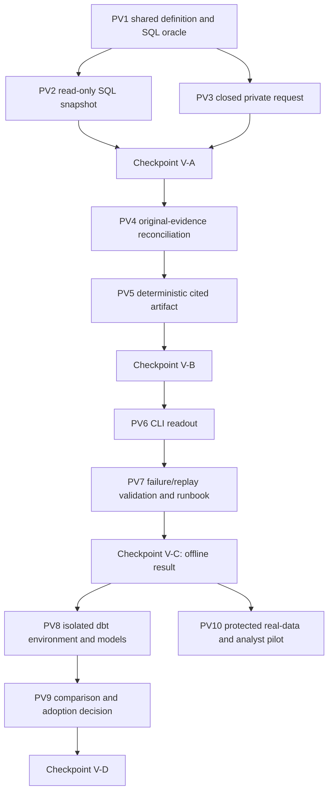

# Delivery plan

## Active V1-04: source boundaries for a second feed

Owner approved the [spec](../SPEC-source-boundaries.md) on 2026-11-19. S1-S4 are delivered (#154,
#155, #156, #157); S5 is gated. Dependency order, each a
separate review-ready PR with full gates and hosted exact-head jobs: S1 freeze the import graph
with a shrink-only baseline (no behavior change); S2 the neutral `SourceAdapter` protocol and a
`KimdisAdapter` wrapper; S3 move the page store, collector and replay onto the protocol with
KIMDIS as the default and a byte-for-byte regression; S4 two synthetic adapters of different
shape and one conformance suite for all three; S5 (gated, optional) a real small public dataset
only after the owner names it, its reuse terms are checked and a network host is allowed. Main
risks: touching the evidence path in S3 (mitigated by byte-for-byte equality and the unchanged
collector/projector access necessity tests) and the existing five-package import cycle, which is
recorded and not fixed here. No migration, dependency or CI change; no live source request.
Preserve all earlier tasks.

## Active V1-03 O3f: evidence TRUNCATE guards

Owner approved the [O3f spec](../SPEC-operating-controls.md#o3f-evidence-truncate-guards)
on 2026-11-19. One additive migration 0013 adds statement-level TRUNCATE guards to the
15 older evidence tables, reusing `nima.reject_mutation`. Order: tests that fail first
(guard, upgrade-from-12 preservation, history/checksums, audit with an empty
limitation list), then the migration and migration-list update, then contract, runbook
and status documents, then full gates, wheel, hosted exact-head jobs and one PR. Main
risk is an unseen TRUNCATE path; none exists in src/scripts/infra and the full suite
must stay green. Disposable databases only; the private pilot is never migrated here.
Preserve all earlier tasks. O3e-2 `collector` follows after this merges.

## Delivered V1-03 O3g: CI trigger scope and quality time budget

Owner merged #153 at `e2ab1a5` (exact `a73aadf`). `push` runs for main and dev only, and the
`quality` timeout is 20 minutes; evidence in
[O3g](../SPEC-operating-controls.md#o3g-ci-trigger-scope-and-quality-time-budget). A feature
branch without a pull request needs `workflow_dispatch`. Preserve all earlier tasks.

## Active V1-03 O3e: worker role profiles

Owner approved the [O3e spec](../SPEC-operating-controls.md#o3e-worker-role-profiles)
on 2026-11-19: per-duty profiles, sequence grants only when execution proves them
necessary, and the TRUNCATE-trigger migration as a separate later increment. O3e-1
adds the `projector` profile: sufficiency (real `drain` completes under exactly the
printed grants with evidence bytes unchanged) and necessity (removing any one
privilege makes it fail), plus the audit passing for that role. Then `collector` as
O3e-2 after review. Next separate increment: additive migration 0013 adding TRUNCATE
triggers to the 15 older evidence tables, with old-data preservation proof. No live
deployment, source call or grant execution. Preserve all earlier tasks.

## Previous V1-03 O3: runtime-role and evidence-protection audit

Owner approved the [O3 spec](../SPEC-operating-controls.md#o3-runtime-role-and-evidence-protection-audit)
on 2026-11-19: named access profiles, a print-only grant script and a restore-check
use. One packaged contract feeds both `access-audit` and `access-grants`.
Dependency order: O3a pure contract and assessment, then O3b grant renderer from
that contract, O3c real-role catalogue adapter, O3d CLI/runbook/mutation/wheel/
gates/hosted proof. Each slice is test-first and verified before the next. Main risk:
a profile ceiling guessed wider than the real SQL; mitigate by deriving only from
documented grants, and from executed worker SQL for ingest/projector. No migration,
dependency, CI edit, live connection or grant execution. Preserve all older work.

## Active V1-03 O2: selected-policy health

Owner-merged #147 is on main `6f706f1`, including exact reviewed `f230ea0` and
identical files. O1 is delivered. Follow [O2](../SPEC-operating-controls.md#o2-selected-refresh-policy-health):
typed pure attention rules; bounded single-snapshot SQL and real role/isolation/
cardinality proof; CLI/private artifact/operator guidance; guard mutation,
installed wheel, complete local gates/audit and exact-head hosted checks. Preserve
all prior work. No DDL, dependencies, CI edits, source/engine call or deployment.
Reassess the existing 100-point foundation rubric at merged #147 only; do not
credit candidate O2 code or invent an overall-v1.0 completion percentage.

## Active V1-03 O1: workflow stage diagnostics

Owner-merged #146 reaches main `476f9be`, including exact reviewed `ded3478`
and identical files. V1-02 current-profile code checkpoint is complete. Follow
[O1](../SPEC-operating-controls.md): bounded opt-in events and failing tests,
existing four-stage integration, real SQL/fixture failure and process proof,
private operator runbook, mutation/wheel/full gates/audit and exact-head hosted
results. No migrations, dependencies, CI changes or live operations. Preserve all
older pending tasks. O1 ends at a verified review-ready PR; remaining V1-03
operations acceptance is separate and must not be called complete.

## Active V1-02 R3: final workflow-recovery code checkpoint

Owner merged #145 at `3626314`, including exact reviewed `0bbdbf6` and identical
files. Follow [R3](../SPEC-refresh-recovery.md#r3-explicit-successor-authorization--final-code-checkpoint):
additive 0012/atomic paused-successor authorization, then bounded lineage/CLI and
expired-child fresh-observation proof, process failures, mutation/wheel/full gates
and final-head hosted results. Preserve all earlier tasks and original budgets/
evidence. No private migration or source activation. Explicitly announce checkpoint
completion at verified review-ready delivery; merge/live rollout remain distinct.
The next planned module after owner acceptance is V1-03, not another R4 expansion.

## Active V1-02 R2: audited policy retirement

Verify owner-merged #144 at `82ded43`, including exact `5e90a32` and identical
tree. Follow [R2](../SPEC-refresh-recovery.md#r2-permanent-audited-policy-retirement):
additive 0011/control decision API and shared policy lock; SQL/Python reservation
fences; snapshot inspection and SQL-only CLI; then process death, mutation, wheel,
full gates/audit and exact-head hosted evidence. Preserve all prior pending work.
Only disposable tests receive DDL. Retain gaps/budgets and separate engine pause
acknowledgement. Successor linking and explicit new-budget authorization stay later.

## Active V1-02 R1: bounded refresh-child recovery

Owner-merged #143 reaches main `435326a`, including exact `e29e1cd` and identical
files. Saved-intent/default/version handling already exists; retain and test it.
Follow [R1](../SPEC-refresh-recovery.md): pure budgets/source-lock reuse and atomic
dispatch reservation, then policy-scoped control/CLI, real SQL/process/engine
failure proof, mutation, installed wheel, full local gates/audit and exact-head
hosted checks. Preserve all earlier pending work. No live operation, migration,
dependency, CI edit or schedule. Expired-child terminal decisions and policy
supersession remain separately scoped; never reset identity, deadline or counters.

## Active V1-01 checkpoint VH1: journal health

Verify owner-merged #142 at `ef657aa`, including exact `2c9cbf6` source reachability.
Continue the [selected-artifact health contract](../SPEC-validation-history.md#vh1-selected-artifact-validation-health):
typed shared records/bounded SQL, pure freshness/current-policy rules, CLI and
operator documentation, then mutation/wheel/full gates and hosted evidence.
No new schema, dependency, source connection, validation attempt or private
deployment. Preserve all pending source, workflow, human-validation and retention
work. Existing health/readout/validation commands retain their semantics.

## Active V1-01 checkpoint: readout validation journal

Owner merged #139/#140 at `73f8aa4`; exact reviewed code/roadmap reachability is
verified. The owner requested continuation on 2026-11-19. Implement
[the bounded history contract](../SPEC-validation-history.md) in sequential H1–H5
slices: contract; policy/schema/journal; shared preparation; explicit verifier and
inspection; failure/recovery/full gates. Preserve all older pending work. Two
append-only journal tables are an explicit new schema proposal for PR review;
apply only to disposable tests, never automatically to the private pilot.
Post-publication verification preserves read-only publication and artifact bytes.

## Active checkpoint C10: historical contract comparison

Owner merged #138 at `9d29845`; exact `4716e4b` reachability/files are verified on
main. Continue [C10](../SPEC-data-contracts.md#checkpoint-c10-committed-historical-compatibility-gate).
C10a freezes the committed-catalogue/CI baseline rules. C10b builds a read-only
Git snapshot reader and identity comparison with real-history tests. C10c adds
CLI/CI baseline selection, including actual subprocess tests. C10d wires the
quality-only full-history checkout, environment-only provider SHAs and existing
just interface; preserve the other gates and jobs. C10e runs mutation, actual
repository comparison, full local gates/audit and final-head hosted proof before
owner review. No data/DB/model/dependency/source-activation changes. Keep all prior
pending work; durable check history remains a separately scoped increment.

## Active checkpoint C9: KIMDIS input and normalized contracts

Owner merged #137 at `9cd4c8a`; `2311539` and its exact files are verified on
main. Continue the [approved contract extension](../SPEC-data-contracts.md#checkpoint-c9-source-acceptance-and-normalized-kimdis-records).
C9a freezes this scope. C9b extracts neutral schema support, preserving C8 APIs
and assertions. C9c adds explicit opaque-array/present-nullable profile flags with
failure tests. C9d adds source-owned policies/two ODCS documents and cached offline
validators. C9e integrates both public normalizers and the unchanged storage
version alias, with real SQL/raw-retention and quarantine tests. C9f verifies
mutation, actual wheel/pilot replay/readout equality, full local gates/audit and
final-head hosted jobs before owner review. Each slice is tested before the next.

Keep all earlier tasks. No dependency/migration edit or live acquisition. The
measured CI exception in the spec changes only the quality-job budget to fifteen
minutes after two unchanged-head PR attempts hit ten minutes; no check is removed
or relaxed. Verify the isolated YAML change and new-head hosted jobs. Raw
acceptance permits malformed record items for existing quarantine. Bad producer
output instead stops the current page before SQL commit. Package policy loading
is cached, never arbitrary source content. Historical compatibility automation
and validation-history storage remain separately scoped follow-ups.

## Active checkpoint C8: first ODCS analytics contract

Owner continued the explicit data-contract proposal on 2026-11-18. Implement the
[bounded contract](../SPEC-data-contracts.md) through existing semantic/analytics
interfaces. #136 is merged on main at `772c321`; the subsequent authorized private
health activation passed permission/data preservation checks, with stale-capture
and low-capacity attention. This does not activate collection or schedules.

C8a: inspect/pin ODCS schema and license; record scope and retained pending tasks.
C8b: metadata/profile loader plus conservative compatibility tests, small direct
dependency declaration, no unrelated upgrades. C8c: gate actual readout publication
with the existing reconciliation unchanged; test real success/failure and byte
compatibility. C8d: mutation, wheel/offline proof, full gates/audit, review and
exact-head hosted checks; stop at owner review before deployment. No CI-policy,
schema, source-budget, schedule or live reader changes. Other dataset contracts,
automatic PR-baseline comparison and durable validation history remain later.

## Active checkpoint C6: selected-run DataOps health

Owner merged #135 into main at `0fb8734`; exact source reachability is verified.
Use spec/TDD/incremental delivery for one bounded read-only feature. C6a freezes
operator thresholds, selected-run scope and no-source/no-repair semantics. C6b
implements a pure policy and SQL aggregate snapshot with read-only restricted-role
tests. C6c adds no-follow capacity sampling, canonical private publication and CLI
with fixed structured stderr events; preserve all existing commands. C6d verifies
boundaries/privacy, a deliberate age-guard mutation, private clone proof, packaged
SQL, complete local gates/audit and exact-head CI before owner review.

No migration/dependency/CI edit or automatic pilot grant/deployment. Capacity is
an operator-selected filesystem sample, not archive verification. Five-second
per-statement SQL limits are explicit; this is not a whole-platform health SLA.
Full policy/child recovery diagnostics and ingestion-wide logging remain later.
Before verification, reclaim only inactive owned synthetic pytest artifacts after
checking controller liveness; keep source evidence/backups and human decisions.

## Completed checkpoint C5: source acceptance and readiness

Owner merged #132 to main at `6fbddc9`, then #133 into its feature base at
`122e7e8`. Owner then merged #134 at `ad62fb3`; command reachability from main
is now verified, with all promotion checks passing. Preserve existing app/tests/CI.

C5a verifies branch reachability and opens the content-identical promotion. C5b
assesses delivered/live/prepared source capabilities and records a stable,
explicit analytics-core readiness rubric. C5c captures and inspects the official
AADE catalogue, mapping and terms; freeze the five-column/release/reuse acceptance
boundary before selecting a parser. C5d validates docs/links, runs required full
gates/audit and exact-head hosted CI, then stops at owner review. No new app
feature or source schedule is activated by a documentation checkpoint.

Observed: both PDFs captured/hash-verified; 430/617 pages, two sampled text pages
each, first correspondence table visually checked. Complete extraction is not
validated. Transitional identifiers and reuse restrictions block automatic
assumptions, not independent DataOps work. Runtime KAD adoption stays pending
its explicit acceptance gates. Health/freshness and failure logging are the next
independent implementation candidate while that source acceptance is resolved.

## Active checkpoint C4: reviewed deployment and CPV references

Owner merged #131 at `7bdf5da` following #130. Prior final code `ec6402e` passes all
three jobs in run 44290911542; C3's combined local gate is 2,213/93.05% with clean
audit. Continue the same taxonomy roadmap without discarding human/model work.

C4a performs private deployment of reviewed 0009 only: fresh native source backup,
verified owned restore/migration, then migration of the unchanged pilot, narrow
existing-role grants, selected prior metadata promotion, retry/refusal/readout
checks and owned cleanup. No new source capture or schedule activation.
C4b inspects official CPV data/reuse terms, freezes source/format/hash/language and
matching semantics, then implements an offline bounded parser with adversarial
and real-release checks. Source data stays outside Git. Empty download responses
are rejected, not used as dictionaries. C4c adds private publication/matching and
CLI as thin slices, with reported metadata unchanged. C4d runs meaningful mutation,
full local gates/audit, package checks and exact-head hosted jobs before owner
review. Actual dictionary scope is frozen after inspecting the source bytes.

Observed C4 scope: OP-TED SDK 1.15.1, CPV 2008, explicit ell/eng, base-code
membership only. Real-release completeness checks cover 9,454 entries in both
languages. The whole batch passes 2,285 tests/93.27% and a clean audit; meaningful
duplicate-code/version-guard mutations are rejected and restored. Packaged reference and SQL commands reproduce the retained bytes. Exact-head
hosted jobs remain the final handoff gate. No company-source
request, model or human-certification claim is added.


## Completed checkpoint C3: SQL metadata serving

Owner merged #129 at `6051d41`; all three exact-head jobs pass on `0709027` in
PR run 44267217179 and branch run 44267160859. Continue the same metadata plan.
The C3 source contract separates SQL serving from C4 dictionary installation.
Official TED/AADE taxonomy versions are assessed now; no company-source request.

C3a (three files): extend contract/plan/tasks without discarding pending tasks.
C3b (export/tests): public canonical preparation; existing C2 bytes unchanged.
C3c (migration/registration/version expectations/schema tests): additive 0009,
immutable document store, source FKs and occurrence view. No live pilot DDL.
C3d (SQL store/query SQL/tests): explicit-hash atomic promotion and read-only
serving; public pure selection shared, SQL/Python parity, boundedness and exact
source/version/coverage semantics. Test roles, concurrency and actual SIGKILL.
C3e (SQL CLI/router/tests): fixed summaries and private publication through actual
commands. Preserve existing CLI forms. C3f (docs/progress): taxonomy source review,
mutation, private disposable-clone proof, full gates/audit and hosted CI; stop at
owner review. Keep all credentials/source evidence/operational proofs outside Git.

One JSONB snapshot per canonical hash avoids a second synchronized fact store.
An occurrence view serves the bounded snapshot using PostgreSQL's JSON operators;
no claim of national-scale performance or code-index latency. Snapshot selection
is explicit; source observation time never becomes processing time. Verify stored
canonical bytes at read time; archive integrity is promotion-time evidence only.
C4 will pin authoritative taxonomy releases/languages/hashes and match separately,
without silently converting KAD 2008 to KAD 2025 or inferring supplier sectors.

Delivery is split into a schema/preparation provider PR and a dependent serving
API/command PR. Schema mutation proves TRUNCATE refusal; private clone proof is
retained outside Git. The initial full run reached 2,188 passing tests and caught
two stale legacy head assumptions. Replace their literals with public schema
validation and a dynamically newer journal version; preserve checksum and unknown-
version refusal. Exact-head hosted gates and the final combined local gate are
required before the two-PR C3 handoff, not waived by focused results.

Final combined local `just check` passes 2,213 tests/93.05%; lint/types/build,
Bandit/secrets and `just audit` pass. The selected-hash mutation fails its
regression, as does schema TRUNCATE removal; both are restored. Actual SIGKILL,
concurrent same-selection retries under both isolation defaults, source leases,
SQL/pure-policy equivalence and CLI boundaries pass. The built wheel contains and
executes its packaged SQL resource. Keep native operational proof outside Git.
Exact-head hosted results for the schema and serving PRs remain the handoff gate.


## Completed checkpoint C2: structured market metadata

Owner merged #128 at `bd7fec4`; all three jobs pass on prior head `78c8fce` in
PR run 44258789845 and branch run 44258739500. C1 is owner-reviewed; pending human
pilot checks remain pending. Continue the same metadata plan, preserving old tasks.
See the C2 source contract. No new source request, migration, dependency or CI edit.

C2a (three files): contract/plan/tasks. C2b (extractor, source decoder, tests): pure
reported metadata assertions with distinct dimensions, status/path preservation,
Greek text and boundedness. Verify red then green; no normalizer output change.
C2c (replay, capture tests): public frozen verified capture API, used by replay and
metadata; retained replay bytes and read-only/relocated evidence behaviour verified.
C2d (export, CLI, dispatcher, integration tests): canonical private metadata
snapshots and exact dimension/code filters across KIMDIS and GEMI archives. No
cross-source joins or current-state metric. Full quality counts survive filtering.
C2e (docs/progress and validation): meaningful mutation, unchanged private pilot
source/readout/guards, complete local gates/audit, PR and exact-head hosted jobs.
Stop at owner review. Private operational details stay out of public delivery text.

Use existing SELECT-only replay scope, hash-verified no-follow recovery, strict
source decoders and GEMI verifier. Bound 32 pages/5,000 KIMDIS records, 10 GEMI
profiles/1,000 activities each and 10,000 assertions/report limit. Snapshot remains
committed-page occurrences, not a taxonomy catalogue or deduplicated company/spend
metric. CPV format is only syntax; KAD taxonomy/version validity remains unverified.
Observed: 46 new cases pass; existing replay/promotion regressions stay green.
The invalid-code filter mutation fails its regression and is restored. Full local
`just check` passes 2,182 tests/93.13%; strict types/lint/build/security/secrets pass;
`just audit` is clean. Hosted exact-head jobs and owner review remain the delivery
gate. Keep private operational proof outside public delivery text.

Next after C2: reviewed SQL metadata serving contract, then isolated Greek models.


## Completed checkpoint C1: pilot operations and saved intents

Owner requests auto-build through a checkpoint after merging #127 at `ef2b438`.
The corrected head `f2eb17b` passed all three jobs in PR run 44168550280 and push
run 44168539451. Use the [C1 contract](../SPEC-source-ingestion.md#checkpoint-c1-operational-replay-and-saved-intent-compatibility)
and continue the same DataOps plan. Existing PG17 cluster was restarted from its
retained data directory without initialization; maintenance began at migration 7
with no running collection or enabled refresh policy. Keep the HTTP guards intact.

C1a records this contract/plan/tasks (three files). C1b performs private verified
native backup/restore, applies reviewed migration 8, scopes promoter/reader grants,
promotes selected prior replays and records proof outside Git. C1c adds a pure v1
intent codec, request compatibility/inspection and tests (intent module, workflow
store, pipeline manifest and compatibility test module; four files). C1d handles
refresh compatibility,
status and control boundaries (refresh store, progress, control and the same test
module; four files). Execute sequentially, test first and keep existing interfaces
except additive diagnostics. No dependency, schema or CI change for this feature.

Checkpoint evidence: source rows/counters/old definitions/grants, originals and
readout preserved across maintenance except the new journal/processing objects;
recorded defaults survive changes; incompatible execution has no effects; historical
policy pause/inspection works; tampered/unknown formats fail; source allowance and
freshness are unchanged. Scope fixed v1 formats and ceilings, no silent upgrades.
Existing archive relocation/resume and explicit intent replacement stay separate.

C1e runs mutation, focused/complete local checks, audit and exact-head hosted jobs;
updates truthful status and publishes the reviewed batch. Owner review is the stop
at C1, not a reason to pause earlier routine implementation. No automatic merge,
source collection, schedule activation, human sign-off or runtime model adoption.
Observed locally: fresh native backup/restore and identical readout verified before
pilot migration 8. Scoped promoter CONNECT/SCRAM and metadata/derived grants work;
reader promotion and wrong-password authentication fail. All original source
rows except the journal, old definitions/counters/source grants, original bytes
and readout are preserved; selected replays are promoted and repeated idempotently.
No new source request or active schedule. Full maintenance proof/credentials stay
outside Git. The initial missing promoter CONNECT grant was corrected before
promotion; the disposable clone had inherited a more permissive database default.

Forty-three new compatibility cases and existing request/refresh regressions pass
(61 focused). Historical defaults/pins/hash are retained, unsafe execution is gated,
old policy pause remains available and manifests retain the recorded format.
Dropping the source-lease pin guard fails its regression; it is restored. Full
local `just check` passes 2,136 tests/93.07%; `just audit` is clean. The public
progress record distinguishes this candidate from the historical percentage rubric.
Hosted exact-head results and owner review accompany the delivery PR; do not label
local checks hosted CI or human validation.

Next after C1: explicit intent replacement if needed, then queryable buyer/CPV/KAD
metadata and isolated Greek model evaluation.

## CI correction for replay promotion

Owner reported PR #127 CI failure. Exact-head run 44163644708 passes quality and
source-worker egress but fails the Compose installed-module smoke check: it still
asserts seven migrations after 0008 was added. The application migration succeeds;
the hosted traceback points to that stale count. Continue the same authorized
promotion plan; do not alter the live pilot or any application/data contract.

Use the CI skill and reproduce the original embedded check in an owned disposable
Compose stack. Replace the version literal with public `validate_schema` on the
existing connection, checking current packaged history and checksums. Preserve the
three empty-ledger checks, UID, time zone, deployments, disabled schedules and all
quality/security gates. This strengthens the smoke contract and avoids another
hard-coded schema version. No permission, threshold, dependency or timeout change.

Files: `.github/workflows/ci.yml`, this plan, `tasks/todo.md` (three). Verify old
embedded check fails, corrected check passes on the same installed image, corrupt
history is rejected and only the owned Compose resources are removed. Run required
local checks/audit, push a fast-forward correction to the existing PR branch as
StamKavid, then inspect all three jobs at the new head. Hosted success is required
before reporting CI fixed; do not merge automatically.

Observed locally: the exact original embedded database block fails after applying
0008; the corrected block passes and rejects a deliberately wrong checksum at the
same migration row count. All empty-ledger assertions remain. The isolated image
build passed, but Compose startup hit the Docker daemon's disk limit while pulling
PostgreSQL. Only the owned stack/image were removed; the disposable native test
database was also removed. Do not call that a local Compose pass. Full local
quality/audit and the corrected exact-head hosted run are recorded with the PR.

## Current extension: explicit SQL replay promotion

Owner merged #126 at `ecb5a85`; all three exact-head jobs passed in run
44154596290. Continue the authorized SQL promotion follow-up under the
[source contract](../SPEC-source-ingestion.md#dataops-increment-explicit-sql-replay-promotion).
No source access/dependency/CI change. Keep human PV10, request/refresh version
policies and metadata/model work open. This is an extension of the same plan.

P1 records the contract/plan/tasks (three files). P2 adds migration 0008, its
registration and minimal latest-version regression expectations (five files,
including `tests/test_replay_promotion.py`). P3 exposes shared public preparation
and the existing run lease key, then implements bounded atomic SQL promotion
(replay, run storage, promotion module and its two test files; five files).
P4 adds the archive promote CLI and real CLI regressions (two files). P5 verifies a private migrated pilot clone, mutation/crash/concurrency,
full local gates and then delivery PR/hosted checks/owner review. Work sequentially.

Use `nima_processing` for immutable derived batches/results; retain the 26 existing
`nima` tables. The migration journal gains version 8; no original migration body
changes. Promotion uses the selected canonical hash, verified originals, a shared
source lease/recheck, and one explicitly READ COMMITTED write transaction. Only complete/quarantined captures;
explicit scope/hash/version, no implicit activation/freshness or default metric.
Processing and observation times remain separate. No source-table write grant is
needed by the promoter. New SQL ownership/grants are explicit operator concerns.

Verify migration upgrade, current NOLOGIN ownership, limited principal behaviour,
bulk insertion, retry/conflict, stale scope, quarantines/exact money, and real
process death at SQL commit boundaries. The private pilot proof runs in a clone;
keep the live pilot, original readout/evidence and all three HTTP guards unchanged.
The app has no database migration or source-fetch fallback during promotion.

Observed: 42 focused promotion cases pass, including upgrade/ownership, exact
money, immutable rows, limited roles, stale scope, conflict, concurrent retries
and actual SIGKILL before/after commit. Final review reproduced a repeatable-read
role-default failure; explicit READ COMMITTED fixes it and both default-isolation
cases pass. Removing the selected-hash guard fails its regression; it is restored.
The migrated private clone passes with unchanged source data/counters/readout,
explicit NOLOGIN ownership and limited promoter/reader controls. The original
pilot database, originals and HTTP guards remain unchanged. Native constraint
formatting was checked by the retained PostgreSQL reparse/boundary proof. No new
source requests. Final local `just check`: 2,093 cases/93.10%; `just audit`: clean.
The built wheel contains the final code/migration. Hosted checks and owner review
remain part of delivery; private proof stays outside Git.

After review, apply the pilot migration in a recorded maintenance step. Then
continue durable request/refresh version-policy handling, queryable buyer/CPV/KAD
metadata and isolated Greek model evaluation. SQL promotion does
not itself certify a metric, choose a new model or constitute human validation.

## Current extension: offline normalization replay

Owner merged #125 at `d98a971`; all three exact-head jobs passed in run
44146760312. Continue the approved replay/version work with the
[source-ingestion replay contract](../SPEC-source-ingestion.md#dataops-increment-offline-kimdis-normalization-replay).
Assume one local operator, PostgreSQL 17, existing private originals and no source
requests. Retain PV10 and all pending metadata/model/SQL-promotion work.

AR1 freezes the bounded replay contract (source spec and these task documents,
three files). AR2 implements the complete read-only SQL → verified originals →
explicit installed normalizer → private dataset path, plus CLI/tests (four files).
AR3 runs required gates, mutation and existing private pilot checks, then publishes
one reviewable PR. Execute sequentially; no delegation or new dependency/migration.
This is the same owner-authorized DataOps plan; continuation already authorizes
routine implementation within this scope.

Version boundary: source-run normalization identity is historical lineage, target
normalization is an explicit installed version. Do not compare historical identity
to current constants or pretend an unavailable normalizer exists. Replay creates
an independently versioned dataset with original observation times. It cannot
write evidence/projections or change metric results; SQL promotion and durable
request/refresh compatibility are later scoped work, not silently claimed fixed.

Use a closed read-only repeatable-read SQL snapshot, shared descriptor-safe blob
recovery and canonical private publication. Reject bad envelopes/metadata/bounds;
quarantine invalid records. Preserve prefix status, original source hash/pointer,
Greek text, Decimal money and duplicate occurrences. No pages is no dataset;
committed empty is a valid empty dataset. Test before implementation, then review
correctness, privacy, resource bounds and deterministic replay. Verify the private
pilot offline with unchanged data/originals/readout. No human task is fabricated.

Observed: 56 new replay cases plus 43 archive-verifier regressions pass, including
actual reader CLI execution, historical quarantine reprocessing, snapshot closure,
relocation and valid-JSON tamper rejection. Removing the shared raw hash guard
makes the tamper regression fail; the original guard is restored. The existing
private pilot replays identically to persisted normalized versions with unchanged
26-table contents/counters/schema, originals, source guards and reader report.
No source request was added. Full local `just check` passes 2,051 tests/93.06%;
`just audit` is clean. Hosted checks and owner review accompany the delivery PR;
local results do not establish either. Private evidence stays outside Git.

Next after review: SQL replay promotion/version-policy handling, then queryable
buyer/CPV/KAD metadata, followed by an isolated Greek model evaluation.

## Current extension: preserve PostgreSQL startup roles

The owner merged #124 at `cae6fe2` and requested continuation; all three exact-head
jobs passed in run 44127404558. Address its observed ownership defect before
archive replay and metadata projection. This is the same approved DataOps work;
retain earlier recovery evidence and pending human/model tasks below.

Contract: public `storage.connection.connect` must preserve libpq startup settings
from explicit DSNs, environment and service configuration, including an authorized
NOLOGIN role. Keyword overrides must not replace `options`. Authenticate using the
normal driver, then apply the fixed session statement/lock timeouts (30 s / 5 s)
in autocommit mode before returning the connection. Preserve the existing 5 s
connect timeout. Invalid/unauthorized startup roles fail; never fall back to the
login user. If timeout setup fails or is interrupted, close the actual connection
and propagate the original error. No new API argument or SQL migration is needed.

Sequence: reproduce wrong schema ownership with a real role-bound migration →
minimal connector fix → environment/service, limits, denied-role and cleanup
regressions → local gates/private pilot verification → PR/hosted checks/review.
Five files: connector, `tests/test_connection.py`, operator runbook, these two task
documents. Execute sequentially; no new source requests, dependency or CI changes.
The operator runbook records the living contract; the prior drill remains a
historical observation rather than being rewritten as though the bug never existed.

After synthetic real-PostgreSQL tests pass, repair only the private pilot's `nima`
schema and its project objects to the already-configured NOLOGIN owner. Require
the retained verified native backup, expected old owners, no running collection,
a migration advisory lock, one bounded DDL transaction and exact scoped identifiers.
Do not use cluster-wide REASSIGN OWNED. Record prior owners for rollback. Check all
26 table contents/counters and effective daily-role policies remain unchanged;
verify actual new owners, role-bound migration replay, archive integrity and
identical reader output. Never move original evidence or activate a source to
verify the repair. Existing deployments receive no automatic ownership rewrite.

Acceptance: real migration creates schema/relations/sequences/functions under the
requested role; native DSN/environment/service behavior and fixed timeout values
pass; invalid role and setup failure/interruption return no usable connection;
legacy no-option operations still pass. A mutation restoring the old options
keyword must fail the ownership regression. Run `just check`, `just audit`, then
all three exact-head hosted jobs. Private pilot data/proof stay outside Git.
Next: archive replay/version handling → structured metadata → Greek model evaluation.

Eleven new connection cases and five migration regressions now
pass; the old options override mutation is rejected. Full local gates pass
1,995 tests/93.04% with a clean advisory audit. The private pilot's explicit
ownership repair passes with unchanged 26-table data/counters, logical schema,
original files, daily capabilities and reader bytes. Local/hosted gates and owner
review accompany the increment; no source request or automatic reassignment of
other databases occurred.

## Current extension: isolated SQL-and-archive restore drill

The owner merged #123 at `3e35bc4`; all three exact-head jobs pass in run
44098176598, and the owner requested continuation. AV1–AV2 are reviewed. Continue
with the [operator restore contract](../docs/operations/backup-restore.md), using
native PostgreSQL 17 tooling and existing application checks rather than a new
backup framework. Keep unfinished PV10, replay and metadata work intact below.

Sequence: RD1 freeze the procedure and owned-resource bounds → RD2 perform the
private native dump/fresh-cluster restore, equivalence and negative checks → RD3
record redacted evidence and required local/hosted gates. At most five public
files: the operator runbook, `docs/verification/restore-drill.md`, these two task
documents and `CAPABILITIES.md`. No source records/hashes/counts, credentials or
private helper scripts enter Git. No application/dependency/migration/CI change.

Use a quiescent bounded pilot; export one read-only repeatable-read snapshot for
comparison and native dump. Pair it with original archives/request/readout and a
separately anchored manifest. Restore into a fresh owned cluster on a different
loopback port/data directory with SCRAM and recreated scoped roles. Compare all
application rows, sequences and schema definitions, validate migrations, run the
archive check and reproduce the report through relocated private bindings. Test
missing/corrupt destination evidence, dump failure and privileges without editing
the source. Stop only the owned destination and verify source health afterward.

Record exact versions and checks, including failures; no result is presumed. The
initial same-workspace checkpoint is not a native restore and does not substitute
for this drill. Fresh local cluster is not a new host, off-host retention or an
RPO/RTO measurement. Absolute-path workflow resume and external Prefect state are
outside scope. Actual production backup/role policy remains separate.

After RD review: refine archived normalizer replay/version handling, then the
structured metadata projection (buyer activity, CPV, reported KAD) before an
isolated Greek-data GLiNER extraction/classification evaluation. Model scores stay
separate from reported facts; no model is selected or installed by this drill.
The private metadata-enrichment proposal retains the owner's latest steering.

The native drill now passes on PostgreSQL 17.11: all 26
application tables/counters and schema checks agree, including a PostgreSQL CHECK
reparse proof, effective role policies and identical relocated readout bytes.
Actual missing/corrupt/incomplete-dump failures and owned cleanup pass. The source
remains unchanged. Source bootstrap ownership differs from its configured role;
record/refine that migration-role follow-up rather than assuming options took
effect. The [verification record](../docs/verification/restore-drill.md) distinguishes
this fresh local cluster from off-host or production recovery. Full local gates
pass 1,984 tests/93.03% and a clean advisory audit. Exact-head hosted checks and
owner review accompany the documentation PR.

## Current extension: DataOps archive integrity — owner-authorized

The owner merged #122 at `7cabec0`; its three exact-head jobs passed in run
44086900388. The owner then requested delegated validation, received a bounded
technical pass with commercial/user limits, and authorized the next batch on
2026-11-17. The private agent assessment does not count as human review; PV10 and
metric certification remain open. Continue the existing source-ingestion foundation
with the [committed-page verifier](../SPEC-source-ingestion.md#dataops-increment-committed-page-archive-verification).
This extends the same delivery plan without closing or replacing pending work.

Assumptions: one trusted operator, PostgreSQL 17, explicit existing local archives,
no additional source requests, and no inferred sector mapping. The source-contract
metadata supports distinguishing buyer function, CPV category and GEMI KAD activity;
a unified sector dimension is future scoped work.

Sequence: AV1 record contract/plan/tasks → AV2 implement and verify the complete
bounded command → owner review/merge. Execute sequentially, no delegation. AV1
changes the existing source spec and these two task documents (three files). AV2
adds `dataops/__init__.py`, `dataops/archive.py`, its tests and minimal root CLI
routing (four files). Each task stays below five files; the PR includes both tasks.
The owner's current instruction authorizes this bounded implementation; no new
approval is needed for routine implementation choices within it.

The command freezes a read-only SQL metadata snapshot, closes SQL, then reuses the
existing public bounded archive-recovery API. Tests must distinguish zero pages
from a committed empty page, partial collection from integrity success, and frozen
metadata from later commits. Reuse public database/schema/filesystem APIs; no
private cross-imports, generic framework or layer-cycle refactor.

Risks: unsafe/missing originals fail without repair; changed body length/hash
fails; a large run fails before reading any body; CLI errors hide private values;
a partial run never becomes full coverage. The operation checks committed pages
only, not unindexed attempts or every database object. Reader privilege auditing,
full restore/replay and source-currentness remain separate scopes.

Verification: failing focused tests before implementation; actual limited-role
SQL/private-file tests, count/hash checks, mutation rejection, `just check`,
`just audit`, then all three exact-head hosted jobs. Exercise the finished command
on the existing private pilot without fetching sources; publish no source-derived
counts, identifiers or evidence hashes in the public PR. No migrations/dependency/
CI changes. AV2 now passes 43 focused cases and full local gates (1,984 tests,
93.03% combined coverage, clean audit). The existing private pilot verifies at its
original and relocated locations, with all 26 tables/files unchanged and no source
requests. A same-length corrupt-body test rejects the removed-hash-check mutation;
the shared helper is restored unchanged. Exact-head hosted checks and owner review
remain PR gates. Future increments: verified SQL-plus-archive restore, then explicit
normalizer-version replay, each with its own refined contract and tests.

## Current: first readout and pipeline validation — approved implementation plan

The owner approved the capability map through #108 at `9ff2eff`, reviewed the
subsequent conceptual quality/deduplication architecture and requested continuation
on 2026-11-16. The [semantic provider](../SPEC-semantic-layer.md) and
[analytics consumer](../SPEC-market-analytics.md) scopes are approved through
owner-merged #109 at `70e06d6`; all three exact-head jobs on `eb34535` passed in
run 43838968903. The owner approved this plan and merged #110 at `c964f4f` on
2026-11-16; its exact-head CI passed in run 43857399789. The owner reviewed/merged
PV1–PV3 and requested continuation, completing checkpoint V-A. Their exact-head
runs 43860790888, 43864276361 and 43867499092 each passed all three jobs.
The stacked merges put PV1 on main (`98b73fc`), PV2 on its feature base (`f5887e8`)
and PV3 on the next feature base (`7438923`). Integration PR #114 promotes their
already-reviewed combined tree to main; no new implementation is hidden in it.
PV4–PV5 proceed from that combined state, and new PRs target main explicitly.
The owner merged #114/#115/#116 into main, ending at `7b6397e`, and requested
continuation on 2026-11-17. All three exact-head jobs passed for PV4 in run
43912312467 and PV5 in run 43922239422, completing checkpoint V-B. PV6–PV7 now
deliver the CLI and operational proof. The owner merged #117/#118 into main at
`3dca868` and requested continuation on 2026-11-17, completing V-C. All three
exact-head jobs passed in runs 44038279239 and 44040022546. PV8–PV9 execute the
isolated candidate and comparison. The owner merged #119/#120 at `3cd4f77` and
requested continuation on 2026-11-17; all three exact-head jobs for PV9 passed in
run 44053781048, completing V-D review. Retain packaged SQL and Prefect; dbt stays
isolated as recorded in the [report](../docs/verification/pipeline-dbt.md).
The owner merged readiness #121 at `7c46d31` and explicitly requested configuration
and next steps; its three exact-head jobs passed in run 44081199621. Under that
authorization the bounded KIMDIS proposal was executed: private database/roles,
originals, request, nonempty readout, identical offline replay and automated
direct-source checks are complete. The attempt allowance is exhausted; no schedule
or paused egress work was activated. PV10's [record](../docs/verification/market-readout.md)
keeps source-derived results private and human review/task observation pending.
New PRs continue to target main explicitly.

Deliver one private evidence-linked supplier–buyer count, then compare the same
known-answer data through a bounded isolated dbt project. The accepted direction
and experiment contract are in [pipeline quality validation](../docs/pipeline-quality-validation.md).
The source stages, reported-only identity, revision/cancellation rules and resource
bounds remain those of the module scopes. Offline implementation/replay needs no
GEMI key or source request. The separately authorized real capture is recorded above.

### Boundaries and dependency order



Execute sequentially without delegation. Review each checkpoint before the next
batch. Each task changes at most five files and includes red→green tests plus the
required `just check`/`just audit` gates. Preserve all current CI jobs and ≥90%
combined coverage. Readout delivery does not depend on adopting dbt; the isolated
comparison follows the verified reference. PV10 can proceed after V-C when inputs
exist; it must not wait on a tool-adoption decision.

### Component contracts

**Provider and reference SQL.** Keep frozen policy/definition types in
`nima.semantics`; no database, graph, Prefect or consumer imports. One versioned
SQL calculation selects revisions before supplier filtering, handles tied
versions explicitly and counts distinct source IDs. Its definition hash binds
the rules and calculation. Hand-labelled expected record sets and the pure
policy independently check SQL, not merely another execution of the same query.
Package the SQL with the wheel and test installed resource access.

**Read adapter.** Add a narrowly public connection/schema-validation interface,
retaining legacy `_connect` behavior for existing callers. Do not move every
storage module or alter migrations. The new adapter checks supported migration
history and SELECT-only role privileges inside one read-only repeatable-read UTC
transaction, including inherited/column write privileges and schema CREATE.
Reject owners/superusers. Preflight row and serialized-byte bounds, validate all
selected run pages/versions/receipts/facts/mentions, compute SQL results and freeze
the exact tuples. Close the connection before filesystem operations.

**Evidence and result.** Decode the closed ≤16 KiB request using existing private
file reads; explicit archive bindings authorize reads. Recover every selected
page, including empty pages, through public `graph.pilot_archive` interfaces.
Re-normalize originals and re-derive projections, comparing every record and
ordinal with the frozen SQL facts. Use public normalizer/projection APIs, not
private cross-imports. A fixed failure publishes no result. Reuse canonical
private no-clobber publication with the consumer's tighter 1 MiB limit. Sort
stable semantic inputs; omit local archive paths, driver context and wall time.

**Operational proof.** The artifact is the bounded input/check manifest; there
is no new durable release table. Quality results distinguish invalid evidence
from legitimate unknown values and all five consumer outcomes. Persisted
normalizer replay, blocked refresh recovery, historical correction sweeps,
backup/restore, broad roles and deployed monitoring remain separate work. Running
the current parser on originals proves reconciliation, not those capabilities.

### SQL/dbt experiment and release decision

Execution preserves five-file increments: PV8 prerequisites, PV9 core models, then
a separate five-file evidence/status record (this plan, tasks, capability map,
validation contract and experiment report). This records the already-required
comparison without expanding application scope or skipping V-D review.

PV8–PV9 use only synthetic inputs and a separately named disposable PostgreSQL 17
database. Candidate direct pins are `dbt-core==1.11.17` and
`dbt-postgres==1.11.0` (PyPI metadata/license declarations checked 2026-11-16).
Resolution, license/advisory review, local connection and the synthetic comparison
now pass for the isolated environment; the experiment report records their limits.
Use a separate lock/environment under `experiments/pipeline_dbt/`; no changes to
application dependencies, runtime images, CI, source schedules or real archives.
Disable optional telemetry and review external runtime behavior before execution.
Package downloads are setup; actual model tests use the local database only.

The minimal project has observations, selected revisions and counts with explicit
input selection. Declare identifier/source-key seed types as text to preserve
leading zeroes; uniqueness tests respect observation/version grains. Compare full
eligible-record/evidence sets, cancellation totals, diagnostics and introduced-defect
behavior with the hand-labelled/reference path.
dbt model lineage is supplementary; keep record-to-original attribution. Report
exact versions, resolved lock hash, SQL/artifact hashes, setup effort, build/query
times and observed diagnostic value. Do not treat tiny-fixture timings as scale
evidence. License/security/compatibility failure stops this candidate. Adopt only
after V-D review; production dependency changes need a separate reviewed change.

### Risks, verification and completion

| Risk | Mitigation / acceptance |
|---|---|
| Revisions counted after supplier filtering | Later-removal/tied-version tests and exact contributing-ID oracle |
| Receipt presence hides bad facts | Re-derive all facts/ordinals from verified originals |
| Live writes change a multi-step analysis | Freeze exact tuples in one transaction; experiment uses the same sealed export |
| Empty capture confused with absence | Five explicit consumer outcomes, including unresolved selection |
| New adapter repeats boundary problems | Public DB entry points; provider import-direction test; no generic rewrite |
| dbt becomes a prerequisite or leaks data | Deliver reference first; isolated synthetic DB/lock, private artifacts, no cloud account |
| Metadata licenses or compatibility mistaken for proof | Inspect resolved distributions, audit and exercise actual PostgreSQL 17 before comparison |
| Data/analyst unavailable | Keep PV10 visibly blocked; do not label synthetic results product validation |

Normal focused tests are specified per task. Full local gates are `just check`
and `just audit`, followed by all three exact-head hosted jobs. A local result is
not hosted CI evidence. No further live collection, merge, deployment or external
contact is implicit. Before shared/live operation, complete the separately scoped
reliability controls retained in the backlog.

Success at V-C is an installed read-only command producing the known answer with
all evidence/quality rules, replay and interruption checks. V-D records a measured
dbt decision, including an honest stop/no-adoption outcome. PV10 establishes
real-data/task evidence only when performed. No new completion percentage follows
from this plan.

New RP3–RP9 work remains paused; existing code, pins, tests and old PE2–PE3 work
stay intact below. #106/#107 completed offline R-A; no deployed egress is verified.

## Paused: accepted acquisition stack and remote egress implementation plan

The owner accepted [ADR-0004](../docs/decisions/0004-bounded-http-and-browser-acquisition.md)
and reported merging #104 on 2026-11-16. GitHub confirms scope merge `f894800`
and all three exact-head checks on `b29eefe` passed in run 43810311235. The
[remote scope](../docs/sources/remote-worker-egress-pilot.md) is approved. This
implementation plan was owner-approved in a later turn after #105 merged at
`0536808`. RP1–RP2 are authorized; later checkpoints remain. The first slice
implements offline configuration loading, not the proposed prepare/verify CLI.
RP1 is owner-merged in #106 at `2e189f3`, with 110 focused cases and passing local
gates (1,683 tests/92.62%) and all three hosted jobs passing. RP2 is also
owner-merged with all three hosted jobs passing; the later instruction pauses
new work after the completed offline R-A checkpoint. RP2 implements immutable private bundles through Python helpers, still
without prepare/verify commands or runtime execution. Bundle reads require the
manifest hash independently retained from preparation; consistent member/manifest
rewrites cannot silently acquire the original identity. RP2 has 38 new cases,
148 combined cases and passing local gates (1,721 tests/92.69%, clean audit).
The local and hosted gates plus owner merges complete offline R-A. Credential
references are metadata-checked regular single-link files of
1–16 KiB; their contents are never read by configuration loading. The [benchmark](../docs/research/acquisition-library-comparison.md)
selects HTTPX/Playwright with Prefect above bounded adapters; it proves no remote
or Publicity behavior. PostgreSQL/private originals remain the storage baseline.

### Deliverable and dependency order

Prepare a private configuration bundle without network access, then provide an
operator-run controlled-endpoint verifier on the declared remote host. Implement
small sequential PRs: RP1 configuration → RP2 bundle → checkpoint R-A → RP3
observer protocol → RP4 remote policy → checkpoint R-B → RP5 owned runtime → RP6
independent cleanup → checkpoint R-C → RP7 case/receipt reconciliation → RP8
commands/rehearsal → checkpoint R-D → RP9 actual remote experiment. Each checkpoint
requires human review before the next pair. Plan approval permits the listed
implementation work; purchasing/provisioning, source activation and CI/dependency
changes are not implicit. Keep already-authorized PE2–PE3 below available, without
deleting or marking them complete. Execute sequentially, without delegation.

### Closed configuration and artifact contracts

RP1 freezes exact nested fields/types and tests in `remote_config.py`, using a
closed `version=remote-worker-config-v1` JSON object with these required groups:

| Group | Required fields and validation |
|---|---|
| `host` | `label` (1–64 ASCII letters/digits/hyphens) and `expected_gateway_ipv4` (one public IPv4); declared context, never host attestation |
| `probes` | Exactly three unique `role`/`hostname` objects: `allowed`, `invalid_tls`, `denied`; canonical ASCII DNS hostnames, HTTPS port 443, no URL/path/credentials/IP literals/wildcards; explicit operator-controlled approval required |
| `observer` | `authority` (one separate controlled HTTPS authority on 443) and `credential_file` (owner-only absolute path); fixed nonce-bound read/control paths; unavailable to the worker |
| `paths` | Absolute private `state_dir`, `gateway_credentials_file` (bounded path strings); outside Git, no symlinks/unsafe ancestors; actual credentials never enter receipts or terminal output |
| `network` | `front_subnet`, `back_subnet` (nonoverlapping private IPv4 subnet strings); exact addresses/ownership validated against this host before mutation; overlap with existing routes/networks fails |
| `runtime` | `pins_sha256`, `gateway_image_id`, `helper_image_id`, `worker_image_id` (exact reviewed hashes); existing package/browser/seccomp pins retained; no mutable tag or implicit pull/build |
| `limits` | Exact integer fields `max_cases`, `run_seconds`, `cleanup_seconds`, `attempt_seconds`, `response_bytes`, `receipt_bytes`; positive bounded values, cleanup reserve at least 60 seconds, tighter values may fail but never weaken a required case set |

No optional arbitrary executable/argv, compose file, shell, proxy-rotation list,
source URL or source credential is accepted. Reject duplicate JSON keys at every
level, unknown/missing keys, booleans as integers, nonfinite numbers, oversized
strings and placeholders. Limit configuration to 16 KiB; path strings to 4,096 characters. Require cleanup reserve
less than run duration; configured limits never raise the scope ceilings. Probe addresses are
resolved only during verification, at most eight public IPv4 answers per host;
reject empty/mixed-private answers and pin the exact approved set for that run.
A changed set requires a new validated policy, never a wider allowlist. The
observer control authority is separate from the worker's probe destination set.
DNS validation cannot establish operator ownership; that remains a recorded
human prerequisite. Known GEMI/Publicity destinations cannot be substituted.

RP2 publishes a canonical `remote-worker-bundle-v1` manifest plus bounded reviewed
configuration/policy-template material, total at most 1 MiB, to 0700/0600 paths.
It contains references to private credential files, not credential bytes. Reuse
`evidence.artifacts` no-follow reads and canonical no-clobber publication; never
initialize company archives. Pin each object's bytes/hash and reject changed,
conflicting, extra or missing objects on read. An unchanged bundle can be reused;
a new observation requires a fresh run ID. A bundle carries no verified flag.

RP7 defines a separate `remote-worker-verification-v1` receipt with
`scope=controlled-remote-endpoints`. Required fields bind configuration/bundle,
policy, actual image IDs, host/namespace/process observations, fresh run nonce,
UTC times, all named case/control results and verified owned cleanup. Declared
and observed context remain separate. `boundary_verified` can be true only for
one complete actual controlled remote run. `publicity_egress_verified`,
`company_origin_verified` and `production_ready` are always false; no identity or
anonymity assertion exists. Local rehearsal uses a distinct test-only scope and
cannot decode as remote success. Missing evidence, zero/partial case sets,
interruption, exceeded bounds or incomplete cleanup cannot produce success.

### Reuse and isolation

Reuse private filesystem/canonical publication, bounded structured subprocess
capture, sandbox/process checks and existing packet/case concepts where their
contracts fit. Existing `FixturePolicy`, `FixtureStack`, fixture target/observer
formats and receipt decoders are intentionally fixture-only. Do not subclass them
into a live mode, change globals or relax `external_networks=False` to make a
remote profile pass. New modules own remote policy, lifecycle and receipts.
Any small shared primitive extraction must preserve all fixture behavior and
be reviewed explicitly rather than bundled into a large refactor.

The controller alone reads observer/gateway credentials and owns Docker control.
The worker receives neither observer access nor Docker/SQL/host namespace access.
Only the gateway has the permitted external path. Namespace setup helpers have
scoped temporary privilege; workload capabilities stay dropped, root read-only,
TLS normal, browser sandbox enabled and IPv6 observed disabled. No host-wide rule
flush, privileged workload, production network change or arbitrary metadata probe.
Use identified run-owned local canaries for host/metadata/packet negative tests.
Observer evidence is authenticated, bounded and nonce-bound; a timeout or client
send is never proof of zero delivery. Keep upstream environment proxy/CA policy.

RP4 must review runtime pins/remote asset differences before RP5 uses them. Existing
fixture pins are research inputs for controlled endpoints, not approval for
untrusted Publicity pages. No new scraping library, vector store or model is
needed. RP8 documents image acquisition as an explicit separate operator action;
`verify` never performs it. An unavailable host/image/control ends with a fixed
failure before browser/source work, not an alternative route.

### Case coverage, cleanup and verification

Maintain a closed named matrix derived from the scope, at most 30 cases, one
attempt each: allowed HTTP and browser HTML/script/image/XHR/fetch with observed
expected public IPv4/clean headers; direct IPv4, removed proxy, bypass, controlled
host/metadata/DNS/UDP/QUIC/STUN attempts; observed disabled IPv6; absent/invalid
proxy auth; actual gateway outage/restart; invalid TLS; redirects outside policy;
missing capability, deadline/interruption and supervisor cleanup. Every negative
case requires working independent positive controls, zero forbidden deliveries
and the appropriate packet/gateway evidence. Bind every observation to this run,
namespace, image set and policy. Never stitch observations across profiles.

Preserve the 600-second total ceiling, including at least 60 seconds reserved for
cleanup, 15-second attempt limit, 1 MiB response cap and 64 KiB receipt cap. RP6's
independent supervisor pins the controller/process identity and resource labels,
handles controller SIGKILL, cleans only exact run-owned objects and verifies
unrelated networks/data survive. Missing supervisor or unverified cleanup blocks
verification. Power loss/kernel compromise/malicious administrator remain outside
this guarantee; an interrupted receipt is never upgraded on retry.

RP1–RP2 use real private filesystem tests and forbidden-network/Docker sentinels;
RP3 tests authenticated nonce-bound responses, malformed/oversized/replayed bodies
and redaction; RP4 tests address/policy compilation and fixed destination bindings;
RP5–RP6 use controlled Docker/process cases with actual namespace ownership and
termination; RP7 requires independent expected cases, corruption/partial/fixture
receipt rejection; RP8 exercises the module CLI and full local rehearsal plus
one material policy-bypass mutation that fails before exact restoration.

Each slice runs its focused tests, `just check`, `just audit`, prose/link review,
and correctness/readability/architecture/security/performance review. Preserve
≥90% combined coverage and all existing tests. Every PR needs the three exact-head
hosted jobs; existing fixture success is only a regression check. Any new remote
integration invocation/CI privilege needs a separate explicit reviewed change;
local integration evidence must say whether it ran, rather than inheriting a
fixture job's result. No CI/constraint/dependency change is proposed here.

### Handoff and blocked inputs

RP8 implements only the scope's module-level `prepare`/`verify` commands, with
fixed redacted `remote_` failures and exits 0/1/2/130, no root CLI change or
schedule. Its runbook includes explicit prerequisites, the separate fixture versus
remote proof, privacy/secret handling, exact owned cleanup and a private
backup/restore check. The local kit can be reviewed without an actual host.

RP9 needs operator-owned host/access, stable public egress, approved independent
probe/observer endpoints and credentials, reviewed available images and backup
destination. These are missing. Actual remote acceptance stays blocked even when
the offline kit passes; the owner runs the prepared commands on that host.
Government-source traffic, billing/provisioning, company extraction/import and
production scheduling remain outside this plan. Publicity source-contract work
follows this boundary; API access is not needed for RP1–RP8 development.

## Preserved: evidence recovery and Publicity-first source priority

The owner approved [scope #98](../docs/graph/company-evidence-pilot.md) in a later
turn and merged it at `aef9f53`. The owner approved plan #99 and merged it at
`36bcb80`; PE1–PE3 are authorized. The latest instruction prioritizes Publicity
acquisition development, with the official API secondary while its key is pending.
METLEN remains the preferred candidate; exact entity identifiers, usable private
archives, selection window and accountable reviewer are not confirmed. Scope
approval supplies none of those inputs and authorizes no live acquisition.

### Owner steering: keep development independent of the API key

Use the [Publicity-first acquisition design](../docs/sources/gemi-publicity-fallback.md).
PE1 #103 is owner-merged at `b3ee7eb`, with all three exact-head hosted checks
passing. No remote worker/gateway exists yet. The owner merged the
[operator-run remote egress scope](../docs/sources/remote-worker-egress-pilot.md)
in #104; its approved implementation plan is above. Then develop the
protected Publicity capture/source contract, while the
remaining offline PE2–PE3 work remains available without API access. The owner also
requested self-hosted storage/retrieval research: PostgreSQL plus private original
files remains the baseline; pgvector/Qdrant/OpenSearch/Milvus/MongoDB are compared
in that design, with no new store adopted.

Manual intake and controlled browser fixtures are implemented; the live collector,
field extractor and channel-specific SQL/graph bridge are not. Current manual
captures do not replace complete API-profile imports in the approved graph reader.
Define that bridge separately rather than relabeling captures or weakening the
existing graph's evidence checks. Source-family cooldowns and fail-closed egress
remain; there is no automatic channel/IP switch after a block. Preserve existing
PE tasks and historical work. This owner-directed reprioritization splits PE1
from the earlier proposed combined PE1–PE3 batch; it does not claim checkpoint A.

### Outcome and dependency order

Build small internal offline helpers to recover referenced archive bytes and
reconcile them with one validated graph snapshot. Then run a private, nonempty
real-company audit with explicit human identity/context review. Mechanical checks
cannot declare a company identity verified or certify source truth.

PE1 bounded recovery → PE2 source reconciliation → PE3 integrated synthetic rehearsal
and operator recipe → checkpoint A (technical review) → PE4 real input gate →
checkpoint B (cohort ready) → PE5 real audit → PE6 measured handoff → checkpoint C.
PE1–PE3 can be built without a GEMI key or company data. PE4–PE6 remain input-gated.
Execute sequentially without delegation; preserve all earlier incomplete work.

PE1–PE3 target one focused implementation PR with five files in total: two internal
modules, their two test files and one runbook. Verify/commit each task separately,
then obtain checkpoint A review after the three tasks. Split an oversized candidate
into smaller reviewed PRs rather than expanding its scope or weakening checks.
PE4–PE5 generate private case files, not source-data commits. PE6 records only
reviewed non-sensitive measurements. No automatic merge or deployment.

### Architecture and trust boundaries

**Use the existing authoritative inputs.** Reuse strict comparison loading and
`graph.snapshot.read_snapshot` for a single read-only repeatable-read UTC snapshot.
Call `build_graph` once for the pinned graph and reuse the canonical encoder/private
publisher. Pin the comparison, embedded resolution and graph hashes from that same
read. Close SQL before archive recovery. A later review creates a separate artifact;
never compare a pinned audit with a subsequently changing review head. Do not add
SQL reads, imports, schema changes, migrations or shared normalization refactors.

**Recover only explicit references.** `src/nima/graph/pilot_archive.py` owns small
typed reference/result/limit definitions and bounded recovery. Operators supply an
explicit source/run/import-to-archive-root mapping; SQL paths and source strings
cannot select arbitrary files. Validate collector markers and digest-derived object
names. Reuse `nima.evidence.artifacts.directory`, `child_directory` and `read` with
creation disabled, private ownership/modes, descriptor-relative no-follow traversal,
regular-file checks and changed-file detection. Do not call the collector `Archive`
constructor: it initializes directories and changes permissions. Close descriptors
on every outcome. Hash-check actual bytes; missing/corrupt/unsafe evidence is a
recorded failure or fixed-code error, never a silent skip or automatic repair.
These primitives do not validate the separate Publicity manual-bundle format as a
GEMI profile; no capture-to-profile conversion is included.

**Reconcile with existing source semantics.** `src/nima/graph/pilot_checks.py` owns
evaluation-specific typed rows/results and reconciliation. It consumes a validated
typed snapshot, its deterministically rebuilt graph and recovered bytes; it does
not add a second general graph/report decoder. Enumerate every active `reviewed_as`
edge in the complete graph, including outside focus. Recover the procurement
occurrence, selected buyer context, accepted registry candidate and creating anchor
evidence; candidate and anchor may come from different imports. Bind exact subject,
contract-version, role/ordinal, event and current-revision keys. Recover candidate
references from the validated recorded-event provenance, including older imports.

Use `normalize_page`/`normalize_contract`, `normalize_profile` and `project_contract`
to check record hashes, existing record/field pointers and claimed values. Preserve
the normalizers' exact Decimal/text/null semantics; do not invent new identity or
date rules. Check contract source dates against raw bytes. Observation/review times
belong to pinned SQL/receipt context, not the response body; state that trust limit.
Do not claim whole-archive/issuer authentication or independent observation-time
corroboration from a body hash. Recovered profile values absent from stored selected
field context remain explicit human checks, not fabricated machine comparisons.

**Keep assessment separate from verification mechanics.** Helper output records
per-check recovered/missing/mismatch/unknown/not-applicable rows, exact keys/locators,
private expected/observed values and checked/required counts. It never emits
`verified_selected_cohort`. Human review records identity rationale, conflicts,
reviewer/self-review, required checks and the final scope-defined outcome in the
private assessment. Required identity/provenance checks cannot be waived as unknown;
source-consistent unknown money/dates remain unknown. Empty denominators cannot pass.
Retain graph assurance fields and `automatic_identity_links=0` unchanged.

Use existing Python 3.12/uv/just/PostgreSQL 17 dependencies. These are internal
evaluation helpers exercised by tests and a documented local Python recipe;
there is no new root CLI route, service endpoint or general evaluator API.
The scope's permission for small evaluation tooling is implemented only after this
plan is approved. New public interfaces need separate scope review.

### Finite evaluation bounds

Keep existing graph/report/SQL bounds unchanged. Add evaluation ceilings: 1–10
contract versions, 32 distinct raw object locations, 8 MiB per raw object, 64 MiB
cumulative raw bytes, 5,000 check rows and 32 MiB canonical output. Source codecs'
smaller limits still apply. Count each distinct root/digest read once; preserve all
reference aliases. Preflight reference counts and safe file sizes; enforce remaining
bytes during reads. Reject bool/negative/non-integer limits and overflow before
further work. No truncation or unbounded directory scans. Keep source bodies out of
results; discard cached bytes after reconciliation. Human notes retain the existing
4 KiB rationale ceiling. Any over-budget case fails closed and requires a smaller,
newly declared cohort, not silently dropped evidence.

Private case files use 0700 directories/0600 files outside Git. Reuse existing
canonical no-clobber publication for generated records; private local paths belong
only in the inventory, not reproducible assessment identity or terminal diagnostics.
No new manifest reader/wire format is needed: the runbook defines the private
selection/inventory/matrix records and shows their construction with existing
helpers. All original records, Greek text, conflicts and unknowns are preserved.

### Verification and checkpoints

PE1 tests unsafe paths/modes, symlinks, non-regular/changed files, hash mismatch,
missing objects and exact byte/count limits. PE2 tests independently expected keys,
wrong pointers/identity/role/version, exact money/dates, unknowns, repeated observations,
joint suppliers, older candidate/anchor imports, revoked links and outside-focus
active links. Tests distinguish mechanical source agreement from human adjudication.

PE3 uses real disposable PostgreSQL plus clearly synthetic collector-layout files.
Prove no HTTP/key lookup, SQL closure before file reads, unchanged all 26 relations,
unchanged archive bytes/modes/mtimes, graph-hash equality with existing graph behavior
and reproducible no-clobber assessment publication. Missing/tampered evidence and
zero active links must block success. A material hash-check/active-link mutation
must fail its regression before exact restoration. Run focused tests, `just check`,
`just audit` and all three exact-head hosted jobs; retain ≥90% combined coverage.
Record local prerequisites honestly; hosted worker fixtures do not prove live IP
protection. Documentation-only work gets link/prose checks, not mirrored new tests.

Checkpoint A requires technical review/merge and all required checks. Checkpoint B
requires confirmed entity/archives/reviewer, the frozen selection and nonempty target
participation/buyer context. Existing explicit import/review preparation, if needed,
finishes before the audit baseline; never manufacture acceptance to meet a target.
The audit itself is read-only. Checkpoint C requires reviewed findings/outcome and
safe handoff; a blocked/failed audit remains incomplete against real-pilot success.

### Risks and unresolved inputs

| Risk | Mitigation / stop condition |
|---|---|
| Key or real archives unavailable | Build/rehearse PE1–PE3; mark PE4 blocked, with no fixture-based real-company claim |
| METLEN brand spans multiple legal entities | Require one officially supported exact identity and record exclusions before selection |
| Hashes/SQL consistency mistaken for identity truth | Human adjudication and contradictions remain mandatory; scope-limited outcome |
| Older acceptance and anchor differ | Recover both exact imports and all complete active-edge references |
| Mutable files or later review contaminate the audit | Stable descriptor reads and one hash-pinned snapshot; new assessment for later revisions |
| Output leaks other selected parties or review notes | Focus retains full selection; keep all evidence/matrix private and review any redacted summary |
| Evaluation grows into a second product interface | Two bounded internal modules; reuse codecs/storage, scope new APIs separately |

The outstanding inputs are the exact legal entity/GEMI/AFM identifiers, private
archive/database/comparison locations, selection window and accountable reviewer.
The GEMI key, if received, stays in environment settings; acquisition/egress needs
its own authorization. Formal investigator usability/timing, UI, graph stores,
broader sources, analytics/ML and cited AI follow separate gates. Progress stays
approximately 33%: a plan, rehearsal or documentation adds no capability credit.


The completed delivery sections below preserve their historical status wording;
the active scope and approval status are recorded above.

## Completed: bounded investigation graph — technical delivery

Status: **G1–G7 owner-merged through checkpoint D**, 2026-11-15, main `686875d`.
Scope #87 and implementation plan #90 were approved. The private JSON graph,
optional selected-history focus, operator CLI and measured runbook are delivered.
G6 #96 and G7 #97 both pass all three exact-head hosted checks and are owner-merged.
The [next evidence-recovery scope](../docs/graph/company-evidence-pilot.md) is a
proposal awaiting approval; no new pilot implementation plan is approved here.
Execute sequentially without delegation; no database adapter, extension, migration,
model/provider, live Greek-source request or deployment is added by this delivery.

The requested [database assessment](../docs/graph/database-candidates.md) identifies
Memgraph/FalkorDB as prototype candidates, Neo4j as a tooling baseline and AGE/HydraDB
as alternatives. Their benchmark/adoption needs a separate adapter scope after a
reference graph exists; it does not block this offline implementation. Older
incomplete work and the full historical plan below remain preserved.

### Intended outcome and dependency order

A local investigator can produce one reproducible, private artifact connecting
selected reviewed handles and reported occurrences to exact contract versions,
selected buyers and evidence locators. Unknown identity/validity remains unknown;
old snapshots and review history remain immutable. The graph is an evidence view,
not a company classification, spending total, fraud score or national coverage claim.

G1 connection-owned review read → G2 consistent graph source snapshot → checkpoint A
→ G3 pure graph/focus view → G4 complete private export library → checkpoint B
→ G5 CLI and physical publication recovery → checkpoint C → G6 measured runbook
→ G7 delivery/progress reconciliation → checkpoint D. Human review/merge applies at
each checkpoint; no automatic merge/deploy. G5 gets its own checkpoint because it
exposes the operator interface. The exact 2–5-file slices and focused commands are
in tasks/todo.md; a slice cannot expand scope silently when a new risk is found.

### Approved architecture and ownership

**One authoritative read.** The current review_snapshot.read_snapshot owns its
connection, so chaining it with another fact read would mix snapshots. G1 extracts
a guarded connection-owned reader while preserving the wrapper's input-before-SQL,
fixed-error and byte-for-byte export behavior. It requires an active repeatable-read,
read-only UTC transaction and never commits/closes its caller's connection. Keep
review validation, event folding and ledger reconciliation in the identity layer;
no caller-supplied validated token or duplicated review policy.

G2's graph reader owns schema checks and one transaction. Count/deduplicate selected
contract-version keys, preflight the additional stored projection and normalized
record bytes before labels, then reserve those bytes in the existing review reader.
The combined 8 MiB budget includes contract context plus all prior source/catalog/
anchor/ledger/terminal context, rather than two independent allowances. The old
review wrapper uses a zero extra reservation. Reject bool/negative/oversized budgets
and validate all selected evidence as before. Never substitute current whole-run
membership for the historical report selection.

Recompute each full contract projection with the existing codec and compare both
its digest and actual stored projected values. Return only immutable minimal
contract facts needed by the graph, not unselected supplier labels or normalized
source bodies. Use batch reads keyed by complete source/version tuples; no N+1
query per node. Existing SQL timeouts apply. Close every connection on success,
fixed failures and interruption. No source, outbox, review or workflow writes occur.

**Pure graph construction.** The graph package owns typed graph inputs, node/edge
keys, focus construction and graph-specific failures. Reuse build_resolution and
canonical encoding for the embedded review object/hash; do not reimplement identity
semantics. Namespaced node/edge IDs retain complete keys. Sorted arrays and collision/
dangling checks preserve deterministic output. Repeated observations retain their
own occurrence nodes while sharing a contract-version node; legal entity class,
validity intervals and new supersedes links are never inferred.

Keep all five approved edge families, selected-history handles and ambiguities,
including unresolved/rejected/revoked members. Only active acceptance creates a
reviewed_as edge; its exact candidate/revision/event remains inspectable. A focused
UUID selects inside this same cohort, with omitted/active_links/no_active_links/
not_in_selected_history outcomes and explicit absent selected buyers. It cannot
search for additional company occurrences or auto-consolidate buyer keys.

**Publication and CLI.** The export library reads, closes SQL, builds/encodes and
publishes through the existing private no-clobber publisher. Original comparison
and resolution hashes, exact source dates, observation times and ledger metadata
remain distinct. No generation clock, path or process metadata changes artifact
identity. Retain decimal-text contract amounts, nulls, record-level procurement
pointers and field-level registry pointers. Never allocate joint-supplier totals
or sum record versions. Archive integrity stays not_checked and attribution stays
database_principal_only; automatic links stay zero.

G5 adds graph snapshot through a graph-owned handler and minimal root CLI wiring.
Reuse the existing strict private report reader. Root graph parsing emits fixed
redacted errors for unknown/misplaced options and invalid values; other commands
retain existing help/exit behavior. Keep DB credentials out of arguments/output;
only NIMA_DATABASE_URL is read for access, with no HTTP/GEMI/provider client or key.
Fixed graph_ failure suffixes and 0/1/2/130 exits follow the approved contract.

### Resource and verification gates

Preserve 100 selected occurrences, 100 combined registry/anchor observations,
1–10,000 events, 8 MiB combined SQL input and exact 32 MiB private input/output
bounds. Enforce at most 600 graph nodes/500 edges and fail before publication
rather than truncate. Counts/bytes include every additional field read for graph
validation. The graph builder does not weaken existing identity/report limits.

Every implementation slice runs focused tests plus just check and just audit,
then all three exact-head hosted jobs: quality with real PostgreSQL, Compose and
the complete controlled-worker verifier. Coverage remains ≥90% combined. Missing
local PostgreSQL/Docker prerequisites are reported; hosted physical evidence is
required, without new skips, suppressions, dependency or CI changes. Existing
StamKavid author/committer verification applies to every pushed candidate.

Verify exact expected graph sets independently of the builder, real SQL budget/
corruption guards, unselected-data exclusion, repeated observations, joint suppliers,
old/new versions, outside anchors, ambiguous handles, missing fields and full review
reversals. Independent transactions exercise a revocation during a pinned read;
results must be a coherent before or after state. Snapshot all 23 existing evidence/
workflow relations plus the three review relations; ordinary export/CLI/retry leaves
all rows unchanged. The concurrent test separately accounts for its intentional writer.

Physical child-kill tests interrupt real publication before/after its final link,
prove SQL is closed and retry the uninstrumented CLI. No production pause hook.
A material active-review or version-deduplication mutation must fail a meaningful
regression, followed by exact restoration and the normal gates. Security review
checks parameter binding, private artifacts and source-value-free errors; performance
review checks batch access, bounded input/output and linear graph/focus construction.

### Risks, mitigation and remaining gates

| Risk | Mitigation / evidence required |
|---|---|
| Refactoring shared identity reads changes old behavior | Separate G1; existing wrapper/export/CLI regression suite and unchanged canonical bytes before graph code |
| Extra contract data bypasses review preflight | Count full normalized/projection payload and reserve it in the same 8 MiB budget before labels; real over-budget tests |
| Matching hashes hide altered projected columns | Compare re-derived full payload and digest with exact stored facts; mutation/corruption cases |
| Review/fact read races or resurrected acceptance | One guarded snapshot, exact active-event keys, independent concurrent revoke and history cases |
| Duplicate observations/versions inflate spend | Stable per-version keys, distinct observations, no aggregate spend or edge value allocation |
| Partial files or source-bearing errors leak | Shared private publisher, actual SIGKILL/retry, fixed parser/driver codes and redaction tests |
| A small graph is mistaken for an evaluated product | Separate real-cohort source recovery and observed investigator tasks; no benchmark or product-value credit from fixtures |
| Database choice becomes a hidden prerequisite | Portable contract first; separately scoped adapters compare technical/runtime results and actual-use license fit |

The merged offline workflow needs no live GEMI key or graph-store choice. Broader
adapters, packages, services, source requests, purchases, deployment and admin changes
still need their own scope. Real-cohort availability, source recovery, empirical
identity/edge/time checks and observed investigator tasks remain separate gates.
The [progress estimate](../docs/progress.md) is approximately 33% using unchanged
weights and limited credit for the implemented bounded graph; documentation and
PR/test counts add no credit.

### Measured delivery and completed owner checkpoints

| Slice | Delivery | Owner merge |
|---|---|---|
| G1 caller-owned review read | #91 / `964c33a` | `0f623a1` |
| G2 complete graph source snapshot | #92 / `7e7660b` | `7de0b9c` — checkpoint A |
| G3 pure graph/focus | #93 / `1f39df4` | `652e609` |
| G4 private export/races | #94 / `8518a7f` | `eb5d9dd` — checkpoint B |
| G5 CLI/physical publication recovery | #95 / `e406c02` | `4a33a3e` — checkpoint C |
| G6 measured operation | #96 / `cab6769` | `66712bd` |
| G7 delivery/progress reconciliation | #97 / `24a9fa4` | `686875d` — checkpoint D |

Every runtime candidate passes all three exact-head hosted jobs. Final runtime
`e406c02` in run 43739790204 passes 1,508 tests/92.37%, quality/build/security/audit,
Compose and 12 Docker tests/833.86 s with one fresh validated 28-case receipt.
Internet-egress/IP-protection/production flags stay false. The
[graph runbook](../docs/verification/investigation-graph.md) records full candidates,
runs, source/identity/time/value limits, 26-relation read-only checks, independent
revoke interleavings, mutations and actual pre/post-link SIGKILL/Ctrl+C retry.
The disposable local PostgreSQL baseline now supports complete SQL checks; earlier
local-prerequisite limitations remain historical, and supported Docker evidence
still comes from hosted CI. Documentation candidates run their own normal gates.

Checkpoint D is complete. G7 `24a9fa4` passes quality (1,508 tests/92.37%),
Compose and the full worker suite (12 tests/861.28 s, one fresh 28-case receipt)
in run 43744988054. Production/privacy flags remain false. The approved design
above and all earlier incomplete tasks and historical records below are preserved.

The proposed next scope is a separate real-company evidence-recovery pilot:
authorize a small private cohort, recover source bytes/locations for every displayed
active link, record contradictions/unknowns and audit identity, dates and amounts.
Then observe participation/citation/revocation tasks against the manual workflow,
including completion, critical errors, time and familiarity. METLEN remains a
candidate from the owner's earlier request; no real-company retrieval or validated
demonstration is asserted here. A thin read-only dossier/explorer and separately
scoped graph-store benchmarks can follow the evidence/value gate. Wider sources,
eligible signals, ML, cited AI, public auth and production operation remain later.

## Completed: reviewed identity decisions — implementation plan

Status: **implementation and measured documentation merged through checkpoint E**,
2026-11-15. Scope #74 and plan #75 were approved. The owner merged RI1–RI9 through
#84 at `50b43be`. Final implementation `fdf8289` passes all three jobs in run
43707453503: 1,375 tests/92.13%, clean build/security/audit, Compose and 12 Docker
tests/855.34 s with one full validated 28-case fixture receipt. Production/privacy
flags stay false. See the [measured runbook](../docs/verification/reviewed-decisions.md).
RI10 #85 and RI11 #86 are owner-merged through `ef58c38`. Both final documentation
heads pass quality, Compose and the full worker suite; see their PR delivery evidence.
No completion credit is added for documentation, PR counts or test counts.

The sections below preserve the approved design and its boundaries. The merged
implementation is a trusted-local-operator workflow, not a deployed public service.

Deliver explicit local accept/reject/revoke operations, stable unclassified party
handles and private reviewed-resolution exports. Preserve all original evidence,
source/projection/outbox/workflow state and existing CLI/report behavior. No source
request, key, model, graph, dependency, public service or production/admin action
is included. Execute sequentially without agent delegation. Older incomplete
access/product work and the complete RC1–RC7 delivery record remain below.

### Dependency order and review checkpoints

RI1 strict private input/request types → RI2 pure state rules → checkpoint A →
RI3 additive ledger schema → RI4 SQL evidence validation → checkpoint B →
RI5 atomic acceptance library → RI6 rejection/revocation library →
RI7 concurrency, permissions and actual SQL-commit recovery → checkpoint C →
RI8 private resolution-export library → RI9 operator CLI/export crash checks →
checkpoint D → RI10 measured runbook → RI11 delivery/progress reconciliation →
checkpoint E. The roughly 2–5-file tasks, acceptance and focused commands are in
`tasks/todo.md`. Every checkpoint includes human review/merge of working slices;
no automatic merge/deploy. Keep dependent PRs draft or target main with their
complete approved prerequisites included. RI1 followed owner approval of plan #75.

### Measured implementation delivery and product handoff

| Slice | Owner-reviewed delivery | Main merge |
|---|---|---|
| RI1 private inputs | #76 | `3a6d1fc` |
| RI2 pure transitions / checkpoint A | #77 | `d07bfb2` |
| RI3 ledger schema | #78 | `3667518` |
| RI4 SQL evidence / checkpoint B | #79 | `623bbf5` |
| RI5 atomic acceptance | #80 | `e9f1e1c` |
| RI6 reject/revoke | #81 | `120febb` |
| RI7 races/principals/COMMIT recovery / checkpoint C | #82 | `b37ec70` |
| RI8 private resolution snapshots | #83 | `cda2c07` |
| RI9 operator CLI/publication recovery / checkpoint D | #84 | `50b43be` |

All final candidates pass quality/Compose/full worker checks; the runbook records
exact results. These are implemented local capabilities, not empirical matching
accuracy or production operations. Local PostgreSQL/Docker setup limitations were
reported rather than skipped. RI10/RI11 candidates have their own final checks.

Capability tracking remains scope-weighted: approximately 30% overall (28–33%
planning range), up from 27% for the complete merged manual review/audit/export
workflow. Weights and other estimates stay unchanged; identity rises 30%→50%,
adding three weighted points. See [progress](../docs/progress.md) for arithmetic,
partial-credit limits and older baseline history.

After checkpoint E, draft a separate reproducible temporal-graph/company-investigation
pilot specification: selected company → procurement → public buyer → dated evidence,
with sampled identity/edge/time correctness and reproducible rebuilds. A thin
read-only dossier/explorer is a product-validation candidate for that scope; full
workspace, broader sources, eligible signals, evaluated ML and cited AI remain later
milestones. Live GEMI compatibility, public-service authentication, consolidation,
production operation and deployed egress are still unverified. No next-stage code
or deployment is authorized by this delivery record itself.

### Typed input and evidence boundary

RI1 uses `nima.evidence.artifacts`' descriptor-based private regular-file reader;
translate its errors into fixed review diagnostics rather than building another
file framework. Require 0700/0600 ownership, no symlink traversal, bounded reads
and unchanged-file checks. Bound the request at 16 KiB/rationale at 4 KiB UTF-8
and comparison bytes at 32 MiB. Reject duplicate/unknown JSON keys, excessive
nesting, wrong types (including bool-as-int), non-finite/oversized numbers, blank
rationales and unsupported versions before database access. Preserve original
Unicode/free text. Canonical request identity includes operation, source keys,
expected revision, entity/reversal fields, rationale, acknowledged issues and the
expected report hash; exclude local file paths and server recording time.

Keep parsing/type validation, pure state folding and I/O separate. Exact request
and report schemas are versioned together with the accepted specification; no
private source-bearing parser error can escape. Pure RI2 transitions forbid direct
replacement/rejection of an active acceptance, cross-pair revocation, resurrection
and implicit propagation. A rejection may be superseded explicitly. At most one
pair is actively accepted for a subject; no rejection creates an entity.

RI4 validates selected immutable SQL tuples through a caller-owned connection.
Do not call the current-run cohort wrapper as if it reproduced historical coverage:
that wrapper would include later collection. Resolve the frozen report occurrence
keys against observations/receipts/mentions and complete declared GEMI imports,
terminal responses/profiles and approved scalar pointers/dates. Reuse existing
normalization codecs and the pure comparison policy. Report hashes are byte
identity, not authentication. Supplied coverage stays labeled report context;
it neither authorizes a write nor certifies historical completeness.

A new accept/reject validates the chosen subject and complete registry catalog.
An existing target handle adds its exact anchor, including AFM-change issues even
outside the report. Resolution validates every selected subject plus needed anchors
and ledger history. Count overlapping observation keys once against the combined
100-observation budget; never discard unmatched/404 rows to fit. Preflight combined
SQL source/ledger context at 8 MiB before transferring labels/notes. No source or
archive repair/import is implicit. Recompute eligibility/issues from SQL facts,
never copied file outcomes. New writes cannot use caller-supplied validation flags
or a fabricated typed proof to bypass that database boundary.

### Additive storage and first working write path

RI3 adds migration `0007.sql` and registers it in `_migrations()`; migrations
0001–0006 and their hashes remain untouched. New authoritative relations hold
immutable entity anchors and request/event history; mutable subject heads contain
only concurrency state that must reconcile with the event fold. Key subjects by
observation/projection/role/ordinal and cross-check their run/source/content keys.
Use foreign keys to existing source observations, projected mentions and GEMI
observations where their existing unique keys support exact references.

Use request UUID as the single immutable event UUID/primary idempotency identity;
store a canonical payload digest, server-derived `session_user`, UTC recording
time, subject revision, exact source/report/candidate refs, policy, rationale,
issues, target entity and reversal reference. Constrain allowed operation/target
shapes, unique `(subject, revision)`, exact anchor ownership and compatible entity
references. Entity creation and its creating event may use deferred mutual foreign
keys checked at commit; no orphan entity is accepted. New immutable triggers use
the existing mutation-rejection mechanism. Add no PUBLIC or dedicated worker-role
grants. Database owners/shared owner credentials remain privileged and are not
claimed to be isolated reviewers or tamper-proof actors.

RI5 owns one READ COMMITTED write transaction with per-subject row locking. Source
facts/anchors are immutable; a fresh statement after acquiring the head lock lets
a waiting identical request observe its winner. Read the database principal,
check committed UUID/payload/principal identity, then create/lock the subject head
and check idempotency again before comparing the expected revision. The latter
check prevents a concurrent exact replay from becoming a false stale-head failure.

For a new request, validate source/anchor context, fold current subject events,
check the expected revision and single-active-accept invariant, create/select the
compatible entity, append the event and advance the head exactly once atomically.
Initialize a new subject at revision zero only inside that transaction; failed
validation leaves no partial head/entity/event. Entity/anchor uniqueness races
must not bypass winner-anchor validation; safe rollback with a fixed conflict is
acceptable. A global request UUID collision on a different subject also rolls back
all local work before classification. No unbounded retry or hidden reassignment.

An identical committed replay returns the original acknowledgment/revision, without
reapplying a decision, checking the now-stale head or claiming that old acceptance
is current. Its declared report hash is part of the stored request identity;
committed replay need not revalidate current source coverage. Changed content or
another principal cannot reuse a committed UUID. An uncommitted rolled-back
request leaves no reserved identity. Print success only after commit; a lost
acknowledgment is recovered with the same request UUID/payload.

RI6 adds rejection and revocation through the same transaction boundary. Revoke
resolves the stored current pair event and expected subject revision without a
report/archive file; it can undo a decision made under an older policy. It appends
history and returns that pair to unreviewed without reviving older decisions or
removing another pair's acceptance. Reassignment remains explicit revoke, then
accept, so interruption between them is safely unresolved.

### Permissions, races and physical recovery

RI7 uses independent PostgreSQL connections to race same/different UUIDs and
expected revisions, including same-subject competing targets and entity-creation
collisions. Verify one accepted pair, one event per committed request, exact head
fold and unchanged source/outbox/workflow state. SQL privileges are checked using
separate disposable test principals, not a request's claimed actor. Read-only
principals cannot perform new writes; another principal cannot replay a UUID as
its own. Shared/trust-authenticated test credentials prove database attribution,
not human authentication.

Create only uniquely named test roles on the supported disposable local PostgreSQL
server; revoke test grants and drop them in guaranteed cleanup. No role/admin setup
runs against production or through an application command. Use child-only database
commit interception/locks for real pre/post-COMMIT SIGKILL and lost-ack replay.
No production pause hook, crash switch or weakening of immutable source controls.
Retain the existing 5-second connection/lock and 30-second statement bounds.

### Resolution export and CLI exposure

RI8 reads one repeatable-read, read-only transaction, then closes SQL before private
publication. Preflight selected event count (requested 1–10,000), source/ledger
context bytes and catalog/anchor count before materialization. Fold every selected
subject, including unresolved/rejected/revoked cases; reconcile each head with its
history and exact immutable anchors. Expose selected ambiguity rather than global
entity uniqueness. Keep review status, unchecked authority/issuer fields and source
claims separate. Preserve original report/context and count reviewed accepted links
separately from `automatic_identity_links=0`.

The canonical artifact binds report hash, policy, selected subject revisions/events
and provenance; server event times are retained, but no generation timestamp or
sequence-as-global-commit-order claim is added. Reuse `identity.artifacts.encode`
and `publish`, their exact 32 MiB guard, private permissions and verified no-clobber
reuse. Later decisions yield a new artifact; old snapshots and comparison reports
remain unchanged. No second generic artifact/persistence framework.

RI9 exposes `identities review` and `identities resolution` only after complete
library paths pass. Existing routes remain unchanged. Fixed IDs/counts/statuses/hash
summaries and 0/1/2/130 exits must redact private files, notes, labels and raw driver
messages, including malformed parser options and transaction errors. It reads no
GEMI key and creates no HTTP client. Test actual export publication termination
and normal-CLI replay using child-only interception. Temporarily mutate a material
revision/reversal guard, prove its regression fails, restore exact bytes, then run
all normal gates. No mutant is committed or exposed as product configuration.

### Verification, delivery and remaining gates

Use failing focused tests before behavior. Every slice runs its listed tests and
unchanged `just check`/`just audit`; final heads also require all three hosted jobs
and the complete `just source-worker-check` receipt. Keep the 90% combined coverage
floor, pins, timeouts and all security/advisory checks. Local PostgreSQL/Docker
prerequisites are currently unavailable; report setup failures honestly and use
supported hosted runners for real evidence. Do not install/pull large local images
into an executor below the worker's storage prerequisite.

RI10/RI11 document measured commands, mutation/physical recovery, grant/trust limits
and exact-head results, then reconcile delivery without crediting proposals or PR
counts as product completion. Live GEMI compatibility, empirical matching quality,
public-service authentication, entity consolidation and graph projection remain
separate gates. No external key or missing operator preference blocks this plan.

| Main risk | Planned control |
|---|---|
| Forged/partial report hides conflicts | Full selected import reconciliation, SQL source checks and existing-handle anchor union |
| Retry reactivates a revoked match | Committed-request acknowledgment before CAS; no state mutation on replay |
| Competing accepted links or orphan handles | Per-subject lock, revision compare, unique constraints and one transaction |
| Shared credentials mistaken for a human | Server principal and explicit assurance/trust limits; no public API |
| Incorrect reversal or stale export | Pure fold, no resurrection, immutable revision/event-bound snapshots |
| Huge private history or leaked rationale | SQL preflight, bounded private readers/encoder and fixed CLI diagnostics |

## Completed increment: offline registry comparison

Status: **RC1–RC7 merged**, 2026-11-15, through #73 at main `d6c1552`.
The user approved the specification through #65 and the implementation plan
through #66, then merged the implementation/review checkpoints through #72.
Main `c764dcb` introduced the complete offline comparison CLI. #73 adds the
measured runbook and progress reconciliation; its candidate `9e5e4ac` passes all
three jobs in run 43681084835 (1,106 tests/91.82%, 12 Docker tests/660.33 s and
one validated 28-case receipt). No new behavior is claimed by that documentation.

| Delivered slice | Human merge / evidence |
|---|---|
| RC1 shared reader | #67, `fd65387`; unchanged assessment and caller-owned transaction checks |
| RC2 pure policy / checkpoint A | #68, `8885aa6`; typed three-way outcomes and zero accepted links |
| RC3 bounded shared snapshot | #69, `09975d2`; SQL limits, exact joins, concurrency and unchanged evidence |
| RC4 private report / checkpoint B | #70 merged to its dependency branch at `6232f71`; #71 integrated its unchanged files into main at `054ca5f` |
| RC5 CLI / checkpoint C | #72, `c764dcb`; redaction, actual pre/post-publication SIGKILL and deterministic replay |
| RC6–RC7 | #73, `d6c1552`; measured runbook, capability notes and reconciled task/progress record |

Final implementation candidate `8c46f144e6ec2f889b56a8f76170e7c5dd9d07b6`
passes all three jobs in [run 43679268034](https://github.com/StamKavid/nima-ai/actions/runs/43679268034):
1,106 quality tests, 91.82% combined coverage, clean build/security/audit,
Compose, and 12 real Docker tests in 648.64 seconds. The worker verifier accepts
one full 28-case controlled-fixture receipt. All 23 new CLI cases and both actual
SIGKILL/replay cases pass on hosted PostgreSQL. Local PostgreSQL is unavailable;
its fixture setup errors were not represented as passes.

A temporary material eligibility-guard bypass caused 10 regression failures;
exact original bytes were restored, then 63 focused policy/CLI tests and the
full hosted suite passed. No mutant or production pause hook is committed.
See the [operator and delivery record](../docs/verification/registry-comparison.md)
for exact slice-level evidence, limits and the policy-file restoration hash.

Build one private, reproducible report comparing a selected KIMDIS run with
1–10 selected stored GEMI imports. Keep all occurrences/observations, three fixed
outcomes, source assertions, contradictions and unknowns. Automatic identity links
stay zero. No live request, key, migration, dependency, graph, model or schedule
change is required. The original access, administration and later-product tasks
remain below; this plan extends the active comparison work without replacing them.

### Dependency order and delivery slices

RC1 shared cohort reader → RC2 typed comparison policy → checkpoint A →
RC3 bounded registry snapshot → RC4 canonical private report → checkpoint B →
RC5 operator CLI/crash/mutation checks → checkpoint C → RC6 measured runbook →
RC7 capability/progress record. Execute sequentially, without agent delegation.
Task acceptance criteria, commands and roughly 2–5 files per task are in
`tasks/todo.md`. Human review/merge remains a checkpoint; do not automatically merge or deploy.
The order below records the approved implementation contract, now delivered
through RC7, including documentation/reconciliation.

RC1 leaves the existing assessment working through a reusable connection-owned
reader. RC2 supplies tested pure comparisons without exposing a command. RC3/RC4
then deliver the complete SQL-to-private-report library path. RC5 exposes that
verified path to operators. No placeholder CLI, fake profile or separate normal
worker-matrix invocation substitutes for a working slice. Combine compatible
small tasks into a focused PR only while their complete diff remains reviewable;
leave dependent PRs draft until their parents are merged or safely retargeted.

### Shared snapshot and source boundary

Extract the existing KIMDIS query/validation body into a reader that accepts an
already configured connection. Preserve `read_cohort`'s public signature, default
32 MiB guard, coverage semantics, sorting and existing assessment output. Its
wrapper retains schema validation, connection ownership, repeatable-read/read-only
transaction and UTC setup. The connection-owned helper must not open, commit or
close another transaction. Give that new helper an optional stricter input-byte
budget, defaulting to the current 32 MiB guard; the public wrapper stays unchanged.
Comparison applies its own complete provenance ordering
without changing the old assessment format.

The comparison reader owns one connection/transaction and sets its characteristics
before evidence queries. Preflight both the selected KIMDIS membership and selected
GEMI metadata/counts/allowlisted scalar contexts in SQL before transferring labels.
Reserve the registry/context estimate from the 8 MiB budget before the shared
KIMDIS helper preflights/materializes its part; fetch registry/context labels only
after the combined bound succeeds. Reuse the membership logic rather than copy
its eligibility/coverage rules into a second KIMDIS reader.
Enforce at most the requested 1–10,000-mention budget, 100 registry observations
and 8 MiB aggregate input; zero KIMDIS occurrences are valid. Do not independently
read the two sources and combine snapshots afterward. Reuse the existing driver's
5-second connection, 30-second statement and 5-second lock timeouts.

Reconcile import versions/counts and terminal response/profile references, including
found versus 404 outcomes. Decode only the approved scalar fields and provenance;
do not fetch full manifest bodies, whole profiles/activities or archive paths as
report context. Retrieve procurement source dates from the matching existing
contract facts. Preserve null/empty values and field pointers; malformed stored
shapes or missing joins fail with a fixed reason. Do not rehash archives or write
source, outbox, identity or scheduling tables. Close SQL before publication.

### Comparison, report and publication contracts

Keep new immutable evidence/result types and comparison functions in
`registry_policy.py`, with no SQL or filesystem dependency. Reuse the existing
KIMDIS assessment for eligibility. Compare only eligible reported AFM texts;
preserve ASCII-only trimming, leading zeros, GR/EL distinction, buyer-key
separation, unknown issuer and unchecked checksum/authority. Candidate agreement
never accepts an identity. Index eligible registry keys, retaining every selected
observation and explicit conflicting AFM/registry-number issues.

`registry_cohort.py` materializes the bounded snapshot. `registry_report.py`
assembles and publishes the complete result through a `compare_run` library entry
point. Keep registry observations in one shared catalog; occurrences hold bounded
references. Use complete provenance keys, including observation IDs, for stable
ordering; selector order and repeated A→B→A versions cannot change replay bytes.
Include observed coverage and import metadata in the report's inputs, with no
wall-clock generation field. Keep temporal claims distinct and
`archive_integrity=not_checked`.

Use `report_format=nima-registry-comparison-report-v1` and
`policy_version=registry-comparison-v1`. Reuse the current streaming canonical
encoder's exact 32 MiB ceiling and the private no-clobber/hash-based publisher;
do not create a second generic artifact framework. Hashes and input provenance
distinguish this format from existing assessment reports. An interrupted publish
may leave a complete reusable artifact; replay verifies exact bytes. Partial or
conflicting files are never accepted or overwritten.

Only after checkpoint B, add the approved `identities compare` interface. Validate
UUID selectors, duplicate/count limits, projection and numeric bounds without
echoing invalid source-bearing values. Preserve all other CLI routes. Use only
environment-supplied `NIMA_DATABASE_URL`; do not inspect a GEMI API key. New
comparison errors and reused assessment/database/publication errors must map to
the specified fixed diagnostics and exits 0/1/2/130. Stdout remains IDs, counts,
statuses and hash; names, AFMs, paths and driver text stay private.

### Verification and release

Use failing focused tests before behavior. Pure tests cover identifier eligibility,
contradictions, 404s and observation preservation. Real PostgreSQL tests use
independent connections and synchronization to prove the common snapshot,
pre-transfer count/byte bounds, exact joins and unchanged evidence/outbox state.
Synthetic cohorts exercise unknown/empty supplier lists and incomplete projection
rejection. Report tests cover deterministic bytes and exact canonical output caps.

CLI tests cover fixed outcomes/exits and redaction. Adapt the existing child-only
publication-boundary interception pattern for actual pre/post-publication SIGKILL;
add no production test switch or pause hook. Replays must leave one complete
accepted report and preserve source state. Temporarily mutate one material
eligibility/provenance guard, prove its regression fails, restore the exact bytes
and rerun the normal suite. Never commit the mutant or make mutation a product API.

Required commands remain `just check`, `just audit` and the additive
`just source-worker-check`, with all three hosted jobs on the exact final head.
Keep the 90% combined coverage floor, pins, timeouts and security checks. The local
executor currently lacks PostgreSQL and cannot inspect Docker's data filesystem;
record those setup failures honestly and use supported hosted runners for physical
evidence. Source calls, external accounts, deployment and live administration are
outside this plan. GEMI live-profile compatibility and empirical matching quality
remain separate gates.

### Risks and open questions

| Risk | Planned control |
|---|---|
| Refactor changes existing assessment bytes/coverage | Keep the wrapper contract and verify existing reports plus caller-owned snapshot behavior in RC1 |
| Different source snapshots or incomplete joins | One real read-only transaction, synchronized concurrency tests and exact reconciliation in RC3 |
| Large text or repeated candidate expansion | SQL preflight for aggregate input, shared observation catalog and exact streaming output cap |
| Report agreement mistaken for identity/history | Zero automatic links, explicit unknowns/dates, no transitive closure or inferred validity |
| Secret/source values in CLI failures | Fixed codes, value-free validation and sentinels through actual command failures |
| Process dies at publication | Real child termination and byte-verified no-clobber replay |

No credential blocked the delivered offline build. The next product work needs
a separate specification for reviewed, reversible identity decisions, evidence
selection and empirical evaluation before temporal graph projection. GEMI live
profile compatibility remains a separate access/pilot gate.

## Completed increment: source-worker egress verification

The user approved implementation on 2026-11-12 by “Continue”, following
`docs/sources/source-worker-egress.md`. E1–E12 are merged through PR #64 at
`127b3b8`. Source collection and deployment stayed disabled throughout this
fixture-only increment. The implementation and measured checkpoint history follow.

Implementation progress: E1–E3 and checkpoint A passed at `98fa958` in
[hosted run 43267775558](https://github.com/StamKavid/nima-ai/actions/runs/43267775558)
(602 tests, 91.53% coverage, all three jobs green). E4's offline policy/receipt
semantics passed at `1f72c8f` in
[run 43272416378](https://github.com/StamKavid/nima-ai/actions/runs/43272416378)
(634 tests, 91.86%, all three jobs green). The user merged PRs #35 and #36
on 2026-11-13. E5 reached main through #37, #38 and #40 (#39 was first
merged into its dependency branch). Delivery head `cfcb677` passed all three jobs
in push run 43398560990 and PR run 43398771919: 650 tests, 90.54% coverage.
E6 gateway CONNECT/TLS/auth and checkpoint B passed at `4d749ae` in
[run 43403470378](https://github.com/StamKavid/nima-ai/actions/runs/43403470378):
two real Docker tests passed in 21.04 seconds, including pinned Envoy validation,
HTTPX/Chromium HTTPS/auth, Chromium NSS trust and independent delivery counters.
Its real client probes live in `protocol.py`; the observer reads allowlisted admin
counters plus origin delivery counts. Unit tests verify configuration and failure
classification; they do not substitute for the real Docker gate.
The user merged #41 and #42 to main. Their delivery head `2ce99b1` passed
687 tests with 90.66% coverage in PR run 43404629205.
Runtime discovery: Chromium 158 reports an invalid-credential
407 CONNECT response as `ERR_HTTP_RESPONSE_CODE_FAILURE`; retain independent
RBAC-denial and origin-delivery checks when classifying this outcome. Do not
accept arbitrary browser errors as authentication proof.
E7 passed at `d8e0a3c` in
[run 43422295581](https://github.com/StamKavid/nima-ai/actions/runs/43422295581):
746 tests, 90.72% coverage, all three jobs green; three real Docker tests passed
in 49.27 seconds. Seven destination/protocol counters increased while independent
canary/host/metadata delivery counts stayed zero after successful controls.
An inner user namespace could not map the observer's outer UID, administer the
parent network namespace or bypass the rule using its own inner UID 10002.
The normal helper reads back policy without rewriting it. Scope is Nima's named
table only; existing Docker tables remain intact. nft 1.0.6 elides a redundant
l4proto check beside a typed port selector; normalize that equivalent form only.
The fixed nft/ip wrapper has two narrowly documented Bandit annotations, B404 and
B603, with no shell or external command/argument/stdin selection. Review the
annotations explicitly; no global scanner exclusions or threshold changes.
At that checkpoint, the complete client/fault matrix and checkpoint C remained
unverified. E8 moved execution into the bounded fixture-only runner. Deployed
IP protection remains unverified throughout this increment.
The user merged E8's HTTP probe slice in #46. E8 now has a reusable bounded
controller and private HTTP-stage reports: delivery head `e866c97` passed all
three jobs in run 43514084957 with 884 tests and 91.37% coverage. Four real Docker
tests passed in 149.92 seconds; the fourth executes the application runner,
reconciles all 18 HTTP cases and reads its report after verified owned cleanup.
The user merged #47–#50 into main at `84ae48d`. Final E8 head `ec9bd87` passed
all three jobs in runs 43515242251/43515327115: 884 tests, 91.37% coverage and
four real Docker tests. See `docs/verification/source-worker-runner.md`.

The user merged E9 PRs #51–#53 into main `c02ef94`: ten Chromium cases, independently
observed runtime/topology and the combined 28-case runner. A small additional
runtime slice reads actual process/forwarding state and privilege probe results;
it does not infer receipt fields from Compose declarations. The initial real
browser suite reached forced QUIC and reported `ERR_QUIC_HANDSHAKE_FAILED`;
recognition of that client outcome still requires the positive independent
QUIC control, named kernel drop increase and zero delivery. STUN now waits for
asynchronous ICE gathering. The real matrix passes those transports and reaches
browser gateway outage, where a timeout needs classification as a network
failure while actual stopped-state/zero-delivery checks remain required. That
correction is published in #54. The owner explicitly confirmed public repository
visibility on 2026-11-14; that supersedes the original private-hosting requirement.
Evidence archives, source data, credentials and databases remain outside Git.
Candidate `c6e9c39` in #54 passes all three jobs in runs 43613463647/43613476257:
967 tests, 91.55% coverage and six real Docker tests in 334.31 seconds, including
the complete 28-case run and actual runtime receipt. This passes checkpoint C;
the correction was merged through #54 at `9562213`. The full receipt validator is
unchanged; it still requires all 28 cases and actual runtime evidence. See
`docs/verification/source-worker-browser.md`. Deployed IP protection is unverified.
Local focused tests/types/security passed; the full local PostgreSQL gate could
not start because this executor lacks Docker storage. Hosted full tests used
real PostgreSQL. Keep that validation limitation visible at delivery.

E10 is merged through #61 at `920472e`. Final candidate `f3a063e` passed all
three jobs in run 43622181210: 967 tests/91.55% coverage and 12 real Docker
tests/853.96 seconds. Actual worker deadline, missing capability, controller
signals, credential redaction, scoped reclamation and packet-rule restoration
are measured. The hard-signal tests cover an explicit between-command boundary;
they do not provide a deployed supervisor.

E11 is merged through #63 at `9a4eddf`: the complete `just source-worker-check`
recipe, fresh private full-receipt validation, success-only canonical JSON upload
and matching proposed protection context. Candidate `4fe920d` passes all three
jobs in run 43625798326: 987 tests/91.58% coverage and 12 real Docker tests in
616.42 seconds. Downloaded artifact 14126851164 matches GitHub's ZIP digest and
contains exactly one valid canonical 28-case JSON receipt, with deployment/privacy
flags false. E12's runbook and five-axis review were merged in #64 at `127b3b8`.
Its exact candidate `39fd05b` passes all three jobs in run 43627192150:
987 quality tests/91.58% coverage and 12 real Docker tests/624.58 seconds.
The final verifier accepted one complete 28-case receipt before successful upload.
See
`docs/verification/source-worker-egress.md` for commands, evidence and limits;
older stage-specific reports retain their historical results.

### Selected stack and immutable pins

First support Linux/amd64 only. Use official publisher images and preserve source
licences. Envoy and Playwright are Apache-2.0; cryptography is Apache-2.0 OR BSD-3-Clause.
Debian utilities retain their upstream OS-package licences. No service subscription
or proprietary proxy SDK is needed. This is a test stack, not a production image.

| Component | Selected pin |
|---|---|
| Gateway | `envoyproxy/envoy:v1.40.2@sha256:49d3e8b6246d1a804acffaebe42f2799edc77b77a37a97709ef742af90b6d223` |
| Browser fixture base | `mcr.microsoft.com/playwright/python:v1.65.1-noble@sha256:ce84a3d75a47e81657d2ec2c0a949e6e0ef790abdc32ce6819220a3df987ff9a` |
| Namespace helper base | Existing `python:3.12.14-slim-bookworm@sha256:392307d22300de8b5986851a12d9176dfc0fc073e65bf6523ebd7dcbeb23564e` |
| Python browser binding | `playwright==1.65.1`; Linux x86_64 wheel SHA-256 `5660e0b050a5bd5672bf8e366ed2580288a3d3640ff9444436ed2d890d3dc442` |
| Bundled browser target | Chromium `158.0.8127.18`, revision `1254`, from the verified wheel's `browsers.json` |
| Fixture certificate generation | `cryptography==50.0.2`, already resolved in the current root lockfile |
| Seccomp profile | Playwright JS commit `a1f35e1955976e84411f9c10358228a80b763ebe`; profile SHA-256 `cc3e61cabda6bbc1e53e54d27ba4d55a9d3be829b6dd1a596f4a7b31b1cc7849` |

The Python 1.65.1 wheel bundles JS driver 1.65.0. Its matching upstream seccomp
profile therefore comes from JS tag v1.65.0, not a nonexistent JS v1.65.1 tag.
Retain its Apache-2.0 licence and exact source/digest in the fixture pins file.
Implementation discovery: derive runtime profile `nima-userns-chroot-v1` from
those exact upstream bytes, adding only a `chroot` allow rule. Runtime SHA-256:
`1ec225154906ce8e797e22d7fadaff5b592d273a08774f35c627f5c940faf4b4`.
The upstream rule is conditional on Docker granting SYS_CHROOT, which conflicts
with our required cap-drop-all parent: its compiled filter blocks even a child
that obtains capabilities solely in its new user namespace. Chromium 158 calls
`sys_chroot("/proc/self/fdinfo/")` to construct its own filesystem sandbox.
Closed network-none probes reproduced child denial with the original filter and
child success with this single rule; the parent remained denied under both.
Keep the upstream file unchanged and test the exact derived delta/hash. Verify
parent chroot denial, child namespace/chroot success, UID/capability restrictions
and real browser sandbox observations before passing checkpoint A. No SYS_CHROOT
capability, host-policy edit or browser sandbox disable flag is added. This is an
explicit syscall-filter expansion for security review in the draft PR, not a
change to the browser/TLS/network boundary or permission for later stages.
Source: [Chromium credentials.cc at the selected version](https://chromium.googlesource.com/chromium/src/+/158.0.8127.18/sandbox/linux/services/credentials.cc#56).
Before launch, check the browser binary/image actually matches the wheel metadata.
Do not silently use the environment's unrelated installed Chromium.

Build the helper from Debian snapshot
`https://snapshot.debian.org/archive/debian/20261112T000000Z/`, suite `bookworm`.
Keep APT signature/TLS verification. The InRelease SHA-256 is
`77737fa4b34f2693e982cc9ee35736816c35a7778fc2d326cc1bbf5b301fe1aa`;
its main amd64 Packages.xz SHA-256 is
`9e0b5aabb2465b3d2e7a7fe27f9913846277833f7a2826e7767acccff5b588c5`.
Treat this as an intentionally frozen build feed; any later pin/feed refresh needs
a reviewed update, not a floating fallback to current mirrors.

| Helper package | Version | amd64 .deb SHA-256 |
|---|---|---|
| nftables | `1.0.6-2+deb12u2` | `966ff20ce58c17163a771c02ddbca264291408f94c512bd85dd18da0ebdbe88c` |
| iproute2 | `6.1.0-3` | `1204b29e916e836267096d0b9d778106752f821ebde0d281539008b4386d9070` |
| libnss3-tools | `2:3.87.1-1+deb12u2` | `7d4efc0ccd28edf39c9bbc108794c7b78020e99376a049c50416e429bae96a9b` |

Resolve transitive OS packages only from the same signed snapshot and record the
installed package manifest. Historical feeds may require snapshot-specific
Valid-Until handling; bind it to this exact verified metadata rather than disabling
repository signatures or TLS. No latest-image or unversioned-package substitution.

Add Playwright and a direct dev-only cryptography pin to the existing root uv dev
group. Keep runtime dependency declarations unchanged. Regenerate the hash-locked
orchestration development export because it intentionally includes all dev tools;
it receives the Python binding, not downloaded browser binaries. Browser binaries
live only in the fixture image. Freeze unrelated resolved packages during this change.

### What planning actually verified

Registry metadata confirmed both selected amd64 image digests. The downloaded
Playwright wheel matched PyPI's SHA-256 and supplied the driver/browser revisions
above. Debian InRelease signatures verified with the archive keyring from the
pinned Python image; the package index matched its declared SHA-256.

Disposable, read-only, network-none probes on Docker 29.9.2 verified:

- A root helper with only NET_ADMIN could set a socket mark; effective capabilities
  were exactly `0x1000`.
- UID 10001 with all capabilities dropped and no-new-privileges could not do so.
- With the pinned seccomp profile, the unprivileged process could create a user
  namespace, but still could not gain NET_ADMIN over its parent network namespace.

These are capability primitives, not installed nftables rules or a Chromium launch.
Gateway CONNECT/TLS/auth, NSS trust and browser sandbox operation remain untested.
The current executor had about 1.6 GB free; do not pull the large browser image
there and pretend a full launch was checked. The build preflight requires at least
8 GiB free on the Docker data filesystem; use a sufficiently sized Linux runner.
No automatic pruning of unrelated images/caches or host security relaxation.

### Concrete process and network boundary

Use two internal Compose networks with fixed test-only addresses selected from
nonoverlapping private subnets. Abort on a conflict; do not attach to the implicit
default network. An anchor holds the worker network namespace. The gateway alone
bridges worker/fixture networks, with IP forwarding disabled. Neither has Internet
egress. Build-time downloads still use the mandatory platform proxy and CA.

| Process | UID/capabilities | Access |
|---|---|---|
| Namespace anchor | 10001, none | Holds the isolated namespace, no service ports |
| Policy setup helper | 0, NET_ADMIN only | Joins that namespace, installs fixed rules/aliases, then exits |
| Collection workload | 10001, none, no-new-privileges | Shares guarded namespace, can contact only the fixed gateway TCP port |
| Independent fixture observer | 10002, none | Test-only control identity; proves canaries reachable without changing the policy |
| Gateway and fixture services | 10002, none | Their own namespaces; only explicit synthetic routes and private control mounts |

The trusted observer shares the worker namespace for comparable positive controls,
but has its own PID/container context and UID. Its exception is explicitly limited
to this fixture profile. Workloads must be unable to assume that UID, alter rules,
mount control volumes or reach the Docker socket. It is not a live deployment
exception or an Internet path. Do not ship the observer/canary aliases as production
configuration.

Install an nftables inet OUTPUT chain with a default drop policy. Accept only the
fixed gateway IPv4/TCP destination for workload UID 10001. Do not add a general
OUTPUT established-flow exemption that could reuse an observer's previous flow.
Playwright uses a local pipe, so no blanket IP-loopback allowance is needed.
Observer UID 10002 is a declared test-only positive-control exception. Disable
IPv6 explicitly in the anchor namespace and verify the effective settings.

The setup helper exits successfully before Compose starts workloads. Applications
never receive NET_ADMIN. A separate short-lived trusted helper may read kernel
policy/counters later; it does not rewrite rules during normal cases. No host
network/PID/IPC sharing, privileged container, host policy edit or mounted Docker
socket. Use private /dev/shm of 256 MiB, read-only roots and bounded tmpfs/state.

Canaries include same-network TCP/UDP/DNS targets and a synthetic metadata address
installed locally within the disposable namespace. A metadata case must never
contact a real cloud metadata endpoint. For the host-boundary case, bind a
synthetic HTTP canary directly to the dedicated Docker bridge address, never
0.0.0.0/public interfaces. Implementation discovery: the Docker-published port on
an internal bridge refused the observer connection despite a reachable direct
canary; confirmed by an isolated two-container probe. The trusted host controller
therefore owns this unprivileged listener and its in-memory counters, while other
fixtures use container UID 10002. It requires the controller and Docker daemon to
share the host network namespace; no container uses host networking. Verify the
positive control, exact binding and controller-side delivery counts before any
negative case. Gateway/browser control interfaces are never exposed as host TCP services.

### Gateway, TLS and observation choices

Use Envoy's HTTP/1 CONNECT termination to a static fixture upstream, not dynamic
DNS forwarding or a custom Python tunnelling server. Exact-authority/port/method
RBAC is enforced, not shadow mode; no wildcard or raw-IP destination is allowed.
Fixture-only Basic proxy credentials are generated at runtime. Configure a bounded
407/Proxy-Authenticate challenge for authentication denial so Chromium can respond;
prove both HTTPX and browser behaviour rather than assuming a 403 is sufficient.
Validate the bootstrap with the pinned Envoy binary before starting it.

TLS remains end-to-end between client and fixture; the gateway does not intercept
certificates. Generate CA/server keys privately with cryptography, publish only
the CA certificate to the workload, and use SSLContext trust for HTTPX. Import
that CA into Chromium's private NSS database with certutil. Chromium M146+ defaults
to `$HOME/.local/share/pki/nssdb`; verify the selected process's actual private home
and database. Do not rely on system CA changes, ignore_https_errors or sandbox
disable flags. Launch full Chromium with `channel="chromium"` and
`chromium_sandbox=True`, with first-run/background networking disabled.

Keep fixture keys, generated gateway credentials/config and observer control
sockets on private mounts absent from the worker. Use separate public-CA mounts.
No unfiltered gateway access logs, configs, HARs or raw exception values enter CI
logs. Gateway admin statistics, if needed, use an observer-only Unix socket and
allowlisted numeric counters; no admin TCP listener. Counters reset/read through
private control channels which the workload cannot reach or spoof.

### Cases, receipts and executable interfaces

Freeze at most 30 named cases from the approved matrix. Each negative case has an
observer positive control, a stable active-policy identity and counter evidence.
Prove proxy-variable removal, trust_env=False and NO_PROXY cannot bypass rules;
cover real browser subresources, DNS/UDP/QUIC/STUN, IPv6 disabled mode, host/metadata
targets, denied redirects, gateway failure, bad auth and bad TLS. Distinguish a
blocked delivery from a dead fixture or a successful UDP send without delivery.

The host-side runner generates its own UUID/project name and private state root,
uses structured Docker CLI arguments and tracks exact resource IDs/ownership.
Cleanup may remove only those resources. The runner can use the local Docker
socket; no test container receives it. Missing disk/kernel/sandbox prerequisites,
timeouts, absent cases or incomplete controls fail nonzero without skips.

First-party code lives under `src/nima/egress/`. Ordinary unit files use
`tests/test_source_worker_*.py`. Real Docker tests use the explicitly selected file
`tests/source_worker_integration.py`, which default pytest discovery does not select
but strict mypy/Ruff still cover. The dedicated CI job must run it; no skip marker,
weakened ordinary check or pretend green result substitutes for this gate.

Proposed commands after implementation:

```bash
uv run --frozen python -m nima.egress.runner --profile fixtures \
  --output-dir data/source-worker
just source-worker-check
uv run --frozen pytest tests/source_worker_integration.py
just check
just audit
```

The just recipe selects the explicit integration file, which exercises the same
fixed-profile runner once per required scenario. It does not redundantly run a
second normal matrix. No live mode, arbitrary target URL, collector integration or
source job is exposed. The runner separates image
builds from runtime's 10-minute deadline. Keep 15-second attempts, one attempt per
case, 1 MiB responses and 64 KiB receipts. Serialize cases; one Chromium instance.

Receipts preserve fixture scope, actual image/policy identities, kernel/workload
observations, counter/control results and UTC times. The report is bounded, private
and published atomically after reconciliation. Keep internet_egress_verified,
investigator_ip_protection_verified and production_ready false. Packet enforcement
does not authenticate the host or prove a remote public IP. No GEMI archive format,
SQL write, identity acceptance or model output is involved.

### Ordered delivery and review checkpoints

E1 dependencies → E2 pins/helper → E3 sandbox prerequisite → checkpoint A →
E4 policy/receipts → E5 controlled fixtures → E6 gateway TLS/auth → checkpoint B →
E7 namespace enforcement → E8 HTTPX cases/runner → E9 browser cases → checkpoint C →
E10 failure/mutation checks → E11 complete CI gates → E12 runbook/review PRs.

Task acceptance criteria and roughly 3–5 files per task are in `tasks/todo.md`.
Use focused failing tests before behaviour, small commits, sequential execution
and no delegation. Stop at a failed feasibility checkpoint; do not silently change
the approved stack or weaken sandbox/TLS/network controls to proceed.

Add `source-worker-egress` as a dedicated `ubuntu-24.04` CI job, initially proving the
image/sandbox prerequisite and extended to the complete matrix by delivery. It
never claims deployed IP protection. Keep quality and orchestration-compose jobs
unchanged in purpose. Use a 25-minute job bound for builds, the complete integration
suite and cleanup; each controller retains its 600-second budget. No live source
secrets. Final exact-head local/hosted evidence,
clean audit and the 90% coverage floor are required before marking delivery ready.
Add the new check to the proposed main/dev ruleset payload. The repository is now
public, but the current active ruleset targets no branches and effective rules for
main/dev are empty. This work updates the payload/instructions, not account
settings or billing; public visibility does not establish server enforcement.
Split large delivery diffs into dependent PRs and leave dependents draft until
their parents are merged/retargeted; human merges only.

### Risks, limits and remaining review

The original sandboxed-Chromium, NSS trust and Envoy CONNECT/auth feasibility
checks have now passed on supported hosted runners. The current small executor
cannot establish those physical fixture results locally: PostgreSQL is unavailable
and Docker's data directory is inaccessible. Preserve that distinction, the final
exact-head CI gate and the separate deployment/public-egress verification gate.

There is no need for a GEMI key, Webshare account or VPN credential in this work.
No source access, hosting purchase or deployment is authorized by this plan.
Provider permission and deployment-specific public-egress verification remain
separate gates. Existing manual intake and the original ingestion/identity roadmap
continue independently.

Official sources: [Envoy CONNECT](https://www.envoyproxy.io/docs/envoy/v1.40.2/intro/arch_overview/http/upgrades),
[RBAC](https://www.envoyproxy.io/docs/envoy/v1.40.2/configuration/http/http_filters/rbac_filter),
[local replies](https://www.envoyproxy.io/docs/envoy/v1.40.2/configuration/http/http_conn_man/local_reply),
[Playwright Docker](https://playwright.dev/python/docs/docker),
[Chromium headless mode](https://playwright.dev/python/docs/browsers#chromium-new-headless-mode),
[NSS trust](https://chromium.googlesource.com/chromium/src/+/main/docs/linux/cert_management.md),
[nftables UID metadata](https://wiki.nftables.org/wiki-nftables/index.php/Matching_packet_metainformation).

## Completed increment: private manual Publicity evidence intake

Status: **implementation approved**, 2026-11-12, by the user's “Yes”. The user approved
`docs/sources/gemi-publicity-fallback.md`, including protection of the investigator's
home/office IP. Execute the reviewed plan and task acceptance criteria.
This extends the existing source-ingestion roadmap. Preserve
the older plans and incomplete access, registry-comparison and administration tasks.

### First delivery and boundaries

Deliver an entirely offline CLI for importing and independently verifying a small
bundle of manually saved public evidence. It needs no GEMI key, browser dependency,
database migration, Prefect dispatch or outbound connection. This is verified
manual-evidence staging, not registry-field extraction or company verification.

Start with PDF, PNG and JPEG files, stored as opaque evidence. Signatures constrain
declared file types; they do not establish that a document is valid or authentic.
Do not render/open files, execute scripts, OCR documents, follow links or fetch URLs.
HTML, HAR, browser sessions and archives are unsupported in this first delivery;
HTML capture requires a separate session-data and safe-display contract.

Manual acquisition must happen through a remote browser or a separately verified
protected VPN path. The offline importer records the operator's declared capture
context; it cannot prove which IP the source saw or authenticate supplied files.
Remote browsing, source egress enforcement and leak testing remain later milestones.
No hosting/proxy purchase or deployment is authorized by this plan.

### Implemented offline interfaces

```bash
uv run --frozen python -m nima evidence intake publicity \
  --request-id 00000000-0000-4000-8000-000000000001 \
  --manifest /private/capture/input.json \
  --input-dir /private/capture \
  --archive-dir /private/publicity-evidence

uv run --frozen python -m nima evidence verify \
  00000000-0000-4000-8000-000000000001 \
  --archive-dir /private/publicity-evidence
```

The UUID is synthetic. Paths denote operator-selected private local directories.
The manifest is versioned JSON, capped at 64 KiB and at ten records. Each record
supplies a GEMI number, relative file path, declared media type, original public
source URL, timezone-aware claimed capture time, capture method and declared
protected capture context. Preserve original values and normalized representations;
unknown JSON keys, duplicate keys and inconsistent declarations fail visibly.

Apply existing positive ASCII-decimal GEMI-number rules without inventing a fixed
number length; preserve supplied text and label the number as operator-supplied.
Use only HTTPS metadata URLs on `publicity.businessportal.gr`, with no userinfo,
query, fragment or nondefault port in this version. Do not resolve or fetch them.
Other document hosts need an explicit later source contract. Maximum URL length is
2,048 characters. Capture/import times remain distinct; supplied dates are claims.

Allow one evidence file per record, at most 8 MiB each and 50 MiB total. Read from
regular files beneath the selected input directory through no-follow directory
descriptors; reject symlinks, traversal, devices, FIFOs and changing inputs. Stream
bounded copies into private staging, hash the bytes copied and never reread an
unchecked pathname for publication. Do not infer a company's identity from a file
name, claimed metadata or successful file-format checks.

### Archive and replay decisions

Keep `source_family=gemi`, `acquisition_channel=publicity-manual` and a distinct
manual archive marker/version. The existing API verifier/importer must reject it.
Reuse established descriptor-based publication patterns from
`src/nima/identity/artifacts.py`; do not weaken or broadly refactor current archives.

Use owner-only directories/files (0700/0600), an archive-local Git exclusion,
content-addressed blobs and a canonical immutable completion manifest. The manifest
binds the request UUID, frozen input metadata, original-byte hashes, importer
version and actual import time. It does not add the investigator's IP or local
absolute paths. No arbitrary notes, request headers or session-state exports are
part of the accepted input contract.

Publish the completion manifest only after all blobs are durably stored. Concurrent
same-request publication uses an atomic no-clobber operation: matching immutable
content reuses the first accepted bundle; conflicting content fails without
replacement. The first import timestamp remains stable on replay. A crash before
publication can leave unreferenced blobs but never a completed partial bundle.
The read-only verifier reconciles every declared reference and byte bound; a
stored digest is not trusted without reading and hashing its referenced bytes.

CLI output exposes only request UUID, version, counts and fixed status/reason codes.
Exit 0 means evidence was staged or integrity verified, not identity established;
2 means invalid configuration/input; 1 means archive/integrity failure; 130 means
interruption. Exclude supplied paths, URLs, IDs and document text from errors.
No browser/collect subcommand, automatic API fallback or active schedule is exposed.

### Dependency order and review checkpoints

1. **P1: input policy.** Pure types, strict bounded manifest decoding, protected
   capture declarations, identifiers, URL/path/media validation and synthetic tests.
2. **P2: private intake.** Bounded descriptor-based file copying, content hashes,
   immutable publication and duplicate/conflicting-request tests.
3. **Checkpoint A.** Review archive/metadata limits, original-byte retention and
   absence of outbound work before exposing a public command.
4. **P3: independent verifier.** Read-only reconciliation, missing/corrupt/unsafe
   archive rejection, unchanged replay and concurrent-publication tests.
5. **P4: CLI.** Lazy command dispatch, help, redacted outcomes and end-to-end
   synthetic intake/verify tests, including explicit no-network guards.
6. **Checkpoint B.** Review the usable offline path and confirm API import remains
   a distinct channel with no accepted identity or SQL writes.
7. **P5: failure verification.** Actual process termination before/after publication,
   races, bounded hostile inputs and a meaningful integrity-guard mutation check.
8. **P6: review and delivery.** Capture runbook/evidence, complete quality/audit
   checks and publish a private implementation PR as StamKavid. Human merge only.

Every code task begins with focused failing tests and ends with its relevant
passing checks and a small commit. Task details are in `tasks/todo.md`; no task
requires more than about five files. Execute sequentially; no agent delegation.

### Verification and risks

Future focused tests are named in the task list; no test results are claimed for
unimplemented code. The repository-wide gates remain `just check` and `just audit`,
with the existing disposable local PostgreSQL fixture for the full suite and the
90% combined line/branch coverage floor. Government services are never CI fixtures.

| Risk | Mitigation and limit |
|---|---|
| Forged or mislabelled manual evidence | Preserve supplied claims and bytes; integrity is not origin, identity or IP verification |
| Input/path substitution or crash | Descriptor-based reads, fixed bounds, immutable completion and real interruption/race tests |
| Imported HTML makes local source requests | Accept only opaque PDF/PNG/JPEG; no rendering, live embeds or automatic link following |
| Operator captured directly from home | Require declared protected capture context and a clear runbook; actual egress requires separate verified remote infrastructure |
| Mistaking this slice for the full fallback | Release notes list pending UI capture, network isolation, extraction and SQL integration explicitly |

Subsequent milestones remain gated: controlled-endpoint egress tests and remote
manual-browser setup; conditional offline UI adapter with pinned dependencies;
live UI pilot only after permitted access is established; explicit channel-aware
registry assertions/import; shared SQL source guard and optional Prefect scheduling.
The original GEMI key/pilot and registry-comparison work remain pending separately.
The offline intake/verification slice is implemented. Final quality and hosted
delivery checks are recorded in docs/verification/publicity-evidence.md and the PRs.
Delivery is split into design, archive-core and CLI/failure-verification PRs to
keep each dependent review below roughly 1,000 changed lines. No automatic merge.

## Previous increment: repository controls and just

The user requested cleanup of merged PR branches, protected main/dev branches,
replacement of make with just, and an explanation of Python 3.12 versus 3.14.
These operational changes are explicitly authorized; preserve all quality gates.

1. Verify refresh PR merges, create dev from main, inspect GitHub controls and
   attempt native settings. Record actual plan/permission blocks without changing
   repository privacy or purchasing a plan.
2. Pin/install official just, port every active recipe and CI invocation, and
   preserve archived command evidence and the immutable skill snapshot.
3. Test a conservative merged-head policy and actual Git deletion leases; add a
   trusted-default-branch cleanup workflow. Preview then clean verified old heads.
   Keep main/dev, protected heads, unmerged/new work and open PR dependencies.
4. Check/audit locally and in hosted CI, publish matching bootstrap PRs for main
   and dev, and supply an importable protection ruleset/manual setup instructions.
   Human merges only; actual protections require a supported plan/admin access.
5. Continue the application roadmap with a bounded offline registry comparison
   spec. The runtime remains 3.12 until a separately validated compatibility change.

## Completed increment: bounded KIMDIS refresh

The user approved docs/sources/kimdis-refresh.md by requesting continuation on
2026-11-12. Implement local/offline tests only; no policy or live poller activation.
Preserve previous completed plans and unrelated pending access/control tasks.

1. Test pure policy validation and Athens calendar/date selection (policy module,
   tests). Include DST, clipping, overlap and bounded oldest-gap catch-up.
2. Add migration 0006 and real-SQL policy lifecycle/frozen cycles (storage module,
   migration loader, SQL tests). Persist cycle intent before idempotent request
   creation; UUID5 child IDs survive a crash before child-map insertion.
3. Add bounded SQL reconciliation/inspection (separate progress module/tests).
   Only evidence-complete children advance contiguous coverage; unknown or
   unresolved work blocks a later cycle without fresh request budgets.
4. Add/test coordinator dispatch and serialized enable/pause against real Prefect.
   Serve coordinator and existing collector in one runner without waiting for
   children. Schedules are created inactive and explicitly activated only in tests.
5. Expose redacted CLI, update migration assertions/Compose CI and document usage.
   Verify real SIGKILL, pause races, changed reobservations and populated-v5 upgrade;
   mutate a guard, review five axes, run checks/audit and publish private PRs as
   StamKavid. Human merges only, no production deployment.

Work is sliced by tested boundaries; each slice uses red/green focused tests
before its implementation and commits. No new dependency or relaxed check.

## Completed increment: local Prefect KIMDIS workflow

The user approved docs/sources/kimdis-orchestration.md and selected self-hosted
Prefect on 2026-11-11. SQL evidence remains authoritative. No live provider calls.
PRs #22–#26 are merged into main at e80e23f; the tree matches tested 749b9ee.
The next source-refresh spec is separate; implementation planning follows review.

1. Add/test migration 0005 and an engine-independent request/dispatch ledger.
   Verify immutable parameters, stable run binding, concurrent submission, leases,
   persistent collection budgets, redacted inspection and populated-schema upgrade.
2. Add/test a stable prepare/resume adapter, per-provider source lease and request
   guard invoked before every provider attempt (including resume verification).
   Add run-scoped projection without changing global CLI behavior.
3. Pin/install Prefect and implement local flow/tasks, dispatch and CLI integration.
   Require an explicit self-hosted API/deployment; no ephemeral/cloud fallback.
4. Exercise real local server/process-runner delivery, duplicate/unknown dispatch,
   exceptions and actual SIGKILL before task acknowledgement after SQL commits.
   Retry/redispatch the same domain request and prove bounded repeat safety.
5. Pin local Compose services and required CI integration; retain all quality gates.
   Review five axes, mutate an identity/budget guard, run checks/audit and publish
   reviewable private stacked PRs as StamKavid. Human merges, no deployment.

Each task has failing tests before implementation, then its focused real-boundary
checks. Dependency changes may require a large generated lockfile; keep it separate
from domain behavior for review. Preserve all previous plans and pending access work.

## Previous increment: offline GEMI evidence persistence

The user approved docs/sources/gemi-persistence.md after reviewing the saved
proposal. Delivery branches are `feature/gemi-archive-verifier`, followed by
`feature/gemi-registry-storage`; no live key or API call.

1. Test and implement a bounded read-only archive verifier. Reconcile terminal
   manifests/attempts/outcomes and regenerate assertions from hash-verified bodies.
2. Test additive migration 0004 and one atomic import transaction on PostgreSQL 17.
   Preserve response versions/observations; serialize replay and verify reuse.
3. Test/expose `gemi import RUN_ID --archive-dir PATH` with redacted outcomes and
   no key/network dependency. Keep KIMDIS SQL/outbox behavior unchanged.
4. Verify real SIGKILL before/after commit, concurrent/rejected replay, populated
   v3 upgrade, bounds and archive immutability; mutation-test an integrity guard.
5. Complete five-axis review, checks/audit, and two private linked PRs as StamKavid
   with hosted CI. Retarget the dependent PR to main after #20 merges. Human merge
   only; live profile compatibility deferred.

Pure verifier tests precede SQL tests, then CLI/recovery. Use synthetic collector
archives and existing real PostgreSQL fixtures. Each task changes about five files;
keep validation separate from transaction orchestration and preserve prior plans.

## Previous increment: bounded GEMI profile evidence

PR #17 is merged (`1f45c70`); docs/sources/gemi.md is approved. Build on
`feature/gemi-profile-collector`, with no database/graph writes or new dependency.

1. Write failing pure-profile tests. Implement strict exact JSON decoding,
   requested registry identity, nullable fields, versioned KAD assertions with dates
   and existing field pointers. Preserve partial profiles and unknowns explicitly.
2. Write failing HTTP/archive tests. Implement explicit-ID/key validation before
   archive creation, bounded sequential GETs, pending/finished manifests, retry/
   rate/deadline/body bounds, raw-before-transform and visible 404/quarantine states.
3. Expose the explicit GEMI CLI and verify credential/error redaction. Test actual
   process termination during a request and at manifest publication boundaries.
4. Mutation-test an identity/budget guard, review five axes, run checks/audit and
   publish one private main-targeted PR as StamKavid with hosted CI. Human merge only.

Pure tests precede collector tests; the CLI depends on both verified boundaries.
Use synthetic fixtures and HTTPX MockTransport; record that no live profile/API-key
validation occurred. Reuse archive and public clock/retry utilities, keeping the
KIMDIS-specific SQL/outbox unchanged. First-release runs are fresh, archive-only
staging; no automatic resume or accepted company identity is implied.

## Previous increment: offline identity assessment

PR #15 is merged (`33115f0`); the user approved SPEC-entity-resolution.md.
Build the first release on `feature/identity-assessment`. No registry calls,
schema/dependency changes, automatic identity links or graph work are included.

1. Test and implement pure identifier assessment and source-scoped candidate
   groups. Keep raw fields, unsupported cases, namespace boundaries and issues.
2. Test and implement one repeatable-read, read-only SQL cohort. Require receipts
   and facts for all accepted observations; bound rows and raw input bytes before
   fetching labels. Preserve coverage, unknown suppliers and exact evidence.
3. Test and implement bounded canonical reports with private atomic publication.
   Use directory descriptors and no-follow opens; no-clobber publication and
   byte-verified reuse. Add the explicit `identities assess` CLI with redacted output.
4. Verify snapshot consistency, read-only operation, file hazards and real process
   interruption before/after publication; mutation-test a meaningful guard.
5. Run checks/audit, offline cached reconciliation and five-axis review; push one
   private main-targeted PR as StamKavid and verify hosted CI. Human merge only.

Each task depends on the preceding tested boundary. Focused tests live in
tests/test_identity_policy.py and tests/test_identity_report.py. Preserve older
plans/tasks. The report includes every occurrence, not a resolved company list;
format checks and reported country do not verify identifier jurisdiction.

## Previous increment: reported contract participation

PR #13 is merged (`14063bf`). Continue the approved ingestion/outbox contract on
`feature/participation-projections`. Build one local, bounded projection consumer;
entity resolution, graph databases, models and deployment remain later work.

1. Extend the accepted spec; define immutable versioned contract facts, party
   occurrences and per-observation receipts in additive migration 0003.
2. Write failing pure-mapping and real PostgreSQL tests. Preserve exact money,
   Greek text, unknown versus empty suppliers, repeated observations and evidence.
3. Implement bounded `outbox project` transactions: lock one event, validate,
   project and acknowledge together. Versioned receipts govern replay, including
   already acknowledged events when a future projection version is introduced.
4. Verify locked-event retries, concurrent consumers, poison-event rollback and
   actual process termination before/after commit. Run a guard mutation experiment.
5. Review five axes, run checks/audit, and publish one unmerged main-targeted PR
   after privacy, attribution and hosted CI verification. Record measured results.

Values belong to contract versions, never individual supplier edges. Every party
is a source-local occurrence, not a resolved business. A run-scoped evidence view
exposes reported relationships without allocating money. A batch cursor is local
to one invocation; locked or late-committing lower IDs remain eligible next time.
Invalid events stop visibly and stay pending; no automatic skip or dead-letter
policy. No external delivery or exactly-once cross-system guarantee is claimed.

## Previous increment: safe database-run resume

PR #12 is merged (`c80efc5`). Continue the accepted ingestion recovery contract on
`feature/safe-run-resume`. Add explicit `runs resume RUN_ID`, using the original
query, limits, versions and archive. No new dependency or schema migration.

1. Add bounded hash-verified archive reads; session advisory leases for both fresh
   and resumed managed runs; claim a new writer token under the run row lock.
2. Restore coverage from committed SQL page evidence. Replay the earliest finished
   successful collect response for the next uncommitted page, preserving its time.
   Revalidate all committed pages and that pending page against current source
   metadata/ordered full-record fingerprints before adding pages to an incomplete run.
3. Continue through the same collector acceptance/retry path, without duplicated
   observations/outbox. Journal verification requests separately. Each explicit
   invocation gets a fresh original time/retry budget; the total page limit stays fixed.
4. Expose CLI only after tests cover real SIGKILL/restart, pending-body replay,
   changed sources, missing/corrupt archives, active-worker exclusion and stale-token
   fencing. Complete archived runs reconcile without source requests.
5. Run checks/audit, review, and open one unmerged PR directly to main. Keep original
   file manifests/JSONL as initial-invocation projections; resumed truth is SQL.

Offset revalidation detects observed drift, not snapshot isolation. Unknown
historical started attempts remain unknown; distinguish them from current-owner
pending requests. Sessions hold an advisory lock while running; writer tokens
fence stale writers if the lock connection disappears. Drain older pre-lease
workers before using resume. Production deployment remains outside this change.

## Previous increment: durable HTTP collection and run inspection

PR #11 is merged into main (`65b08ea`). On `feature/durable-kimdis-runs`, connect
the existing collector to the accepted PostgreSQL persistence contract. First
ship fresh database-backed collection and read-only inspection. Keep HTTP resume
hidden until worker ownership, pending-response replay, drift verification, and
multi-page restart have been verified in a following increment.

1. Add migration 0002 without changing 0001: managed run settings/ownership/status,
   durable HTTP attempts, and per-page source IDs for honest coverage counts.
   Generalize checksum migration replay and test upgrading an existing v1 database.
2. Journal attempts before HTTP and finish their metadata after bounded body archival.
   Connect accepted pages to the page transaction; guard managed pages with owner
   identity and persist final state only after all page commits and reconciliation.
3. Add opt-in `ingest kimdis --database` and read-only `runs show RUN_ID`. Use only
   NIMA_DATABASE_URL for connection configuration; redact driver errors. Missing or
   outdated schemas fail before HTTP. Migration remains explicit via `db migrate`.
4. Test HTTPX plus real PostgreSQL, including retries, quarantine, incomplete runs,
   failed SQL, missing/corrupt evidence, ownership guards, and real SIGKILL during
   an HTTP request and after a page commit. Inspection reconstructs counts from SQL
   and never treats saved running state as proof of a live worker.
5. Run checks/audit, self-review, and open one unmerged PR directly to main. No new
   dependency or relaxed check is needed. Confirm private hosting and attribution.

## Previous increment: atomic archived-page persistence

PR #10 is merged into main (`e2314cd`). Continue the already-approved
PostgreSQL portion of SPEC-source-ingestion.md on `feature/postgres-page-persistence`.
This slice persists one archived KIMDIS page atomically: versions, observations,
quarantine, pending outbox events, and the next-page checkpoint. It does not expose
HTTP resume or claim full ingestion completion. Production hosting remains deferred.

1. Extend the accepted spec with transaction/schema details and review invariants.
   Choose direct Psycopg 3 SQL and a numbered, checksum-verified additive migration.
2. Write failing tests against disposable real PostgreSQL 17 databases. Add the
   isolated service to CI without weakening existing quality or coverage gates.
3. Implement migration and source-content fingerprints, then persist one page in
   one transaction. Prove A→B→A history, unchanged observations, exact money,
   idempotent replay, changed-page rejection, quarantine, and gap rejection.
4. Kill a real child worker before/after page commit and verify rollback/durable
   replay using a new connection. This proves page persistence, not HTTP resume.
5. Review, run make check/make audit, push as StamKavid to the private repository,
   and open one PR targeting main directly. Do not merge/deploy automatically.

A run row lock serializes page commits. A page identity is (run UUID, page number);
its first committed body cannot be replaced. Source-content versions exclude page
position/evidence so unrelated neighboring changes cannot create false versions.
Observation identity is (run, page, original record index); outbox references that
identity and is created in the same transaction. Filesystem objects precede SQL;
a failed SQL transaction may leave an unreferenced blob but never a committed
checkpoint whose page transaction rolled back. Recovery must verify archived bytes.

## Previous increment: bounded KIMDIS evidence collection

PR #5 was merged by the user on 2026-11-08. Build the next slice of the accepted
ingestion spec on `feature/kimdis-evidence-collector`: a CLI that collects one
explicit date window, preserves completed HTTP response bodies before parsing,
normalizes records, and reports coverage and failures. PostgreSQL history,
durable work handoff, and crash-resume remain the following increment.

### Implementation order and acceptance

1. **Page contracts:** decode each response once; validate pagination and preserve
   per-record quarantine/evidence locations. Existing normalization behavior stays
   compatible. Verify: source/page behavioral tests.
2. **Archive:** content-addressed immutable bodies, private directories/files,
   atomic run manifests, and derived normalized/quarantine JSONL artifacts. An
   existing corrupt blob or unrelated directory must fail visibly. Verify: real
   filesystem tests for reuse, corruption, privacy, and path safety.
3. **HTTP collection:** official fixed endpoint, date/buyer filters, request-rate,
   response-size, retry, page, and time budgets. Honor bounded Retry-After; do not
   follow redirects. Archive bounded completed responses including HTTP errors.
   Verify: HTTPX MockTransport tests for pagination, retries, errors, and budgets.
4. **CLI and coverage:** expose `python -m nima ingest kimdis` with a JSON summary.
   Validate options before network access. Successful raw collection with bad rows
   reports quarantine and exits nonzero; inconsistent/duplicate pagination never
   claims completeness. Verify: command tests and a bounded live one-day probe.
5. **Review and publication:** run `make check` and `make audit`, review the diff,
   push as `StamKavid` to the private repository, and open unmerged dependent draft
   PRs for page/archive, HTTP collection, and CLI/documentation. Each gets CI.

### Boundaries and evidence

The archive stores decoded HTTP entity-body bytes before JSON parsing, not a
capture of compressed wire bytes. Hash references must resolve to those exact
archived bytes. Original bodies and derived artifacts remain outside Git.
Manifests record collection and normalization completeness separately. They are
run evidence, not a substitute for transactional PostgreSQL checkpoints. A new
run may reuse body blobs; automatic resume is not exposed in this slice.

Use HTTPX with verified TLS and inherited proxy/CA settings. Documentation:
https://www.python-httpx.org/quickstart/#streaming-responses and
https://www.python-httpx.org/advanced/timeouts/ . Official source contract:
https://cerpp.eprocurement.gov.gr/khmdhs-opendata/help . HTTPX is the only new
runtime dependency; structured ingestion still has no model dependency.

## Previous completed increment: Nima investigation foundation

The user reaffirmed the company/public-spending investigation concept, supplied
the original architecture as the project brief, and created `StamKavid/nima-ai`.
Keep the ingestion-first sequence while making graph, ML, AI, and investigative
insights explicit downstream capabilities. The election concept is a separate
idea and has no implementation tasks here.

GitHub authentication works, but the repository was initially public and the
integration cannot change visibility (403). Do not push before independently
confirming private visibility. Earlier private-hosting authorization remains in
effect. Keep local changes on `feature/nima-investigation-foundation`.

## Ordered increments

1. Install the complete skill snapshot and record provenance.
2. Establish locked Python tooling and behavioral tests for snapshot integrity.
3. Add CI, security checks, review conventions, and architectural context.
4. Rename first-party package metadata to `nima-ai` and import namespace to `nima`.
5. Implement one contract-normalization slice with exact money, unknown-value
   preservation, source references, and evidence pointers. Use standard-library
   JSON/Decimal; introduce no model dependency into the collection path.
6. Document graph ontology, model candidates, detector coverage prerequisites,
   and the investigation workflow, with acceptance gates for each stage.
7. Verify private GitHub visibility, connect the remote, push the existing
   bootstrap main and the feature branch, then open a draft PR. Run hosted CI
   and verify available branch controls. Never merge the PR without authorization.

The task state is in `tasks/todo.md`. Remote controls and hosted CI cannot be
marked complete from local evidence alone.

## Risks

| Risk | Handling |
|---|---|
| GitHub credential fails | Continue local work; use the authorized GitHub integration once connected |
| A skill update changes operating rules | Pin the source revision, preserve full references, and review updates separately |
| Bootstrap checks look like product validation | State exactly which behavior is tested; ingestion has its own acceptance criteria |
| Private repository plan lacks branch rules | Verify support and report limitations; never claim protection from configuration alone |

## Source-normalization acceptance

- Decode source decimals without a binary-float intermediate; reject duplicate
  keys, non-finite amounts, malformed shapes, and out-of-range record indexes.
- Preserve missing bidders/suppliers, leading-zero identifiers, multiple supplier
  participation, cancellation state, and raw source timestamps.
- Attach the original response hash and record JSON pointer. Preserve the meaning
  of source reference fields; do not infer ownership, transfers, or bid collusion.

Verify with focused behavioral tests followed by `make check` and `make audit`.
The raw collector, archive, database, checkpointing, and crash-recovery guarantees
remain open work; this increment does not satisfy the full ingestion spec.

## Next slices

KIMDIS HTTP collection and bounded pagination → raw archive → PostgreSQL
observations/versions/outbox → restart/reconciliation tests → document evidence →
Diavgeia linking → GEMI enrichment. See `docs/architecture.md` for the later graph,
model, and insights roadmap. Stage completion requires its acceptance tests.

## Release planning checkpoint: v1.0 and agent handoff

The owner requested a complete versioned release plan on 2026-11-18 while the
separate contract-evolution PR #139 is being verified. The proposed
[release contract](../SPEC-release-v1.0.md),
[version roadmap](../docs/roadmap/v1.0.md) and
[agent backlog/handoff](../docs/roadmap/agent-handoff.md) define acceptance and
dependencies through analytics-ready data, shared semantics, insights, serving
and a measured release. No package version, source activation or release changes.

Keep detailed slice specs and all pending tasks. Verify #139 main reachability
before using its historical gate. Next implementation candidate is V1-01's
bounded durable validation history; first freeze its exact result/attempt and
SQL/file recovery contract. The broader roadmap is proposed scope, not an
instruction to implement every card, deploy or publish. Main delivery/progress
and actual evidence, not roadmap checkboxes, establish what exists.
